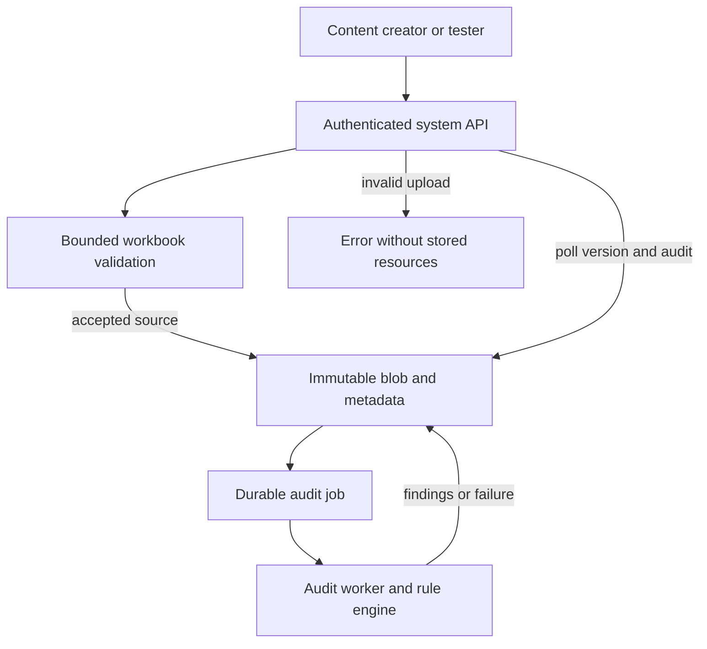
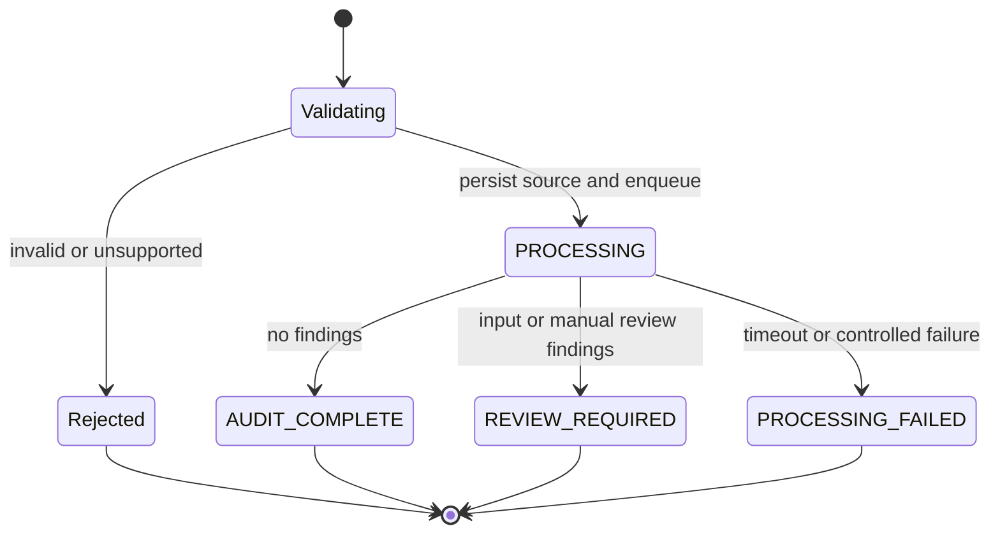
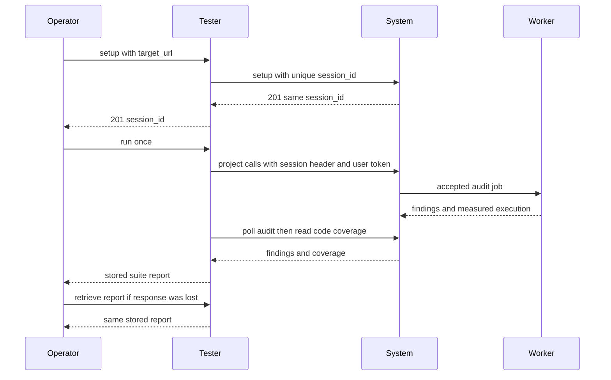
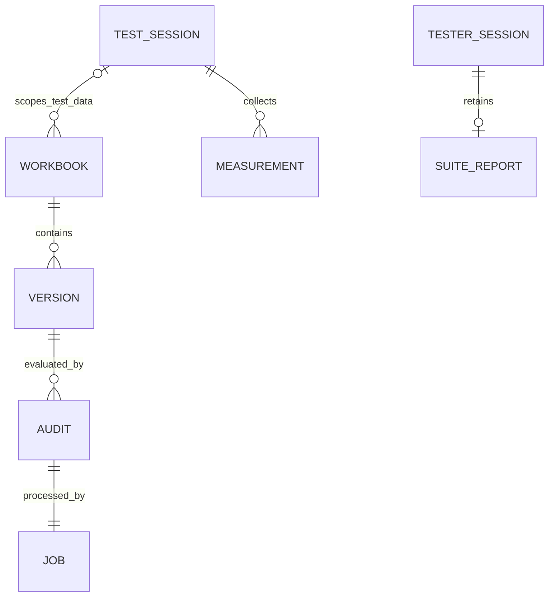

# Phase 3 contract profile — Team 9 1.0.0

Recorded 2026-10-14. This file preserves the supplied shared specification and completion appendix below verbatim. Team 9 defaults are not instructor or pod approval. No newer accepted repository contract existed at the inspected baseline, 88ae6165973021523d8448787b90c9ac92049f1d.

## Foundation delivery status

The shared foundation and Dixon's independent tester are implemented. `tester.openapi.json` lists the authenticated instructor setup/run/report endpoints; `system.openapi.json` remains a foundation DTO catalog with empty paths. All 14 system business operations and the system testing endpoints are pending their owners' integration on this branch. Dixon's local HTTP evidence uses a test-only fake target; it does not establish system implementation or cross-team conformance. See `docs/evidence/dixon_handoff_verification.md` for the current completion audit.

The instructor [Cross-team Testing Interface](https://docs.google.com/document/d/1GhEVTw3a2tNJY2arfDyWgWS94kVYfgC7/edit) was retrieved in full via text export on 2026-10-14 after the web viewer failed. Its fields, outcome/source rules, null coverage, single-use runs, report retention, and 0.4.2 starter match this profile. Factories and catalogs explicitly use the starter's OpenAPI 3.1.1 dialect. Catalogs expand DTO schemas while leaving pending route paths empty; they do not claim to be a delivered instructor service. No changes to the instructor interface were needed.

## Bootstrap clarification and confirmation list

Jackson should confirm these Team 9 choices with Team 12 before cross-testing:

- Exact JSON names/nullability, identifiers, UTC Z dates, full enums, terminal status precedence, deterministic compact UTF-8 hash vectors and XML fallback paths.
- Both alt-text fields, native decorative review policy, Unicode White_Space trimming, unsupported-object review and leading-zero worksheet names.
- Additional ZIP/XML limits; nonempty-cell counting; protected-workbook rejection; .xlsm as 422 versus other unsupported extensions as 415.
- X-Test-Session transport, configured identities/grants, session concurrency, empty setup, explicit caller-owned cleanup and CLEANED tombstones.
- Six component/eight partially scoped AC catalogs, qualifying executed assertions, audit/validation-only code scope, shared fixtures and independent expectation review.
- Timing/queue deadlines, exact URL allowlist/access provisioning and AWS EC2/SQLite/S3 topology.

No scope reduction is authorized. Any changed interface requires documented pod agreement and a profile-version update.

## Concrete foundation settings representations

Environment names are exact; application attributes are snake_case. JSON fields are parsed by pydantic-settings, not left as untyped text:

| Environment field | JSON shape (synthetic placeholders only) |
|---|---|
| SYSTEM_TOKEN_HASHES_JSON | SHA256(token) lowercase digest -> {subject, role}, where role is user/reviewer/test_admin |
| REVIEWER_GRANTS_JSON | reviewer subject -> list of approved owner subjects |
| TEST_SESSION_USERS_JSON | test-admin subject -> list of approved A/B/reviewer subjects |
| TESTER_OPERATOR_TOKEN_HASHES_JSON | SHA256(operator token) lowercase digest -> operator subject |
| ALLOWED_TARGET_URLS | list of exact approved base URL strings |
| TARGET_AUTH_MAP_JSON | exact allowed base URL -> {userA, userB, reviewer, test-admin}, each a private raw token |

These JSON representations fill an internal omission in the packet and require coordinated owner adoption. Maps containing identities/access or tokens are excluded from settings repr and model dumps; target token values additionally use SecretStr. Logging explicit secrets or raw validation-error dictionaries remains forbidden. Frozen Pydantic records prevent field reassignment; nested lists/maps remain ordinary Python containers, so owners must treat them as immutable or copy before editing.

AuthService accepts the extracted raw bearer token (str or None) for require_user/require_test_admin and returns Principal; can_read takes owner_subject and Principal. These are synchronous declarations; Jackson decides their adapter integration without blocking ASGI. SystemServices includes all required ports plus the engine assembly hook; absent integrations are explicit None, never fakes. Neither factory invokes injected dependencies in the foundation. Future production assembly initializes storage during lifecycle and installs request-ID/error handling.

Tester URL settings perform syntax, exact access-map membership and local HTTP checks only. They do not resolve DNS or implement the HTTP client's redirect/SSRF defenses. Dixon must enforce network policy and HTTPS verification in the actual client. Production system settings require a real full DEPLOYMENT_SHA; selecting S3 requires bucket and region. Empty local credential maps enable docs-only startup and authorize no users. Measurement is disabled by default; install the measurement extra only for enabled deployments. The fixture manifest path is an input; no manifest or vetted suite is delivered yet.

## Preserved shared specification and appendix

# Shared Phase 3 specification

This section is identical in all five handoffs. Read it before the role-specific work. The repository is https://github.com/JGraff24/30861_Team9. On 2026-10-14, origin/main contained only README.md at commit 88ae6165973021523d8448787b90c9ac92049f1d. Inspect the actual checkout before editing; later code and accepted contracts may already exist.

## Authority and decision status

The project is the ECE 30861 Excel accessibility hub, separate from the Balance finance app. The user reports that Team 12 agreed to the Phase 3 plan. The product scope and audit policy below incorporate the user's decisions. Exact serialization, session transport, coverage catalog, runtime/storage choice, and additional defensive limits below are **Team 9 implementation defaults** introduced to make the parallel work concrete. Implement them consistently, record them in docs/contracts/phase3.md, and give Jackson a concise list for Team 12 to confirm before cross-team testing. Never describe these defaults as instructor-approved or already pod-approved. If the repository contains a newer accepted pod contract, use it, update the dependent tests and models, and document the difference.

Instructor testing formats take priority over examples in this packet. The Phase 2 business contract remains the baseline; the defaults resolve omissions without silently reducing shared scope. Shared-scope reductions require both teams and instructor sign-off. Changes to interface details require documented pod agreement and a contract-version update. Internal modules can be refactored while preserving their public behavior.

## Purpose and delivered boundary

Faculty/content creators and accessibility staff upload copies of .xlsx workbooks. The system validates them, audits missing alternative text and generic worksheet names, and returns version-specific findings. The project's regulatory trace is 28 CFR 35.104 and 35.200 and WCAG 2.1 A/AA; an audit is supporting evidence, not a final legal determination.

Phase 3 delivers authentication, upload/validation, immutable sources, basic version/audit metadata, two checks, deterministic findings, controlled failures, a basic upload/results UI, system testing endpoints, a separately addressable tester, and documentation/evidence. Remediation, output workbook generation, full version history, downloadable audit reports, scheduling, reminders, test-clock controls, and ordinary user deletion are future phases. Do not advertise or implement them as completed Phase 3 capabilities. The original and every external/live workbook remain unchanged. No production AI evaluation, generated alt text, macro execution, live Excel editing, or external notification service is needed.

Re-auditing identical bytes under the same ruleset must return the same findings. No findings means only that these implemented checks found no issues. It does not mean ADA compliant. The user-selected requirement for both title and description is a pod audit policy; do not claim that WCAG itself universally requires both separate fields. W3C distinguishes meaningful non-text content and decorative content [R3].

## Four owners and shared files

| Owner | Owned implementation | Owned continuation document |
|---|---|---|
| Jackson | app/api, app/auth, app/storage, app/jobs, app/services, deployment, application assembly | docs/implementation/jackson_phase3.md |
| Dylan | app/workbooks, app/audit, their unit tests | docs/implementation/dylan_phase3.md |
| Ryan | app/test_interface, app/measurement, app/ui, UI assets, their tests | docs/implementation/ryan_phase3.md |
| Dixon | tester, tests/contract, tests/acceptance, CI, fixture manifests | docs/implementation/dixon_phase3.md |

Run the bootstrap handoff first and merge its small foundation PR before distributing feature work. All owners work on separate branches from that baseline. Jackson maintains app/main.py, app/contracts, app/config.py, pyproject.toml, the lock file, and top-level README.md. Changes to those shared files should be coordinated through Jackson; add narrow, compatible integration hooks rather than replacing another owner's implementation. Each owner writes tests for their own module. Dixon owns the cross-service tester, not every unit test.

Bootstrap creates directories and interface declarations. Missing feature dependencies may be replaced by injected fakes **inside tests only**. Never ship fake findings, successful placeholder routes, an in-memory repository as production persistence, or a fallback import that silently disables required work. Clearly distinguish module-level success from whole-system readiness.

## Repository layout and runtime defaults

```text
app/main.py                     System app factory and router assembly
app/config.py                   Typed environment settings
app/contracts/models.py         Pydantic wire and internal DTOs
app/contracts/ports.py          Protocols between owners
app/auth/                       Token validation and ownership rules
app/api/                        Four Phase 3 project routes
app/storage/                    SQLite metadata and local/S3 blob adapters
app/jobs/                       Durable audit worker and subprocess execution
app/services/                   Upload and audit orchestration
app/workbooks/                   Safe intake and object inventory
app/audit/                       Rule evaluation and deterministic identities
app/test_interface/             System test setup/report and session namespace
app/measurement/                Isolated code measurement and aggregation
app/ui/                         Minimal UI router, templates, static assets
tester/main.py                  Independent tester app factory
tester/                         Sessions, HTTP client, suite, reports, coverage
tests/unit/                     Owner-local automated tests
tests/contract/                 Wire conformance tests
tests/acceptance/               Deployed Phase 3 suite implementation/tests
tests/fixtures/                 Workbooks and independently authored expectations
docs/contracts/phase3.md         Authoritative Team 9 contract profile
docs/contracts/system.openapi.json
docs/contracts/tester.openapi.json
docs/implementation/             Four actual-implementation continuation files
docs/evidence/                   Run metadata, limitations, model/operation status
deploy/                         Docker, Compose, AWS and HTTPS runbook
scripts/                        Local setup, fixture and development helpers
```

Use Python 3.12, FastAPI, Pydantic 2, pydantic-settings, Uvicorn, python-multipart, HTTPX, openpyxl, defusedxml, boto3, coverage.py, pytest, pytest-asyncio, Ruff, and mypy. Pin a tested compatible set in pyproject.toml and a uv.lock; use uv consistently. Do not insert unverified version numbers from memory. Add development type stubs when required; do not disable type checking for the entire project. Packages are development dependencies unless the deployed system needs them. coverage.py is a runtime dependency only when measurement is enabled.

Local system: http://127.0.0.1:8000. Local tester: http://127.0.0.1:8001. Both are separate ASGI apps and processes. Production may use https://HOST/system and https://HOST/tester on one AWS host. A reverse proxy strips /system or /tester before forwarding; set ASGI root_path appropriately for docs and UI URLs. Project endpoint paths still begin /api/v1 inside the system. There is no /api/v1 prefix on instructor /test endpoints. Registry URLs end at the base, without /test, queries, fragments, or credentials.

AWS is selected. For a concrete semester-scale default, prepare Docker Compose for a single EC2 host, persistent EBS-backed SQLite metadata, and private S3 source blobs; use local filesystem blobs for development. This compute topology is a Team 9 choice, not a previously agreed pod requirement. Use one system API process and one durable audit worker. Persist SQLite on a bind/named volume, use WAL and busy timeout, and prevent competing worker claims transactionally. Persist tester session/report data separately. A reverse proxy supplies valid public HTTPS. Prepare infrastructure/configuration and instructions; actual account, region, DNS hostname, certificate access, budget, and AWS credentials are deployment inputs, not values to invent. No paid resource needs to be provisioned to complete local feature work. Check current AWS guidance and prices before deployment [R8]. Avoid treating an App Runner container's transient filesystem or an in-process task queue as durable storage [R9].

## Project interface and HTTP behavior

Authentication uses Authorization: Bearer TOKEN. Health is public. Other project operations require a user identity and ownership authorization. The system testing endpoints require a test-admin credential and ENABLE_TEST_INTERFACE=true. The tester endpoints require a grader/operator credential. Resolve actual tokens from protected environment configuration; no default public production token. Example strings in documentation are placeholders. Token hashes may be stored in system configuration; the tester must have the raw target tokens available privately to make requests. Never log them.

| Operation | Method and path | Success | Key failures |
|---|---|---|---|
| 1 Health | GET /api/v1/health | 200, HealthResponse | 503 dependency/service unavailable |
| 2 Initial upload | POST /api/v1/workbooks | 202, UploadResponse | 400 missing/malformed file; 401; 413 bytes; 415 unsupported type; 422 invalid workbook; 500 storage/init failure |
| 4 Version | GET /api/v1/workbooks/{workbookId}/versions/{versionId} | 200, VersionResponse | 401; 403 ownership; 404 unknown or mismatched IDs |
| 5 Audit | GET /api/v1/workbooks/{workbookId}/versions/{versionId}/audits/{auditId} | 200, AuditResponse | 401; 403; 404 unknown or mismatched IDs |

Upload body is multipart/form-data with a required binary field named file. Validate before accepting: rejected input creates no workbook, version, audit, or queued job. Temporary validation files are cleaned up. Store accepted bytes under an immutable, server-generated key; the client filename never becomes a filesystem path. Commit metadata and enqueue a durable job with compensating cleanup if persistence fails. Only return 202 after successful initialization, even if a worker might finish before the first poll. An audit problem after acceptance leaves the source retained and exposes PROCESSING_FAILED with an error; do not replace it with a successful empty findings list.

Limits from Phase 2: maximum 25,000,000 uploaded bytes, 50 worksheets, and 250,000 nonempty cells. Exactly-at-limit is allowed; exceeding one limit is rejected. The 10 MB/100,000-cell case in REQ-15 is a separate performance test size, not the upload ceiling. Auditing must finish within 60 seconds or record a controlled failure. Validation has a proposed independent 30-second ceiling. Stop work at bounds instead of fully parsing an unbounded file.

Additional Team 9 defensive defaults: maximum 10,000 ZIP entries, 200 MiB total expanded bytes, and 50 MiB per expanded XML part. Measure actual bytes read, not only ZIP declarations. Reject path traversal, duplicate ZIP paths, encrypted ZIP entries, DTD/entities, unsafe XML, and macro-bearing packages. Keep memory bounded; use streaming XML/counting when appropriate. Document these additional limits and get pod confirmation rather than hiding them in code.

Use 415 for .xls, CSV, non-spreadsheet formats, and missing/unsupported extensions; handle a named .xlsm as 422 MACRO_ENABLED_WORKBOOK_UNSUPPORTED following Phase 2's explicit invalid-input example. A .xlsx containing VBA/macro parts also returns 422. This resolves conflicting Phase 2 examples and must be confirmed with Team 12. MIME headers alone are not proof. Reject unreadable/corrupt/encrypted workbooks and password-protected workbook/worksheet structures; record the exact detection policy in the contract. Do not execute formulas, external links, macros, or fetch package relationships over the network.

Define a nonempty cell for the limit as a worksheet c element with a formula, a nonempty value, or nonempty inline-string content. A numeric zero and boolean false count; formatting-only and empty value cells do not. Count stored cells across all worksheets, including hidden sheets. Document and test this convention with Team 12.

Successful examples below use placeholders for IDs/hashes; generated real values must satisfy the schema.

```json
{"status":"AVAILABLE","apiVersion":"1.0","rulesetVersion":"1.0.0"}
```
```json
{"workbookId":"workbook-001","versionId":"version-001","auditId":"audit-001","status":"PROCESSING"}
```
```json
{
  "workbookId":"workbook-001","versionId":"version-001",
  "fileName":"budget.xlsx","sha256":"64-lowercase-hex-characters",
  "createdAt":"2026-10-14T16:00:00Z","status":"REVIEW_REQUIRED",
  "latestAuditId":"audit-001","sourceVersionId":null
}
```
```json
{
  "auditId":"audit-001","workbookId":"workbook-001","versionId":"version-001",
  "rulesetVersion":"1.0.0","status":"REVIEW_REQUIRED",
  "startedAt":"2026-10-14T16:00:01Z","completedAt":"2026-10-14T16:00:03Z",
  "findings":[{
    "findingId":"64-lowercase-hex-characters","ruleId":"ALT_TEXT",
    "category":"NON_TEXT_CONTENT","worksheet":"Expenses",
    "target":"xl/drawings/drawing1.xml#id=7",
    "classification":"REQUIRES_USER_INPUT",
    "message":"Picture 2 is missing its alternative text title and description.",
    "recommendation":"Provide an alternative text title and a short description."
  }],
  "limitations":[],"error":null
}
```

Project errors always use {code, message, requestId, details}; code/message/requestId are nonempty and details is an object. Override FastAPI's default missing-file/body validation response to match the agreed 400 and project error schema. Preserve 422 for readable request bodies containing invalid workbook content. Uniform exception handling must not expose stack traces or workbook contents.

```json
{"code":"UNSUPPORTED_FILE_TYPE","message":"Only .xlsx workbooks are supported.","requestId":"request-123","details":{}}
```

IDs are strings of 1-64 characters matching [A-Za-z0-9_-]+. Generate workbook/version/audit/request/session IDs independently of finding IDs. Timestamps use UTC RFC3339 ending Z. JSON business fields use camelCase; instructor testing fields use snake_case. fileName is 1-255 characters; sha256 is exactly 64 lowercase hex characters; rulesetVersion uses SemVer 1.0.0. Finding message/recommendation are 1-500 characters. Worksheet/target are strings. Finding categories/classes use the exact Phase 2 enums. Empty findings and limitations are arrays, not null. While processing, completedAt is null and error is null. On failure completedAt is set, error is a ProjectError, and partial findings are not exposed as complete.

Phase 3 terminal status: AUDIT_COMPLETE when no findings; REVIEW_REQUIRED whenever either rule or decorative/unsupported-object review emits a finding; PROCESSING_FAILED on controlled processing failure. PROCESSING is transient. REMEDIATION_AVAILABLE and REMEDIATED remain recognized full-contract enums but are not claimed by this phase because no correction can be submitted. REJECTED is an HTTP rejection condition, not a stored workbook state. If an accepted pod contract later requires a different precedence, update tests and models together.

Verify immutable storage with real byte hashes before/after audit. Version retrieval checks the stored bytes against the original hash; do not prove preservation by merely echoing an unchanged database hash. A GET integrity mismatch returns 500 SOURCE_INTEGRITY_FAILED without rewriting completed audit history; the worker records PROCESSING_FAILED when it detects a mismatch during processing. Source versions and audit records have distinct IDs; state transitions may update the current audit record, but completed history must not be overwritten by future runs.

## Audit policy and deterministic identity

ALT_TEXT inspects all images, charts, and shapes, including grouped child objects and objects on hidden worksheets. Use the uploaded package's relationship graph and namespaces. DrawingML nonvisual properties expose id, title, descr and name [R4]. Visible chart titles, shape text, filenames, and object names do not substitute for the alt-text title or description. For each non-decorative object, absent/empty/whitespace-only title OR description triggers one ALT_TEXT finding, category NON_TEXT_CONTENT, classification REQUIRES_USER_INPUT. If both fields are present, this presence rule emits no finding; content meaning/quality is outside its automated scope. The short description has no agreed maximum word count; do not invent one.

For whitespace trimming use Unicode White_Space: U+0009-000D, 0020, 0085, 00A0, 1680, 2000-200A, 2028, 2029, 202F, 205F, 3000. An explicit set avoids language-specific trim differences. The object is decorative only when its own native decorative flag is explicitly true/1. Read the Microsoft drawing/2017/decorative extension under its nonvisual properties [R5]. Do not infer decoration from empty text, filenames, or visible content. An explicitly decorative object always produces one ALT_TEXT finding with MANUAL_REVIEW and a message asking a reviewer to confirm that it conveys no essential information; skip the missing-title/description finding for that object. Invalid/ambiguous decorative metadata yields MANUAL_REVIEW with a limitation. Title/description presence does not prove legal compliance.

Inventory all objects. Where legacy VML, SmartArt/group metadata, or another object representation cannot yet be interpreted, emit a deterministic MANUAL_REVIEW record and explicit limitation instead of silently dropping it. This is disclosed partial support, not successful inspection of every required feature; inform Jackson and preserve the shared requirement. Add parsing support and fixtures for such cases when feasible. Never reject a valid workbook solely to conceal an unsupported audit feature.

WORKSHEET_NAME flags a worksheet name matching ASCII (?i)^Sheet[0-9]+$ after the specified whitespace trim, when the numeric suffix is greater than zero. Thus Sheet1, sheet2, Sheet01, and " Sheet3 " trigger; Sheet0, Sheet, Expenses, and Q1 Budget do not. This explicit handling of leading zeroes is a Team 9 convention for pod confirmation. Inspect hidden sheets too. Emit one WORKSHEET_NAME finding, category WORKSHEET_NAME, classification REQUIRES_USER_INPUT, requesting a descriptive user-provided name. Preserve the original worksheet name in the response; no automatic rename.

Object target: normalized case-preserving ZIP part path + "#id=" + stored object ID, e.g. xl/drawings/drawing1.xml#id=7. Worksheet target: its XML part path + "#sheetId=" + workbook sheetId. Namespaces and relationships resolve actual part paths; do not assume Sheet1 maps to sheet1.xml. If object IDs are absent/duplicated, use "#xml=" plus a documented indexed XML element path for the affected element, using local element names and one-based sibling indices among siblings with that same local name, from the root through cNvPr (for example /wsDr[1]/twoCellAnchor[2]/pic[1]/nvPicPr[1]/cNvPr[1]); disclose the unusual metadata. Targets must be unique per worksheet/object occurrence, including duplicate IDs. Keep the object display name in message for human use. Never rely on enumeration order of a library's object lists.

findingId = lowercase SHA256 hex digest of UTF-8 compact JSON encoding of the ordered array:
[sourceSha256, rulesetVersion, ruleId, worksheetName, target]
Use ensure_ascii=False, separators=(",", ":"), no Unicode normalization, no BOM/newline. Preserve worksheet/target case and raw worksheet spelling. The digest is 64 characters and fits Identifier. Do not include randomly assigned workbook/audit/session IDs or timestamps. Sort findings by (ruleId, worksheet, target) using Unicode code-point ordering. For the same source bytes and ruleset, messages/classifications/targets and IDs are deterministic too. Hash an object once per rule so simultaneous missing title and description produce one finding. For XML-fallback targets, define the same indexed path function in shared identity utilities.

## Instructor system and tester contract

System and tester are independent services. The tester uses only HTTP against the target, never its database/files/modules. Each team builds both. The system exposes no required /test/run. The project test-clock endpoint is unrelated to these instructor endpoints and remains future work.

| Service endpoint | Input | Success and behavior |
|---|---|---|
| Tester POST /test/setup | {target_url: systemBaseURL} | 201 {session_id}; creates a unique UUID, retains target and initial data, calls system setup, waits for successful 201 with the SAME ID; no tests run |
| Tester POST /test/run | {session_id} | 200 complete suite report after execution, including failed tests and system errors; 500 {message, source:"tester"} if tester aborts, with available report stored |
| Tester GET /test/report?session_id=ID | No body | 200 stored final/aborted report, byte-equivalent JSON content; 409 while suite not ended; never executes tests |
| System POST /test/setup | {session_id, setup:{}} | 201 same session_id only after preparation; duplicate 409; preparation failure 500 {message,source:"system"} |
| System GET /test/report?session_id=ID | No body | 200 session code coverage measured so far; 409 during preparation; no project operations or resets |

Test endpoint errors use {message, source}, not the project error envelope. Sources are tester, system, communication, unknown. Invalid requests ->400; missing/invalid auth ->401; forbidden ->403; unknown session ->404; existing/used/running session or report not ready ->409; service failure/abort ->500. Forward system setup errors preserving status, message, and source. A setup communication failure is 500 source communication; tester-internal setup failure is 500 source tester. Failed setup leaves no runnable tester session and must compensate for partial system preparation. Reject any second/concurrent/later run on the same session with 409, including after abort. Validate a run request before atomically consuming its session. No automatic retry of setup/upload/run POSTs after uncertain outcomes. A new session is required to repeat a suite.

Each suite runs planned tests in fixed order. Include every planned test exactly once, with a unique nonempty test_id and nonempty message. pass means behavior matched; fail means an evaluable response differed; error means evaluation was prevented; skip means unexecuted. Expected project errors can pass. Unexpected target internal errors are error/source system; no response/timeout is error/source communication. If tester aborts, preserve completed outcomes, mark the interrupted test error/source tester, and remaining unexecuted tests skip. Store the complete/available report BEFORE returning. Once final, the report is immutable. A lost run response must be recovered with GET report; if 409, poll later instead of repeating POST run. A service crash might prevent recovery; disclose it rather than promising impossible guarantees.

```json
{
  "session_id":"run-123","target_url":"https://team12.example/system",
  "results":[
    {"test_id":"P3-01","outcome":"pass","message":"Health returned the expected schema."},
    {"test_id":"P3-02","outcome":"error","source":"communication","message":"Upload timed out; no response was available."}
  ],
  "coverage":{
    "code":{"covered":null,"total":null,"basis":"Audit and validation source lines; target instrumentation unavailable."},
    "component":{"covered":2,"total":6,"basis":"Phase 3 component catalog in docs/contracts/phase3.md; only executed qualifying calls counted."},
    "system":{"covered":2,"total":8,"basis":"Phase 3 portions of eight ACs; executed assertions count independently of pass/fail."}
  }
}
```

System report: {session_id, coverage:{code:{covered,total,basis}}}. covered/total are nonnegative integers with covered<=total; total=0 is allowed for a genuinely empty measured scope. If unavailable, BOTH are null with a nonempty reason. Do not substitute 0/0 for missing measurement. Code coverage belongs to the target. Component/system coverage belongs to the tester. Test success and coverage are different measures. Report code scope honestly: partial audit/validation-only line instrumentation is not whole-app coverage.

## Team 9 testing defaults requiring pod confirmation

Normal project calls work without testing headers. In enabled test environments, tester project calls carry X-Test-Session: UUID plus normal user authentication. System setup/report use a separate test-admin token. A session is associated with its test-admin owner; authorized test-user A/B/reviewer identities are server-configured. Unknown session -> project 400; a caller not authorized for that session ->403. Every created test resource is tagged with session_id, including blobs, metadata, jobs, and measured results. Session A cannot read or reset session B's data. Use session identity to isolate concurrent runs; no global database wipe.

setup is {} by default: create an empty session namespace and measurement manifest. Optional {cleanup_session_ids:[...]} requests cleanup of caller-owned earlier namespaces; reject deletion of another caller's session or any namespace with active jobs. Unknown setup keys ->400. The new session starts with no resources; ordinary user data is untouched. Keep completed target state and coverage available through the suite and retrieval. After retrieval, an explicit later setup may clean owned old namespaces. Cleanup is test-only, not completion of REQ-14's ordinary user deletion endpoint. An interrupt leaves inspectable namespace state. State changes and cleanup must be transactional or have compensating recovery.

Timing defaults: system setup<=30s; tester setup<=45s including system call; audit polling<=75s for each accepted workbook; each normal GET<=10s; upload request<=35s including validation; suite wall-clock<=600s including coverage retrieval; grader's tester-run HTTP read timeout>=630s. Configure proxy timeout accordingly and register actual measured limits. Bound each network call AND the total suite. Retry only safe GET polling (at most three transport retries within deadline); never repeat a POST because of a lost response. GET report can be polled at 1s with an explicit deadline. Queue wait has a bounded deadline too; an accepted audit cannot remain PROCESSING indefinitely.

Tester target_url must be an exact approved pod system base URL from ALLOWED_TARGET_URLS environment configuration. Reject URLs with userinfo, queries, fragments, /test suffix, or unsupported schemes. HTTPS and certificate validation in production; explicit configured loopback/Docker HTTP addresses for development only. Do not follow redirects with credentials, probe arbitrary hosts, or contact EC2 metadata endpoints. Resolve target-specific test-user/admin tokens from a private environment mapping keyed by exact allowed base URL; do not hard-code Team 9 tokens for Team 12. Graders supply only target_url; operators configure access beforehand. No credentials go in registry URLs or report bodies.

## Shared internal interfaces

Bootstrap must declare these DTOs and Protocols in app/contracts. Names/signatures are internal Team 9 defaults, shared by all owners; add fields compatibly if actual implementation needs them and update all owners' docs. Prefer bytes-based engine interfaces so no module can change source storage accidentally.

```python
# Frozen Pydantic models, with no network or database dependencies.
class ProcessingLimits(BaseModel):
    max_file_bytes: int = 25_000_000
    max_worksheets: int = 50
    max_nonempty_cells: int = 250_000
    max_zip_entries: int = 10_000
    max_expanded_bytes: int = 209_715_200
    max_xml_part_bytes: int = 52_428_800

class ValidatedWorkbook(BaseModel):
    source_sha256: str
    size_bytes: int
    worksheet_count: int
    nonempty_cell_count: int
    worksheet_parts: dict[str, str]  # exact worksheet name -> resolved ZIP part

class Finding(BaseModel):
    findingId: str
    ruleId: str
    category: str
    worksheet: str
    target: str
    classification: str
    message: str
    recommendation: str

class AuditEvaluation(BaseModel):
    findings: list[Finding]
    limitations: list[str]

class WorkbookEngine(Protocol):
    def validate(self, data: bytes, filename: str,
                 limits: ProcessingLimits) -> ValidatedWorkbook: ...
    def audit(self, data: bytes, validated: ValidatedWorkbook,
              ruleset_version: str) -> AuditEvaluation: ...

class BlobStore(Protocol):
    def put_source(self, key: str, data: bytes) -> str: ...  # no overwrite; returns hash
    def read_source(self, key: str) -> bytes: ...
    def delete_test_source(self, key: str, session_id: str) -> None: ...

class SessionService(Protocol):
    def require_ready(self, session_id: str, principal: Principal) -> TestSession: ...
    def prepare(self, session_id: str, principal: Principal,
                setup: dict[str, object]) -> TestSession: ...
    def get_code_coverage(self, session_id: str,
                          principal: Principal) -> CoverageMeasure: ...

class CodeMeasurementStore(Protocol):
    def record_execution(self, session_id: str,
                         measurement: ExecutionMeasurement) -> None: ...
    def summarize(self, session_id: str) -> CoverageMeasure: ...
```

Principal fields: subject:str and role:user/reviewer/test_admin. Reviewer access is explicit and scoped using REVIEWER_GRANTS_JSON (reviewer subject to approved owner subjects); reviewer role alone never permits all data. No review-grant endpoint is delivered in Phase 3. Project errors are a typed exception with status_code, code, message, details; web handlers add requestId. WorkbookValidationError carries the same status/code/message/details without requestId. BlobStore raises typed storage/integrity errors, not HTTP responses. TestSession includes session_id, owner_subject, state PREPARING/READY/FAILED/CLEANED, created_at. CLEANED is a reserved tombstone; report lookup returns 404 and setup with that ID remains 409. ExecutionMeasurement includes relative source-file executable/covered line sets, source-tree revision, session_id, invocation_id, and an unavailable reason when collection failed. CoverageMeasure has covered:int|None, total:int|None, basis:str. Bootstrap also defines HealthResponse, UploadResponse, VersionResponse, AuditResponse, ProjectError, TestEndpointError, SetupRequest/Response, TestResult, SuiteReport, and internal WorkbookRecord/VersionRecord/AuditRecord/JobRecord.

Repository protocol methods: initialize; health; create_upload(workbook,version,audit,job) atomically; get_version; get_audit; get_job; claim_next_job(worker_id); complete_audit; fail_audit; recover_stale_jobs; create_test_session; get_test_session; mark_session_ready/failed; cleanup_test_session; record_measurement; summarize_measurements. Returned records contain owner_subject, optional session_id, IDs, original filename/hash/blob key, dates, states and relevant payloads. Enforce permission in service layer before returning any content. Job claim and terminal transition are atomic and idempotent; stale PROCESSING jobs are failed after their documented lease rather than blindly replayed. Session cleanup waits for no jobs and deletes only matching namespace records/blobs. Jackson implements metadata persistence; Ryan implements session orchestration and measurement over these methods.

Validation occurs in a bounded child process before create_upload. Audits run in a bounded child process claimed by the durable worker. Ryan supplies app/measurement/runner.py to measure each child invocation; Jackson calls that wrapper for validate/audit and enforces hard kill at timeout. The subprocess receives a private read-only temporary input path, explicit operation and JSON arguments, not a shell command built from filenames. Dylan's engine has no knowledge of sessions. Measured executable and covered line sets are collected per invocation, merged as sets per session, and associated with the deployment revision. If measurement fails, return honest null coverage with a reason; don't fail an otherwise valid audit merely to fabricate coverage. An audit timeout still yields PROCESSING_FAILED even if measurement is unavailable.

System app factory create_app(settings, repository=None, blob_store=None, engine=None, session_service=None) supports dependency injection. Lifecycle initializes storage; requestId middleware and error handlers are common. Feature routers export create_router(services) and get attached by Jackson. Tester create_app(settings) is independent, with its own sessions/report persistence. Imports may not start network calls, create AWS resources, or execute tests. The worker is a separate CLI module/process, not FastAPI BackgroundTasks. README must give real runnable system/worker/tester commands after implementation. The contract completion appendix below pins additional record and port details for bootstrap; all five packets contain the same appendix.

## Models for the intended Phase 3 implementation

These are target models. The final continuation documentation MUST replace them with actual implemented models; omit modules not delivered or label future work separately.









## Fixtures and validation requirements

Team 12 was asked to create three shared files: clean.xlsx, seeded_issues.xlsx, corrupt.xlsx. Their delivery is not assumed. Both valid files should exercise images, charts and shapes; clean has descriptive sheets and nonblank title/description without decorative review markers. Seeded has generic names, absent/empty/whitespace fields, and a native decorative marker; expect one review/input finding per object as specified. Corrupt is deliberately unreadable and yields 422 with no accepted IDs. Keep an independent expectations.json manifest with raw source SHA256, rule version, object/worksheet targets, classifications, and expected rejection schema. Do not derive expected findings by running the implementation being tested.

Owners may create additional synthetic local fixtures to develop while shared files are pending. Preserve and distinguish them; do not overwrite Team 12 fixtures. Create a genuinely valid clean package and seed OOXML fields deliberately. Three shared files are a starting set, not full acceptance coverage. Additional inputs cover missing file, .xls/.xlsm/CSV, protected files, each upload boundary, ZIP/XML attacks, Unicode whitespace, grouped shapes, multiple drawings, repeated IDs, foreign ownership, and controlled faults. Large fixtures may be generated temporarily during tests instead of committing huge binaries. Inventory fixtures and record manual expected-result review by two pod members when it happens; never invent that review.

| Criterion | Phase 3 demonstration | Scope |
|---|---|---|
| AC-01 | Supported files accepted with IDs; upper limits | Intake |
| AC-02 | Invalid, unsupported and over-limit inputs rejected | Intake |
| AC-03 | Real source hash unchanged after auditing | Audit-only portion |
| AC-04 | Both rules detect exact seeded issues; clean fixture no findings | Two-rule portion |
| AC-05 | Required finding fields/classifications and locations | Two-rule portion |
| AC-14 | Controlled upload/audit/storage failures | Delivered-operation portion |
| AC-15 | Authentication and basic owner isolation | Delivered-operation portion |
| AC-18 | Five audits of same bytes produce identical findings | Determinism portion; full performance scope remains later |

Also test health success/503, status polling, unknown resources, each core endpoint's failure path, session setup/report, repeated/concurrent run rejection, report recovery and retention, timeout/abort reporting, and URL/access controls. Fault injection belongs in local dependency-injected tests unless an explicitly agreed protected test mechanism exists. A healthy arbitrary target cannot be forced into 503 through an invented public endpoint. Separate unit/fault-injection evidence from deployed black-box results. Never claim a local ASGI run was executed against AWS.

Component catalog C1 authentication/access; C2 upload/validation; C3 source storage/version metadata; C4 rule engine; C5 jobs/audit-result API; C6 system session/coverage interface. Total=6 for Phase 3. Define qualifying exercised calls/assertions in the suite manifest; planned tests and skipped/blocked paths do not earn coverage. System catalog is the eight AC IDs above with explicit Phase 3 scope, total=8. Count an AC when at least one predeclared relevant assertion actually executes; report separate completeness per AC because coverage does not prove every boundary was tested. Future-phase tests may be listed as skip only if they are genuinely planned; don't inflate present coverage. Share these catalogs with Team 12 before reporting cross-team percentages.

Use Ruff, mypy, dependency scanning and OpenAPI/schema validation in CI; pin dependencies and document which failures block merging/deployment. Do not promise branch protection that has not been configured. Externally deployed tests require only base URL/access configuration changes, not editing test code. The tester must return all actual outcomes; red cross-team results are allowed in Phase 3, but reports and meaningful tests are required. Record run datetime, tested tag/SHA, run/pass/fail/error/skip counts, failures with system/test/specification classification, code/component/system coverage and actual target. Cross-test both directions before submission.

## Required continuation documentation and evidence

Each owner MUST write their assigned docs/implementation/<owner>_phase3.md before finishing. It must include implemented capabilities and non-capabilities; file/module map; interfaces consumed/exposed; data/state invariants; actual Mermaid models; configuration names without secrets; runnable commands; test commands and honest results; known limitations/defects with severity, workaround and target phase; deviations from this handoff; REQ/AC traceability; and Phase 4/5 extension points. Include a section titled Next Codex prompt containing a ready-to-use prompt for a future developer to inspect the actual code/docs before adding the next phase. Use real file references and model nodes only. If nothing changed, say that models were checked and unchanged.

Every owner also writes docs/evidence/<owner>_phase3.md mapping contributions to assignment questions. Jackson consolidates operation status for **all 14** business operations: 1/2/4/5 implemented only when proven, 3/6/7/8/9/10/11/12/13/14 unimplemented unless separately authorized. Mark success/error conformance honestly. Ryan records model-to-code checks and at least one real divergence if discovered; do not manufacture one. Dixon records all test runs and cross-team report coverage. Each teammate records actual AI tools/work delegated, verification, one real correction if it occurred, and agentic engineering reflection. Never fabricate a correction example, deployment URL, SHA/tag, CI link, review meeting, coverage, test outcome, or instructor approval.

Finish with a real changed-files summary, tests run with outcomes, integration dependencies, and exact documentation paths. If an external input blocks deployment or cross-testing, complete local code and tests first, provide exact remaining configuration/action, and disclose the blocker. Do not stop after a plan, skeleton, unexecuted tests, or instructions to implement later. Do not push, merge, send email, provision billed AWS resources, or change shared pod scope unless the user separately authorizes that action.

## Source index

- R1: ECE 30861 Phase 2 Pod E - Copy.pdf, Sections 3-9, supplied project specification, 2026-09-27. Read in this conversation. Preserve its IDs and acceptance obligations; the packet contains the Phase 3 portion needed for implementation.
- R2: Instructor Cross-team Testing Interface, https://docs.google.com/document/d/1GhEVTw3a2tNJY2arfDyWgWS94kVYfgC7/edit ; starter OpenAPI 3.1.1, info.version 0.4.2; reviewed 2026-10-14. Endpoint registry: https://docs.google.com/spreadsheets/d/1bTCN3IdCcOPDYIAh7nG7WKNnv9WaAfbdkWfnnK97HL4/edit?gid=508969597 . Phase 3 questions supplied as Pasted markdown(1).md in this conversation.
- R3: W3C, WCAG 2.1 and Understanding 1.1.1, https://www.w3.org/TR/WCAG21/ and https://www.w3.org/WAI/WCAG21/Understanding/non-text-content.html ; reviewed 2026-10-14. Use for regulatory trace, not invented format-specific policy.
- R4: Microsoft, NonVisualDrawingProperties for Spreadsheet DrawingML, https://learn.microsoft.com/en-us/dotnet/api/documentformat.openxml.drawing.spreadsheet.nonvisualdrawingproperties?view=openxml-3.0.1 ; reviewed 2026-10-13.
- R5: Microsoft, CT_Decorative, https://learn.microsoft.com/en-us/openspecs/office_standards/ms-odrawxml/1c5cfa5e-0042-48e3-ba41-2cc88fcc0266 ; reviewed 2026-10-14.
- R6: FastAPI file uploads, https://fastapi.tiangolo.com/tutorial/request-files/ ; HTTPX timeouts, https://www.python-httpx.org/advanced/timeouts/ ; reviewed 2026-10-14.
- R7: Coverage.py public API and contexts, https://coverage.readthedocs.io/en/latest/api_coverage.html and https://coverage.readthedocs.io/en/latest/contexts.html ; reviewed 2026-10-14. Use documented APIs and measure actual target executions.
- R8: AWS EC2 security groups, https://docs.aws.amazon.com/AWSEC2/latest/UserGuide/ec2-security-groups.html ; EC2 pricing, https://aws.amazon.com/ec2/pricing/ ; verify prices/region/account eligibility at deployment.
- R9: AWS App Runner application development/storage, https://docs.aws.amazon.com/apprunner/latest/dg/develop.html ; reviewed 2026-10-14. Used to avoid an ephemeral-storage design.
- R10: openpyxl tutorial, https://openpyxl.readthedocs.io/en/stable/tutorial.html ; Python zipfile, https://docs.python.org/3/library/zipfile.html ; defusedxml, https://pypi.org/project/defusedxml/ . Verify current APIs before use. openpyxl round trips may not preserve every object; this phase does not save the uploaded workbook through it.

---


## Contract completion appendix for bootstrap and all owners

This appendix is a Team 9 implementation profile, not a new claim of pod approval. Bootstrap creates the following shared definitions so feature branches do not invent incompatible signatures. Prefer a newer accepted repository contract if one exists. Preserve explicitly listed wire fields; internal fields may grow compatibly.

### Wire models and enum values

All business responses forbid undeclared fields in contract tests. JSON aliases and nullability must match the examples above. Shared DTOs validate real identifiers and hash strings, not the explanatory placeholder strings used in examples. Time fields are timezone-aware UTC datetimes serialized with Z. The full Phase 2 enums remain recognized even when their states are unused this phase.

| Model | Required fields and constraints |
|---|---|
| HealthResponse | status: AVAILABLE; apiVersion: "1.0"; rulesetVersion: SemVer |
| UploadResponse | workbookId, versionId, auditId: Identifier; status: PROCESSING |
| VersionResponse | workbookId, versionId: Identifier; fileName: 1–255; sha256: lowercase SHA256; createdAt: UTC; status: VersionStatus; latestAuditId: Identifier or null; sourceVersionId: Identifier or null |
| AuditResponse | auditId, workbookId, versionId; rulesetVersion; status: AuditStatus; startedAt: UTC; completedAt: UTC or null; findings: Finding[]; limitations: string[]; error: ProjectError or null |
| ProjectError | code, message, requestId: nonempty strings; details: object |
| TestEndpointError | message: nonempty string; source: tester/system/communication/unknown |
| TesterSetupRequest | target_url: string; no project-specific setup field is required from grader |
| SystemSetupRequest | session_id: Identifier; setup: object (empty by default) |
| SetupResponse / RunRequest | session_id: Identifier |
| TestResult | test_id: nonempty string; outcome: pass/fail/error/skip; message: nonempty string; source: error source when appropriate, omitted on pass/fail/skip |
| CoverageMeasure | covered, total: nonnegative integers or both null; covered <= total; basis: nonempty string |
| SystemReport | session_id; coverage: object with code: CoverageMeasure |
| SuiteReport | session_id; target_url; results: TestResult[]; coverage: object with code/component/system: CoverageMeasure |

VersionStatus = PROCESSING, AUDIT_COMPLETE, REVIEW_REQUIRED, REMEDIATION_AVAILABLE, REMEDIATING, REMEDIATED, PROCESSING_FAILED.
AuditStatus = PROCESSING, AUDIT_COMPLETE, REVIEW_REQUIRED, REMEDIATION_AVAILABLE, PROCESSING_FAILED.
FindingCategory = NON_TEXT_CONTENT, TABLE_STRUCTURE, MERGED_CELLS, WORKSHEET_NAME, LINK_TEXT, COLOR_OR_CONTRAST.
FindingClassification = AUTOMATICALLY_REMEDIABLE, REQUIRES_USER_INPUT, MANUAL_REVIEW.

Do not add required grader inputs for authentication, fixtures, catalogs, or access configuration. Tokens and target mappings are server configuration; document their provisioning. Extra report metadata belongs in separate evidence files unless allowed by the current instructor schema. If the instructor publishes stricter fields/enums/status codes, preserve its schemas verbatim and adapt these DTOs compatibly; record a contract correction rather than ignoring the supplied instructor source.

### Internal records

Internal names are snake_case. Record IDs are generated server-side; uploaded filename is display metadata. Use typed immutable records for reads and explicit repository mutations. Database exceptions are typed StorageError/IntegrityError, never embedded HTTP responses.

| Record | Fields |
|---|---|
| WorkbookRecord | workbook_id, owner_subject, session_id or null, created_at |
| VersionRecord | version_id, workbook_id, owner_subject, session_id or null, file_name, source_sha256, blob_key, size_bytes, worksheet_count, nonempty_cell_count, created_at, status, latest_audit_id, source_version_id or null |
| AuditRecord | audit_id, workbook_id, version_id, owner_subject, session_id or null, ruleset_version, status, started_at, completed_at or null, findings, limitations, error or null |
| JobRecord | job_id, audit_id, workbook_id, version_id, session_id or null, state QUEUED/RUNNING/DONE/FAILED, created_at, queue_deadline, worker_id or null, lease_expires_at or null |
| TestSession | session_id, owner_subject (test administrator), allowed_subjects, state PREPARING/READY/FAILED/CLEANED, created_at, revision, cleanup_error or null |
| ExecutionMeasurement | session_id, invocation_id, revision, executable_lines and covered_lines (relative-file to sorted unique line numbers), unavailable_reason or null |
| ExecutionResult | operation validate/audit; validated: ValidatedWorkbook or null; evaluation: AuditEvaluation or null; measurement: ExecutionMeasurement or null |

AuditRecord.started_at is the acceptance timestamp while status is PROCESSING, matching Phase 2's required field. Worker actual start/duration is separate job/log metadata; do not invent queue-start time as measured audit execution duration. An execution returns only the appropriate validated/evaluation value. Invalid input raises a typed EngineExecutionError preserving status_code/code/message/details and any collected measurement; its kind distinguishes validation_rejected, timeout, crash and invalid_result. Never serialize untrusted tracebacks.

### Repository and runner ports

Bootstrap declares these signatures in app/contracts/ports.py; Jackson implements the repository, Ryan the runner and session orchestration. Synchronous SQLite/engine work runs off the ASGI event loop using a thread or subprocess. Typed exceptions distinguish duplicate IDs, busy sessions, unavailable storage and missing records. Reads return None for missing records; service code maps to the correct HTTP envelope after authorization.

```python
from typing import Literal, Protocol

class Repository(Protocol):
    def initialize(self) -> None: ...
    def health(self) -> bool: ...
    def create_upload(self, workbook: WorkbookRecord, version: VersionRecord,
                      audit: AuditRecord, job: JobRecord) -> None: ...
    def get_version(self, workbook_id: str, version_id: str) -> VersionRecord | None: ...
    def get_audit(self, workbook_id: str, version_id: str,
                  audit_id: str) -> AuditRecord | None: ...
    def get_job(self, job_id: str) -> JobRecord | None: ...
    def claim_next_job(self, worker_id: str, now: datetime,
                       lease_seconds: int) -> JobRecord | None: ...
    def complete_audit(self, job_id: str, worker_id: str,
                       evaluation: AuditEvaluation, completed_at: datetime) -> None: ...
    def fail_audit(self, job_id: str, worker_id: str | None,
                   error: ProjectError, completed_at: datetime) -> None: ...
    def recover_stale_jobs(self, now: datetime) -> int: ...
    def create_test_session(self, session: TestSession) -> None: ...
    def get_test_session(self, session_id: str) -> TestSession | None: ...
    def mark_session_ready(self, session_id: str) -> None: ...
    def mark_session_failed(self, session_id: str, reason: str) -> None: ...
    def begin_session_cleanup(self, session_id: str,
                              owner_subject: str) -> list[str]: ...
    def finish_session_cleanup(self, session_id: str) -> None: ...
    def record_measurement(self, measurement: ExecutionMeasurement) -> None: ...
    def summarize_measurements(self, session_id: str) -> CoverageMeasure: ...

class EngineRunner(Protocol):
    def execute(self, operation: Literal["validate", "audit"], data: bytes,
                filename: str, limits: ProcessingLimits,
                ruleset_version: str, validated: ValidatedWorkbook | None,
                session_id: str | None, revision: str,
                timeout_seconds: float, memory_limit_mib: int) -> ExecutionResult: ...

class BlobStore(Protocol):
    def health(self) -> bool: ...
    def put_source(self, key: str, data: bytes) -> str: ...
    def read_source(self, key: str) -> bytes: ...
    def delete_uncommitted_source(self, key: str, expected_sha256: str) -> None: ...
    def delete_test_source(self, key: str, session_id: str) -> None: ...
```

The example uses datetime and shared record types; bootstrap imports/defines them rather than leaving unresolved names. The later BlobStore declaration extends the earlier one with health and compensating deletion. `delete_uncommitted_source` is internal rollback only, authorized only for a key allocated by the failed current upload; it does not expose ordinary deletion or permit removal of committed source records. S3 cleanup is namespace constrained and idempotent.

`create_upload` verifies READY and allowed subject for session-tagged resources in the same transaction as record creation. `claim_next_job` changes QUEUED to RUNNING once. `complete_audit` atomically sets audit/version/job state, refusing foreign/expired worker leases and prior terminal changes. Stale queued/running jobs become controlled failures. `begin_session_cleanup` transactionally checks ownership and absence of queued/running jobs, reserves CLEANED so no new upload can race, and returns only that namespace's blob keys. Blob deletion occurs outside the database transaction; `finish_session_cleanup` deletes matching records/measurements while keeping the reserved tombstone. A partial blob failure remains a resumable cleanup error; it must not resurrect a runnable session. Ordinary user data is never selected by this operation. The earlier `cleanup_test_session` shorthand refers to this two-stage implementation.

The runner uses the same engine adapter path for all invocations (configured/injected once, not supplied by an HTTP caller). Production memory cap defaults to 512 MiB on Linux and is tested with OS/process limits; document platform limitations locally. Use a minimal allowlisted child environment and pass no AWS credentials or auth tokens. A child process alone is not a security sandbox. Never evaluate uploaded code, formulas, or external relationships. Runtime coverage data is generated in a private temporary output directory and returned through bounded structured IPC; a killed process produces a timeout even if final measurement cannot be recovered.

SystemServices contains repository, blob_store, runner, session_service, auth_service, settings. Shared auth exposes require_user, require_test_admin, and can_read(owner_subject, principal) using the explicit reviewer grants. Router factories receive this container; constructors/imports cause no storage writes or external calls. The engine adapter is Dylan's responsibility; Jackson registers it once during assembly. Owner tests inject narrow fakes, and production startup reports missing integrations as unavailable rather than silently supplying fake services.

### Fixed identifier example

Use this exact array as a golden test input (a synthetic hash, not a file claim):

```json
["0000000000000000000000000000000000000000000000000000000000000000","1.0.0","ALT_TEXT","Expenses","xl/drawings/drawing1.xml#id=7"]
```

Expected digest: `502d6624551c9da5c9a80d7efcc04be1119dad4a16f55171487949600a177714`. Bootstrap independently checks and documents this SHA256 using a standard-library script; Dylan's production hashing function must match. Additional Unicode vectors verify ensure_ascii=False and no normalization. Cross-team comparison requires both implementations to adopt this algorithm, not merely a promise of deterministic hashing.

### Phase 2 commitments and grading evidence that need human inputs

The Phase 2 risk plan also calls for five de-identified real-world workbooks, manual expected-result review by two pod members, comparison with Excel's Accessibility Checker, five repeated audits per workbook, and a 90% precision target on manually reviewed real-world data. These are separate from the three initial shared fixtures. Codex can implement the evaluation scripts, manifest and precision calculation but cannot invent workbooks, manual reviews, screenshots, or Excel repair-warning checks. Ryan coordinates the rule/expectation review; Dylan supplies parsing/results; Jackson records approval and unfinished evidence.

The preservation experiment tests candidate alt-text insertion, worksheet renaming, hyperlink text, and header-row changes using both openpyxl and targeted OOXML edits. Worksheet renaming must account for formula and reference updates; a single XML name edit is not enough to claim preservation. Compare values, formulas, styles, named ranges, relationships, referenced ranges and supported objects; require zero unexplained semantic differences and an actual Excel open without repair warnings before calling an approach safe. Keep this experiment separate from deployed remediation. Do not reduce remediation scope solely because an experiment fails.

REQ/AC coverage in this phase is partial. AC-14/15/18 in the suite are additional delivered-path checks, not completion of their full Phase 5 obligations. AC-16 HTTPS/credential evidence and AC-17 UI accessibility evidence are recorded separately; do not claim deletion/remediation pages were tested. If the measured catalogs change with pod agreement, update denominators/manifest/basis together.

For assignment Q1–Q9, retain a dated evidence index: actual delivered scope and milestone comparison; release/URL/hosting/configuration and startup/log evidence; all 14 operation statuses; test-ID-to-AC map with independent oracle rationale; regression/static-check outputs and real CI links; deployed-run results; actual models and consistency review; both cross-testing directions and genuine ambiguities; limitations and Phase 4 risk revisions; each member's real GenAI delegation/verification/correction and reflection; source references. Populate facts as work occurs. Unavailable external evidence is labeled pending and assigned to a person.

### Integration order and checkpoint

After bootstrap is merged, all four owners can develop with injected ports. Merge Dylan's engine and Ryan's runner/session services, then Jackson's assembly/storage/worker integrations, then Dixon's full local HTTP run and UI integration checks. Order individual compatible PRs flexibly; this is the final integration dependency order, not a requirement that anyone wait to write their code. Jackson resolves shared-file integration conflicts after review. The end-to-end checkpoint is setup → authenticated clean/seeded upload → durable worker completion → version/audit retrieval → real coverage report → immutable tester report. Run it through live local processes, then AWS, then both cross-team directions when URLs/access are available. A passing owner unit suite is not evidence that this integrated checkpoint has passed.

---
