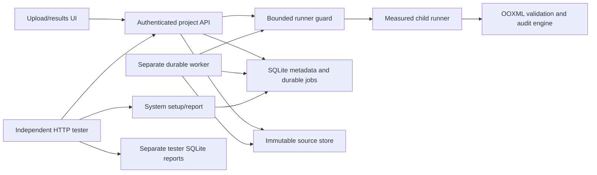

# Phase 3 PR review and integration — 2026-10-17

Reviewed and integrated the four requested PRs against the supplied owner handoffs and the
repository's Team 9 contract. The attachments supplied review criteria; their embedded starter
prompts were not separate requests to redo the owner projects. The user's explicit request
authorized merging. No AGENTS.md was present. Existing untracked `docs/handoffs/` was preserved.

Baseline main: `ffa6947` (merged bootstrap). Reviewed PR heads:

| PR | Owner / scope | Reviewed head |
|---|---|---|
| [#4](https://github.com/JGraff24/30861_Team9/pull/4) | Dylan: safe workbook intake, two audit rules, deterministic identities | `264f89f1af1b20611b8e4912686eda31740843de` |
| [#5](https://github.com/JGraff24/30861_Team9/pull/5) | Ryan: isolated measured execution, testing sessions, UI | `55442b6329a4e6acc3cc5bc7d007c9deabbeb6bb` |
| [#3](https://github.com/JGraff24/30861_Team9/pull/3) | Jackson: API/auth, immutable storage, SQLite, durable worker, deployment | `6e2ebfb47f59c80ef903d712dd8fe322adfe74c5` |
| [#2](https://github.com/JGraff24/30861_Team9/pull/2) | Dixon: independent HTTP tester, fixtures/oracles, CI | `66d588c6fafcc20fff7f9a541f9e4c29060fa128` |

PR #2 was a draft when inspected; the user requested merging all four PRs. No prior reviews or
comments were present. Its existing Ubuntu/Windows and dependency-audit checks were successful;
PRs #3/#4/#5 had no check runs at their heads. Integration keeps all four branch histories and
resolves the overlapping README, contracts, schema tooling and foundation tests.

## Findings and corrections

| Scope | Finding | Resolution and evidence |
|---|---|---|
| #3 + #4 + #5 | High: assembly's empty factory defaults left the real engine/runner/UI unavailable after merging. | Concrete, trusted default factories now assemble engine, runner, session service and routers. Explicit injection/disabled integrations remain supported. Real default-factory HTTP checkpoint passed. |
| #4 + #3 | Medium: bare `ooxml_builder` imports stopped five test modules from collecting after the unit directory became a package. | Package-qualified fixture imports; full engine regressions execute. |
| #5 + #3 | Medium: memory-limit test expected Linux enforcement on macOS. | Both genuine RLIMIT_AS checks are Linux-only; no claim of macOS memory enforcement. Linux CI retains them. |
| #5 + #2 | High: deferred cleanup after a setup that never reached the system made every subsequent setup fail on an unknown namespace. | Unknown earlier namespaces are idempotent no-ops. Existing-owner authorization and active-job checks remain enforced. Added regression; session tests passed. |
| #5 | Medium: system testing routes had default response documentation despite returning instructor schemas/statuses. | Added setup 201/report 200 schemas, request/query descriptions, bearer requirements and instructor error envelopes; regenerated and validated catalogs. |
| #2 + #3 | High: Docker build omitted forced-included fixture files, and copied source packages would shadow installed bundled assets. | Build copies fixture inputs; runtime imports the installed wheel. Wheel contains UI/fixtures and loads the 53-case suite and real measured engine from outside the checkout. Docker execution remains pending. |
| #2 + #5 | Medium: CI excluded `tests/ryan` and lacked a real integrated-system checkpoint. | Linux CI runs full pytest plus the new real integration command; Windows retains portable tester/schema checks; static typing targets the supported Linux deployment runtime. |
| All | Bootstrap-era docs/tests still reported missing teammates and empty route catalogs. | Updated current README/profile/runbook, smoke checks, schema catalogs and unavailable-integration tests. Historical owner evidence is retained with its original context. |

Review also checked authentication/ownership before source reads, nested-ID matching, bounded
multipart/ZIP/XML intake, untrusted XML handling, deterministic targets/IDs and rules, child
secret isolation, transactional claims/leases/terminal results, source hashing, session cleanup,
independent tester oracles, report retention and target coverage attribution. Existing tests and
the real fixture suite exercise these paths. No unresolved merge-blocking finding remained
in the locally verified scope.

## Actual validation

Executed on macOS, Python 3.12.15, uv 0.13.1:

- Locked sync and lock consistency: passed with the existing lock; no dependency additions.
- Ruff check and format: passed.
- Strict mypy `app tester scripts` and Linux deployment platform: passed.
- Full pytest: **515 passed, 6 skipped**. Four unconfigured live acceptance cases were run
  separately by the integration command; two genuine memory-cap tests require Linux.
- OpenAPI validation/current catalogs, identity vectors and synthetic fixture checks: passed.
- Default API/tester process smoke: passed; health 200, unauthorized tester report 401.
- Source distribution and wheel build: passed. Extracted-wheel validation confirmed bundled
  UI/fixtures, the 53-case plan, default assembly and actual measured workbook validation.
- Locked runtime plus measurement vulnerability audit: **no known vulnerabilities found**.
- Real API restart retained an accepted seeded workbook before a separate worker processed it.
  Findings reached REVIEW_REQUIRED and source SHA256 remained unchanged.
- Independent real-system suite: **52 pass, 1 skip, 0 fail/error**, all 53 IDs retained.
  The skipped controlled-failure observation is intentionally not injected into the black-box run.
- Actual engine line coverage: **698/835**; component catalog **6/6**; partial AC catalog **7/8**.
  These are scoped catalogs, not whole-service coverage or complete acceptance compliance.
- Four live tester acceptance checks passed, including single-use runs, byte-identical stored
  reports, and response-loss recovery without repeating POST run.

The repeatable command is:

```sh
uv run python -m scripts.integration_selfcheck --evidence-dir /tmp/team9-integration-evidence
```

The script creates only private temporary local state and random credentials, uses real
application modules, and stops only its own processes. Final live source commit: `f41c3bcb89fc6bb86439b2afa8c5d5bb31e46e1c` (clean runtime source). Tracked sanitized artifacts live in
`docs/evidence/phase3_local_integration/report.json` and `run-record.json`; the latter records
the tested commit, working-tree status, checkpoint and all 14 operation statuses. A documentation
commit after the tested source commit does not change the runtime implementation.

## Remote CI verification

[First integration CI run](https://github.com/JGraff24/30861_Team9/actions/runs/39040548545):
Linux full regressions (including both memory-cap tests), real integration checkpoint,
schema/identity/fixture checks, process smoke, fake-target tester self-check and the
runtime dependency audit passed. Windows passed 234 portable tests, lint/types and catalog
checks, then exposed a smoke-script startup defect: its stripped environment omitted
Windows runtime variables. The smoke script now preserves only SystemRoot/WINDIR/TEMP/TMP
from the OS environment on Windows, while keeping application credentials excluded.
Local smoke/lint/types passed after that correction.

[Follow-up integration CI run](https://github.com/JGraff24/30861_Team9/actions/runs/39040853751)
on `4a9722e0aa0d1c2b4d31317c0427bfed9ca2060b`: **Ubuntu checks passed, Windows checks
passed, dependency audit passed**. Both process smoke checks and fake-target tester self-checks
passed; Linux also repeated the full real API/worker/tester checkpoint. The separate external
live-suite job correctly skipped because this push did not invoke an operator-configured deployment run.
The subsequent evidence-only commit changes no application or test behavior.

## Delivered boundary and remaining evidence

Business operations 1/2/4/5 are delivered; 3/6/7/8/9/10/11/12/13/14 remain future work. Both
instructor interfaces and the basic UI are assembled. Default credentials still authorize nobody;
testing endpoints remain explicitly gated. The UI shell was served through the real app and its
owner HTTP tests passed. Playwright is unavailable here; no new browser/manual accessibility
claim is made. The framework emits an existing TestClient/httpx deprecation warning.

Docker is unavailable on this host. Container builds/Compose, image-level Linux enforcement, AWS/S3 with
real role credentials, valid public TLS, Team 12 contract confirmation and both cross-testing
directions remain pending. Deployment templates are prepared, not deployed. Five reviewed
real-world workbooks, two-person expectation review and Excel Accessibility Checker/preservation
checks still require human evidence. Fixture tests remain synthetic. No cloud resources or
external messages were created, and no scope expansion was merged.

## Actual integrated model



No planned cloud host is shown as deployed. Owner continuation documents remain the entry
points for Phase 4; preserve this integration checkpoint as a regression when extending them.
