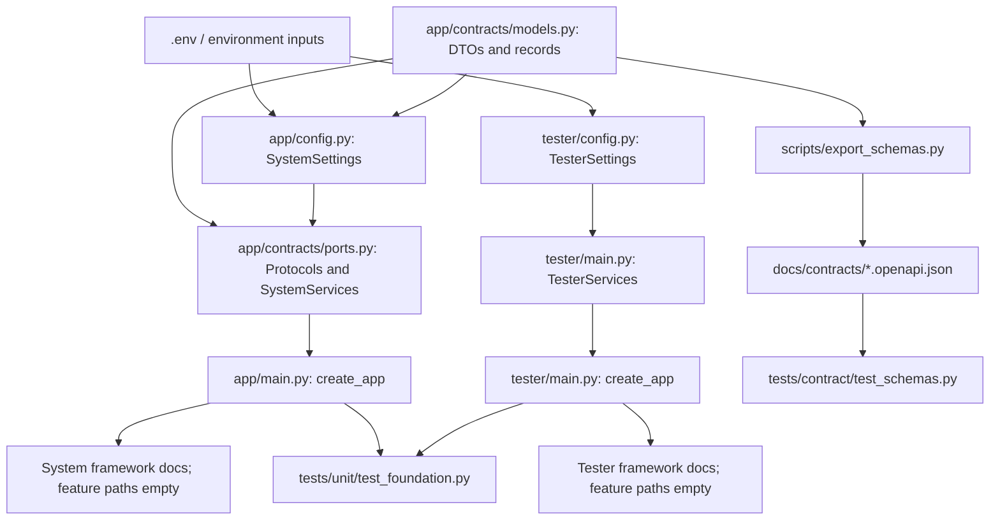
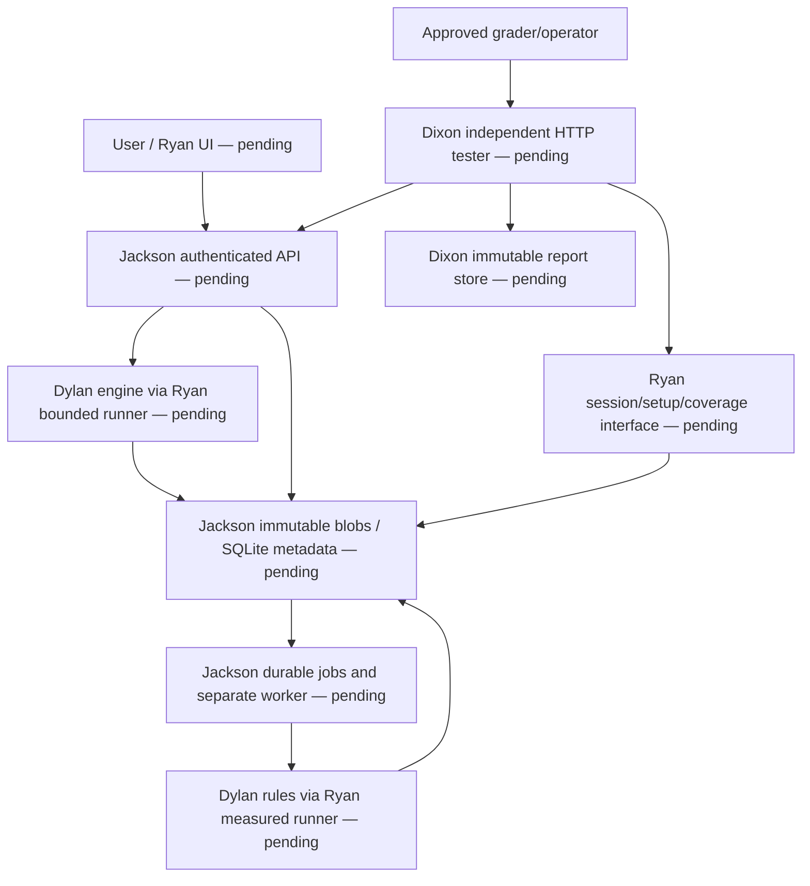

# Phase 3 bootstrap implementation

Recorded 2026-10-14, America/Indianapolis. Branch: `bootstrap/phase3`.
Inspected baseline: `88ae6165973021523d8448787b90c9ac92049f1d` (`main`), clean checkout with
only README.md. Origin is `https://github.com/JGraff24/30861_Team9.git`. No repository or ancestor
AGENTS.md instructions were found. The attached 656-line bootstrap document was read completely.
Existing README identity was retained and expanded. No feature work existed to replace.

The instructor Google document was retrieved in full using its text export after the web viewer
failed. It matches the packet's instructor fields and behavior. The preserved profile and the
list of Team 9 choices needing Team 12 confirmation are in [../contracts/phase3.md](../contracts/phase3.md).
No newer accepted repository contract was present. No push, merge or AWS provisioning occurred.
The foundation is ready for review as uncommitted local changes; no foundation SHA/PR is invented.

## Delivered boundary and file map

The foundation is runnable and locally verified. It delivers contract declarations and framework
startup, not the Excel accessibility service. All 14 business operations and every instructor
endpoint are pending. There are no successful health/upload/audit/testing stubs, parser, engine,
authentication implementation, database/blob adapter, worker, session orchestration, HTTP suite,
UI, fixtures, deployment or CI workflow.

| Files | Delivered purpose |
|---|---|
| `pyproject.toml`, `uv.lock`, `.python-version` | Python 3.12; exact resolver-selected direct versions; transitive/artifact lock; uv 0.13.1 requirement |
| `.gitignore`, `.env.example` | Ignored environments/secrets/state/binaries; complete local settings names/defaults |
| `app/contracts/models.py` | Wire DTOs, enums, internal records and validation invariants |
| `app/contracts/errors.py` | Typed failures and one request-ID-aware project envelope conversion |
| `app/contracts/ports.py` | Owner Protocols and SystemServices injection container |
| `app/config.py`, `tester/config.py` | Parsed environment settings, typed access maps, secret redaction, local/deployment input validation |
| `app/main.py`, `tester/main.py` | No-argument/injected FastAPI factories, startup boundary logs, framework docs only |
| Owner package `__init__.py` files | Importable ownership directories, without feature implementations |
| `app/ui/templates`, `app/ui/static`, `tests/acceptance`, `docs/evidence`, `deploy` | Tracked ownership scaffolding; `.gitkeep` preserves empty directories |
| `scripts/export_schemas.py` | Deterministic OpenAPI DTO catalog export and stale-file check |
| `scripts/check_identity.py` | Independent standard-library compact UTF-8 golden-vector check |
| `scripts/create_dev_tokens.py` | Explicit local-only credential scaffold, ignored exclusive private output |
| `scripts/smoke_foundation.py` | Starts/checks/stops two actual local Uvicorn processes; refuses occupied ports |
| `tests/unit/test_models.py`, `tests/unit/test_foundation.py` | Validation, settings, startup, injection and local secret-file checks |
| `tests/contract/test_schemas.py` | OpenAPI/JSON Schema conformance, independent payloads and hash vectors |
| `docs/contracts/phase3.md`, `system.openapi.json`, `tester.openapi.json` | Preserved shared profile, clarifications and foundation DTO catalogs |
| `README.md`, `deploy/README.md`, `tests/fixtures/README.md` | Setup, ownership and honest pending boundaries |

## Actual foundation model

All nodes below exist. Arrows represent settings/injection/schema use, not completed service calls.



## Separate target architecture — pending owner implementations

This diagram is an integration target only. None of its business components is delivered here.



## Concrete shared interfaces and data invariants

Business DTOs use exact camelCase fields: `HealthResponse`, `UploadResponse`, `VersionResponse`,
`AuditResponse`, `Finding`, `ProjectError`. Instructor DTOs use exact snake_case:
`TesterSetupRequest`, `SystemSetupRequest`, `SetupResponse`, `RunRequest`, `TestResult`,
`CoverageMeasure`, `SystemCoverage`, `SuiteCoverage`, `SystemReport`, `SuiteReport`,
`TestEndpointError`. The grader needs only target_url or session_id as specified.

Internal models are `Principal`, `ProcessingLimits`, `ValidatedWorkbook`, `AuditEvaluation`,
`WorkbookRecord`, `VersionRecord`, `AuditRecord`, `JobRecord`, `TestSession`,
`ExecutionMeasurement`, `ExecutionResult`. Every referenced record is defined; Protocol annotations
resolve at runtime without cyclic imports. Full Phase 2 version/audit/finding enums are retained.
Role, outcome, error-source, job/session state and execution-error-kind enums are explicit.

- Identifier: 1–64 ASCII letters/digits/underscore/hyphen. Finding ID and source hash: exactly
  64 lowercase hexadecimal characters. File name: 1–255; finding message/recommendation: 1–500.
- DTOs forbid undeclared fields, reject empty/blank required text and validate SemVer. Aware
  datetimes normalize to UTC and JSON emits Z; naive datetimes are rejected. Nullable business
  fields are required fields and ordinary serialization keeps them null.
- All shared models are frozen against field reassignment. Nested Python collections are not
  deeply frozen; owners must not mutate them in place. Wire lists remain JSON arrays.
- PROCESSING exposes no completed time/error/findings. Terminal audits require a completion
  timestamp at or after acceptance. PROCESSING_FAILED requires a project error and hides partial
  findings. AUDIT_COMPLETE has no findings; REVIEW_REQUIRED has findings. This validates records;
  it does not implement a runtime state machine.
- Coverage counts are strict nonnegative integers or both null; covered<=total; basis is nonblank.
  Null means unavailable, never an invented 0/0. Test error outcomes require source; pass/fail/skip
  omit it. Reports reject duplicate test IDs. The future suite must also include every planned
  test in manifest order; the foundation cannot validate an absent manifest.
- Measurements require canonical relative POSIX paths, sorted unique positive line numbers,
  and covered lines contained in executable lines. ExecutionResult returns only validated or
  evaluation according to operation. No measurement collector is implemented.
- SystemSetupRequest permits `{}` or `cleanup_session_ids` with valid IDs; unknown setup keys
  fail validation. No cleanup or session preparation executes here.

Typed errors: `ProjectException`, `WorkbookValidationError`, `EngineExecutionError` preserve
status/code/message/details. `to_envelope(request_id)` adds the required requestId. Engine errors
retain kind and optional measurement. Storage errors are `StorageError`, `IntegrityError`,
`DuplicateIdentifierError`, `SessionBusyError`, `StorageUnavailableError`, `RecordNotFoundError`,
`LeaseConflictError`. They are not embedded HTTP responses. Request middleware and handlers remain
Jackson/Ryan work; the factory does not promise feature error conformance yet.

Ports are the exact completion-appendix signatures for Repository, EngineRunner and BlobStore,
plus WorkbookEngine, SessionService and CodeMeasurementStore. AuthService takes an extracted
bearer token for require_user/require_test_admin and Principal for can_read; it declares no
authentication behavior. SystemServices contains settings, repository, blob_store, runner,
session_service, auth_service and the engine hook. All missing ports are explicit None. Router
factories will consume this container. TesterServices currently contains only its independent
settings. Constructors/imports/lifespans invoke no injected port and perform no storage writes.

Future repository transaction boundaries are documented in the preserved profile:
create_upload atomically checks READY/allowed subjects and creates all records; claims acquire
one worker lease; terminal completion updates audit/version/job atomically and refuses foreign or
expired leases. Cleanup reserves CLEANED transactionally, returns only owned namespace blob keys,
deletes blobs outside the DB transaction, then removes records/measurements while retaining the
tombstone. A partial cleanup never resurrects a runnable session. These are adapter obligations,
not a persistence implementation. The appendix replaces the earlier cleanup_test_session shorthand.

## Configuration and runnable commands

The full names/defaults are in `.env.example`; JSON shapes and typed omissions filled by bootstrap
are documented in `docs/contracts/phase3.md`. All credential/access fields are excluded from
settings repr and dumps; nested raw target tokens use SecretStr. Do not log raw validation-error
dictionaries or explicitly unwrapped secrets. Token provisioning is server configuration, never
a new required grader request field. Empty local maps authorize no users.

Use the platform-specific uv installation/setup commands in README. The actual verification host
was macOS ARM64 with CPython 3.12.15 and uv 0.13.1. For this session uv and its Python/cache were
installed under `/private/tmp/team9-bootstrap-tools`, `/private/tmp/team9-uv-python`, and
`/private/tmp/team9-uv-cache`, keeping application dependencies in the ignored `.venv`. Network
downloads, Git branch creation and loopback binding needed sandbox escalation, which succeeded.
There is no unresolved network blocker. All recorded `uv` commands used that executable, with
UV_CACHE_DIR/UV_PYTHON_INSTALL_DIR set as appropriate. Teammates use normal installed uv paths.

```sh
uv sync --locked --group dev
uv run uvicorn app.main:create_app --factory --host 127.0.0.1 --port 8000
# In another terminal:
uv run uvicorn tester.main:create_app --factory --host 127.0.0.1 --port 8001
```

Do not run the smoke helper while these manual processes occupy its ports. The helper starts
and stops only its own children. Factories set OpenAPI 3.1.1 to match the instructor starter's
dialect. Runtime schemas contain no paths. Exported catalogs add validated DTO components and
explicit foundation status/version metadata; they also have no paths. Full endpoint OpenAPI
descriptions must be added when features exist, not advertised ahead of implementation.

All direct dependency versions were selected by the actual resolver, then pinned; none were
invented from memory. Runtime: FastAPI 0.143.1, Pydantic 2.14.1, pydantic-settings 2.16.0,
Uvicorn 0.54.0, python-multipart 0.0.32, HTTPX 0.28.1, openpyxl 3.1.5, defusedxml 0.7.1,
boto3 1.43.113, Jinja2 3.1.6. Dev: pytest 9.1.1, pytest-asyncio 1.4.0, Ruff 0.17.0,
mypy 2.4.0, jsonschema 4.26.0, openapi-spec-validator 0.9.0, pip-audit 2.10.1,
Hatchling 1.32.4, coverage.py 7.16.2. Hatchling is also the pinned build backend.
coverage.py is an optional measurement extra, absent from base runtime. No JS toolchain,
Playwright/browser tests, owner-specific type stubs or project-wide typing exclusions were added.

## Verification outcomes

Executed locally on 2026-10-14, not on AWS or against Team 12:

| Command/check | Actual outcome |
|---|---|
| `uv lock` and `uv sync --group dev` | Resolver generated lock; dev environment installed successfully |
| `uv sync --locked --group dev` / `uv lock --check` | Passed; lock current and installed dev environment consistent |
| `uv run ruff check .` | Passed |
| `uv run mypy app tester` | Passed; 20 source files; strict checking |
| `uv run pytest tests/unit tests/contract` | 141 passed; one Starlette/HTTPX deprecation warning |
| OpenAPI validator + Draft 2020-12 JSON Schema checks | Passed in six contract tests; independent malformed payloads rejected |
| `uv run python -m scripts.export_schemas --check` | Passed; deterministic catalogs current |
| `uv run python -m scripts.check_identity` | Golden digest and two Unicode vectors match independently |
| `uv run python -m scripts.smoke_foundation` | Actual separate processes on 8000/8001: docs 200; paths empty; pending routes 404; processes stopped |
| pip-audit on locked runtime + optional measurement, 33 third-party packages | Passed; no known vulnerabilities found |
| pip-audit on runtime/dev/build + optional measurement, 83 third-party packages | Passed; no known vulnerabilities found |
| `uv build --no-build-isolation` | Source distribution and wheel built successfully using the pinned dev build backend; dist ignored |
| `git diff --check` | Passed |

The initial run failed because an incorrect Pydantic serializer type was imported. This was
corrected to Field(exclude_if=...) so nonerror source fields disappear without hiding unrelated
nulls or degrading generated schemas. Collection warnings caused by imported DTO names were
corrected with test-local aliases. Ruff formatting issues were fixed. The remaining warning is
Starlette 1.8.0 deprecating HTTPX 0.28.1 TestClient integration in favor of httpx2. The required
HTTPX dependency works in the executed tests and live process checks; no unapproved toolchain
was added and the warning was not suppressed.

Ruff 0.17.0 also reformatted Python snippets inside Markdown during the initial format pass.
The copied shared profile was restored byte-for-byte as normalized UTF-8/LF text; Markdown is
now excluded from formatting and its preserved-body SHA256 is asserted by the contract suite.
No contract semantics were changed. Catalog generation explicitly uses documented local defaults
so a private environment/root-path setting cannot alter tracked catalogs.

The independent vector script computes SHA256 of compact JSON UTF-8 with ensure_ascii=False,
separators=(",", ":"), and no normalization/newline. Packet vector digest:
`502d6624551c9da5c9a80d7efcc04be1119dad4a16f55171487949600a177714`.
Composed `Dépenses 📊`: `65c48a7e1beb35c5e0068830b884d5d6f658793be5bcf21a1189a134f592ddc3`.
Decomposed `De\u0301penses 📊`: `780ab5b340613108fa0dd216616b987cf1929a01b527495cbf3d9e63057fd9e7`.
This verifies a shared algorithm example; Dylan's production implementation is still pending.

## Limitations, deviations and traceability

| Limitation | Severity / action | Owner / target |
|---|---|---|
| All business/test/UI features absent | Expected bootstrap boundary; do not present the foundation as a service | All owners, Phase 3 |
| Team 9 conventions await pod confirmation | Integration blocker before cross-team conformance claims; use confirmation list | Jackson / Team 12, Phase 3 |
| No fixtures/manifest/manual reviews or Excel checker evidence | Acceptance evidence pending; author independent expectations and obtain real human inputs | Dixon/Ryan/Dylan/Jackson, Phase 3 |
| No AWS deployment, HTTPS, URLs/access configuration, CI or cross-team runs | Deployment/assignment evidence pending; supply actual inputs and implement owner handoffs | Jackson/Dixon, Phase 3 |
| Starlette TestClient deprecation | Low; tests pass; coordinate a compatible test-client migration with Jackson/Dixon | Phase 3 maintenance |
| Frozen models have mutable nested collections | Low internal limitation; treat reads as immutable or copy; do not mutate shared results | All owners |
| URL syntax checks are not HTTP/DNS/redirect SSRF enforcement | Pending tester obligation; implement exact allowlist, DNS/redirect and credential policy | Dixon, Phase 3 |
| Memory ceiling is a setting only | No Linux RLIMIT/process enforcement or macOS/Windows guarantee yet | Ryan/Jackson, Phase 3 |

No requested owner feature was implemented. Additional bootstrap choices are explicitly documented:
access-map JSON representations, AuthService token arguments, optional measurement runtime extra,
no-argument-capable factories and DTO-only catalogs rather than advertised pending paths. The
packet's target deployment/CI/owner evidence sections are future handoff obligations. No fixture,
approval, manual correction review, production hash, coverage percentage, CI link or release was fabricated.

REQ/AC status: this is a prerequisite for the Phase 3 portions of AC-01/02/03/04/05/14/15/18,
not proof those acceptance criteria pass. REQ-15 performance, AC-16 HTTPS/access and AC-17 UI
accessibility remain pending. The packet does not include every Phase 2 REQ definition, so no
additional IDs or names are invented. Operation 1/2/4/5 DTOs are defined but their success/error
routes are unimplemented. Operations 3/6/7/8/9/10/11/12/13/14 are unimplemented future scope.
Phase 4/5 extension points are the preserved legacy enums, source-version IDs, immutable records,
owner Protocols and coordinated router assembly. Remediation/deletion/history/report-download/
scheduling/test-clock features remain outside bootstrap and current Phase 3 claims.

## Foundation commit and sharing steps

Review the actual diff and run checks before committing. Commands below are for Jackson to run;
Codex has not executed commit/push/PR/merge steps:

```sh
git switch bootstrap/phase3
git status --short
git diff --check
git add README.md .env.example .gitignore .python-version pyproject.toml uv.lock app tester tests scripts docs deploy
git diff --cached --stat
git diff --cached --check
git commit -m "Bootstrap Phase 3 shared contracts and runnable foundations"
git rev-parse HEAD
# When ready to publish for review:
git push -u origin bootstrap/phase3
gh pr create --base main --head bootstrap/phase3 --title "Bootstrap Phase 3 foundation" --body-file docs/implementation/bootstrap_phase3_pr.md
```

Review and merge through the normal team process. Share the PR, preserved contract profile and
actual merged foundation commit with all four teammates. Prefer the merged main SHA if squash
merge changes the branch SHA. Every owner then runs, replacing FOUNDATION_SHA with that real SHA:

```sh
git fetch origin
git switch -c phase3/OWNER FOUNDATION_SHA
uv sync --locked --group dev
```

Each teammate attaches only their own self-contained implementation document and uses its starter
prompt. Jackson coordinates shared files; each owner writes their assigned implementation and
evidence records at delivery. Integrate Dylan engine + Ryan runner/session services, Jackson
storage/worker/assembly, then Dixon live local HTTP/UI checks. Only then test deployment and both
cross-team directions. Do not infer integrated readiness from this 141-case foundation suite.

## Next Codex prompt

```text
Read README.md, docs/contracts/phase3.md, docs/implementation/bootstrap_phase3.md
and all applicable AGENTS.md files completely. Inspect the current branch,
history and actual code before editing. Confirm that my owner branch starts
from the reviewed merged foundation commit. Read my attached self-contained
owner handoff and implement only my assigned features behind the shared ports.
Preserve all other owners' work. Coordinate shared-file changes through Jackson.
Keep wire names, nulls, enums, errors, settings and transaction obligations exact.
Use injected fakes only inside tests. Run uv sync --locked --group dev, Ruff,
mypy, owner tests and schema checks. Document actual results, limitations,
models and evidence in my assigned continuation/evidence files. Do not claim
whole-system readiness until the live integration checkpoint has passed.
Do not push, merge or provision AWS unless separately authorized.
```

Supporting technical references: [uv dependency groups](https://docs.astral.sh/uv/concepts/projects/dependencies/),
[Pydantic serialization](https://docs.pydantic.dev/latest/concepts/serialization/),
[FastAPI stripping-proxy root paths](https://fastapi.tiangolo.com/advanced/behind-a-proxy/).
Local code and executed checks are the evidence for the implementation statements above.
