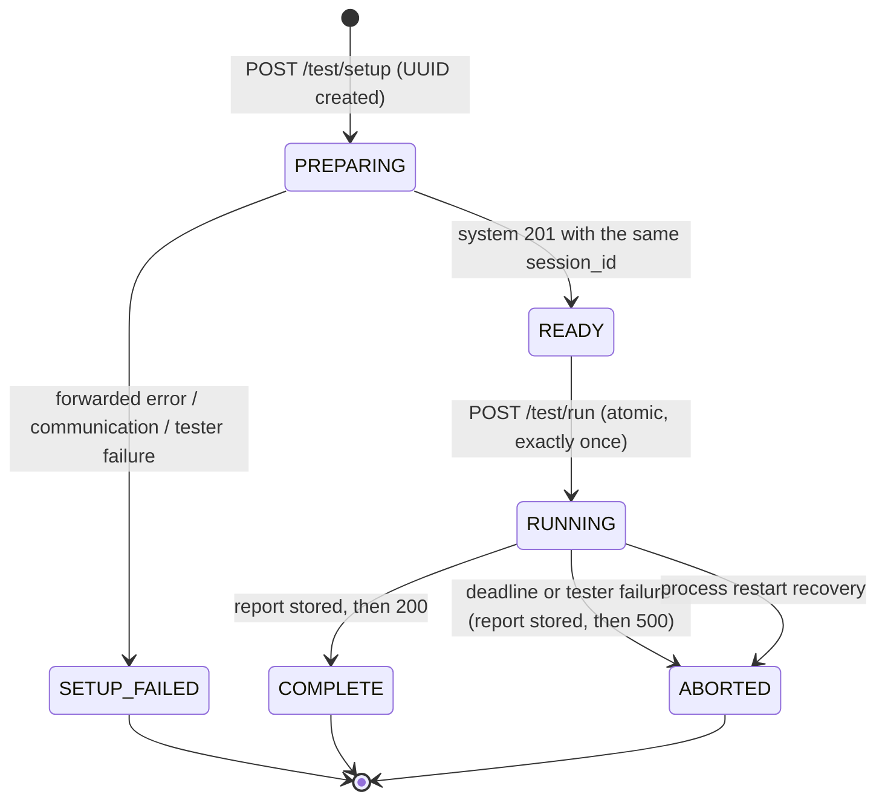
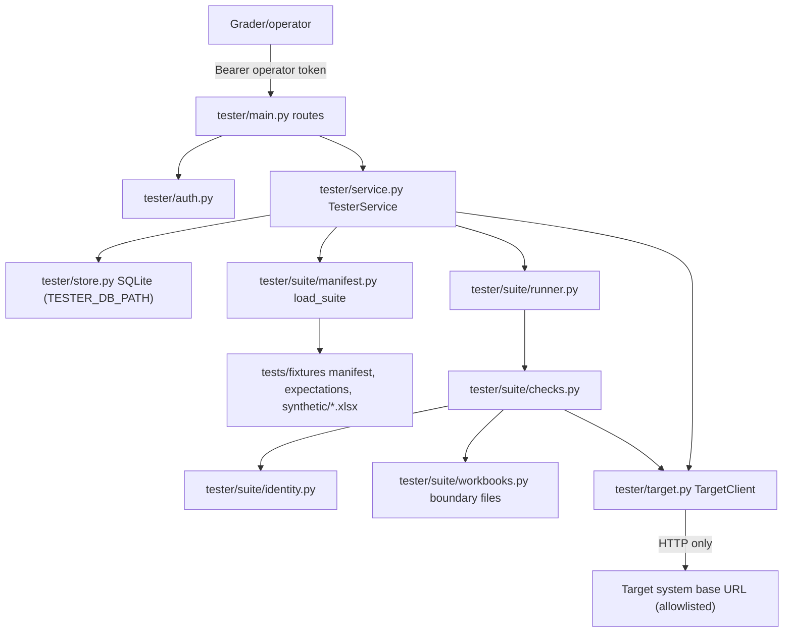
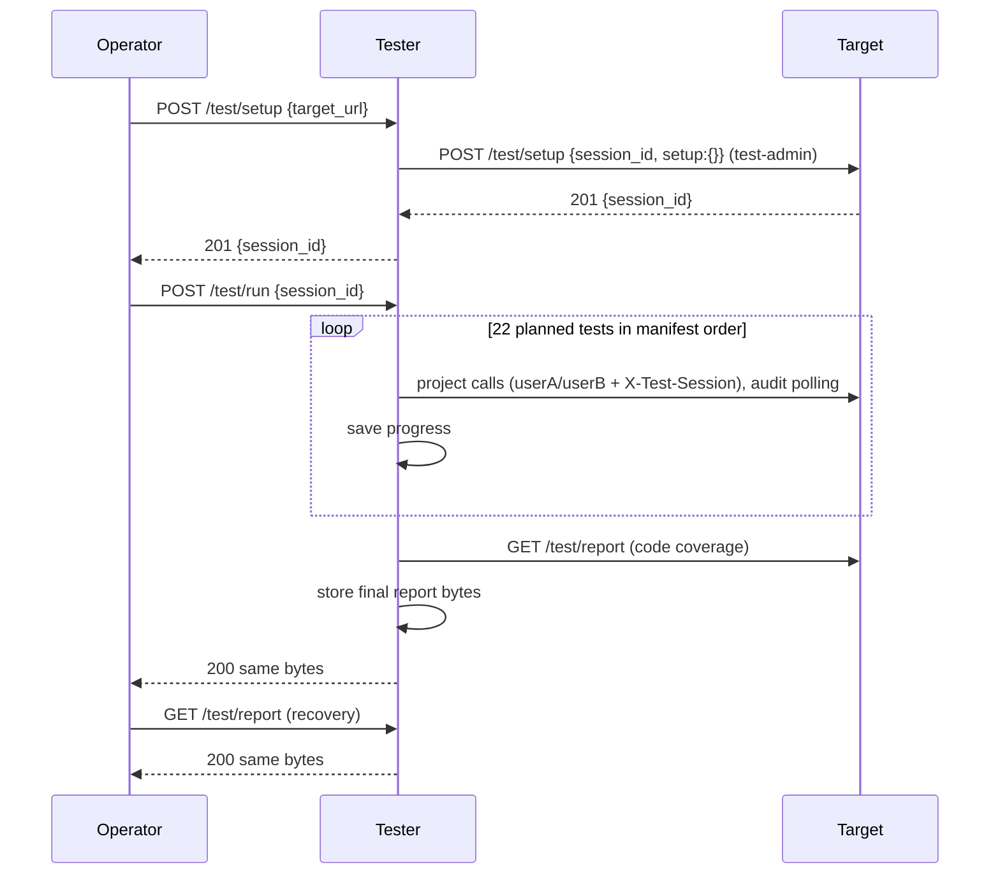

# Dixon Phase 3 implementation: independent tester, suite, fixtures, CI

Recorded 2026-10-14 (America/Indianapolis) on branch `phase3/dixon`, cut from the merged
foundation `ffa6947` (merge of PR #1). Built with Claude Code; see
[../evidence/dixon_phase3.md](../evidence/dixon_phase3.md). Nothing has been pushed or deployed.

## Delivered boundary

**Implemented (local, verified):**

- Instructor tester endpoints `POST /test/setup`, `POST /test/run` and `GET /test/report`, with
  `{message, source}` errors, operator bearer authentication and per-operator session ownership.
- Single-use sessions: atomic `READY -> RUNNING` consumption. Repeat, concurrent and post-abort
  runs get 409. A setup failure leaves no runnable session.
- Immutable report storage in a separate SQLite database. The report is stored before the
  response is sent, and `GET /test/report` returns byte-identical JSON.
- Abort handling: completed outcomes are kept, the interrupted test is error/`tester`, and the
  rest skip. A run left `RUNNING` by a crashed process is closed the same way at next startup.
- A target HTTP client with an exact allowlist, a per-target access map, no redirects,
  `trust_env=False`, TLS verification and a DNS pre-check that rejects metadata, link-local,
  unspecified, multicast and reserved addresses (plus loopback/private in production). It has
  per-call and whole-suite deadlines, retries only GETs (at most 3) and never retries POSTs.
- A 22-test ordered Phase 3 suite (`tests/fixtures/manifest.json`) with component (C1-C6) and
  system (eight AC portions) coverage, plus target code coverage taken from the system report or
  reported as null with a reason.
- Three labeled synthetic fixtures with hand-authored expectations, a deterministic generator
  and runtime-generated 25,000,000 / 25,000,001-byte boundary uploads.
- The tester's own `findingId` oracle, checked against the contract golden vector.
- Contract tests for tester responses against the committed catalog, an env-driven live
  acceptance test, an operator CLI and a live self-check.
- A GitHub Actions workflow (`.github/workflows/ci.yml`).

**Not implemented / not claimed:**

- No run against the Team 9 system. The system's business and test endpoints don't exist yet
  (Jackson, Dylan and Ryan). Every full-suite result so far is against the **test-only fake
  target** in `tests/support/`.
- No AWS deployment, HTTPS endpoint, registry URL or cross-team run with Team 12.
- CI has not run on GitHub: the branch is unpushed. Branch protection is not configured.
- Team 12 shared fixtures have not been delivered. There has been no two-person manual
  expectation review and no Excel repair-warning check of the synthetic files.
- Tester UI checks and the live UI integration checks are pending Ryan's UI.

## File and module map

| Path | Purpose |
|---|---|
| `tester/main.py` | App factory, routes, bearer security, OpenAPI cleanup (no unused 422), crash recovery on startup |
| `tester/service.py` | Setup, run and report lifecycle; forwards system setup errors; opt-in prior-namespace cleanup |
| `tester/store.py` | SQLite session/report store (WAL, `BEGIN IMMEDIATE`); created lazily on first use |
| `tester/target.py` | `TargetClient`, the only network path to a target; address policy, deadlines, retries |
| `tester/auth.py` | Operator token SHA256 lookup with constant-time comparison |
| `tester/errors.py` | `TesterError` and handlers: 400 for invalid requests, 500 `tester` for unexpected failures |
| `tester/config.py` | Existing settings plus `TESTER_CLEANUP_PRIOR_SESSIONS` (default false) |
| `tester/suite/checks.py` | 22 black-box checks and their outcome signals |
| `tester/suite/runner.py` | Ordered execution, outcome mapping, coverage, aborted-report building |
| `tester/suite/manifest.py` | Manifest/expectations models, loading and fixture SHA256 verification |
| `tester/suite/identity.py` | Independent `findingId` implementation |
| `tester/suite/workbooks.py` | Deterministic OOXML builder for synthetic and boundary workbooks |
| `tests/fixtures/manifest.json`, `expectations.json`, `synthetic/*.xlsx`, `README.md`, `.gitattributes` | Suite plan, catalogs, fixtures, inventory and review status |
| `tests/unit/test_tester.py` | 42 tester unit tests against the injected fake transport |
| `tests/contract/test_tester_contract.py` | Tester responses validated against `docs/contracts/tester.openapi.json` |
| `tests/acceptance/test_live_tester.py` | Live black-box checks of a running tester; skipped unless configured |
| `tests/support/fake_system.py`, `fake_target_app.py` | **Test-only** contract-following fake target (MockTransport and ASGI) |
| `scripts/run_suite.py` | Operator CLI: setup, one run, report polling after a lost response, summary |
| `scripts/tester_selfcheck.py` | Starts the real tester and the fake target as processes and runs the CLI and acceptance tests |
| `scripts/make_synthetic_fixtures.py` | Writes or `--check`s committed fixture bytes |
| `.github/workflows/ci.yml` | Ubuntu + Windows checks and dependency audit |

### Shared files changed (Jackson to review)

| File | Change | Why |
|---|---|---|
| `tests/unit/test_foundation.py` | Windows loopback socketpair allowance in the no-network guard; the tester now asserts its three routes and 401 instead of empty paths/404 | Failed on Windows before any feature work; the tester now has routes |
| `tests/contract/test_schemas.py` | UTF-8 reads; per-service implemented path sets | Profile hash failed on Windows (cp1252); the tester now has routes |
| `scripts/export_schemas.py` | Per-catalog status string; keeps route-level `components` (security schemes) | The tester catalog now documents real routes and bearer security |
| `scripts/smoke_foundation.py` | Per-service expected paths/statuses | Same |
| `.env.example` | `TESTER_CLEANUP_PRIOR_SESSIONS=false` | New tester setting |
| `docs/contracts/tester.openapi.json` | Regenerated | Real tester paths |

`docs/contracts/phase3.md` line 7 still says both catalogs have empty paths. That's Jackson's
file, so it was left unchanged. Suggested wording: "tester.openapi.json lists the implemented
instructor tester endpoints; system.openapi.json paths remain empty until system routes exist."
README tester commands are also left to Jackson. Suggested commands are under
[Commands](#commands).

## Interfaces

**Exposed (HTTP, separate process, default port 8001):** `POST /test/setup {target_url}` →
201 `{session_id}`; `POST /test/run {session_id}` → 200 `SuiteReport` or 500 `{message,
source:"tester"}`; `GET /test/report?session_id=` → 200 stored report. Errors: 400 invalid, 401
credential, 403 other operator's session, 404 unknown, 409 not ready / already used / not
ended, 500 failure. The authoritative shapes are in `docs/contracts/tester.openapi.json`.

**Consumed (target system over HTTP only):** `POST {target}/test/setup` and
`GET {target}/test/report` with the test-admin token. Project calls `/api/v1/health`,
`/api/v1/workbooks`, `/versions/{id}` and `/audits/{id}` use the userA/userB tokens plus
`X-Test-Session`. The tester never imports system modules or reads system storage; it imports
only shared DTOs from `app/contracts/models.py` and settings types from `app/config.py`.

## State and invariants



- A report is written exactly once (`report IS NULL` guard) and returned as stored bytes.
- `begin_run` checks ownership and state, then transitions, in one `BEGIN IMMEDIATE` transaction.
- Results are saved after every test, so crash recovery keeps completed outcomes.
- The suite is validated (manifest, expectations, fixture SHA256, target access) **before** the
  session is consumed, so a configuration error leaves it `READY`.
- Coverage: a component/AC counts only when a test declaring it reached pass or fail (its
  qualifying assertion executed). Error and skip results earn nothing. Target code coverage is
  null with a reason whenever it can't be retrieved and validated.
- Tokens exist only in `TargetAuth` (`SecretStr`) and Authorization headers. They never appear
  in reports, error bodies, exception messages or logs (asserted by a test).

## Models





## Suite and traceability

| Test | Check | Components | ACs |
|---|---|---|---|
| P3-01 | Health schema and ruleset | none | none |
| P3-02, P3-03 | Upload with no token / an invalid token → 401 | C1 | AC-15 |
| P3-04 to P3-07 | Missing file 400; CSV and .xls 415; named .xlsm 422 `MACRO_ENABLED_WORKBOOK_UNSUPPORTED` | C2 | AC-02 |
| P3-08 | Corrupt → 422 with a strict envelope (no IDs) | C2 | AC-02, AC-14 |
| P3-09 | 25,000,001 bytes → 413 | C2 | AC-02 |
| P3-10 | A valid workbook of exactly 25,000,000 bytes → 202 | C2 | AC-01 |
| P3-11, P3-12 | Clean and seeded accepted | C2, C3 | AC-01 |
| P3-13 | Version IDs, fileName and SHA256 match the tester's own hash | C3 | AC-01 |
| P3-14 | Clean audit → `AUDIT_COMPLETE`, no findings | C4, C5 | AC-04 |
| P3-15 | Seeded audit → exactly six expected findings (ID, rule, category, worksheet, target, class, order) | C4, C5 | AC-04, AC-05 |
| P3-16 | SHA256 unchanged after the audit; version reflects it | C3 | AC-03 |
| P3-17 | User B → 403 on user A's version | C1 | AC-15 |
| P3-18 | Unknown / mismatched IDs → 404 | C3, C5 | none |
| P3-19 | Five audits of the same bytes are identical | C4 | AC-18 |
| P3-20 | Unknown `X-Test-Session` → 400 | C6 | none |
| P3-21 | Duplicate system setup → 409 | C6 | none |
| P3-22 | System report schema and session | C6 | none |

Tester-behavior tests (single use, report recovery, abort, timeouts, URL/access controls) live in
`tests/unit/test_tester.py` and `tests/acceptance/`; they aren't counted in the suite's catalogs.
AC-14 coverage is partial: controlled audit and storage faults can't be forced black-box without
an agreed protected mechanism. Health 503 is likewise only testable in owner-local
fault-injection tests.

## Configuration (names only)

`TESTER_ROOT_PATH`, `TESTER_DB_PATH`, `TESTER_OPERATOR_TOKEN_HASHES_JSON`, `ALLOWED_TARGET_URLS`,
`TARGET_AUTH_MAP_JSON` (keys `userA`, `userB`, `reviewer`, `test-admin`), `FIXTURE_MANIFEST_PATH`,
`TESTER_SETUP_TIMEOUT_SECONDS` (45), `TESTER_RUN_TIMEOUT_SECONDS` (600),
`TESTER_CLEANUP_PRIOR_SESSIONS` (false), `APP_ENV`. Built-in timing: system setup call 30 s,
normal GET 10 s, upload 35 s, audit polling 75 s at 1 s, GET retries 3. The grader's run read
timeout must be at least 630 s; configure the reverse proxy to match.

## Commands

```sh
uv sync --locked --group dev
uv run uvicorn tester.main:create_app --factory --host 127.0.0.1 --port 8001
```

Operator run against a configured, approved target (token from the environment, never argv):

```sh
TEAM9_TESTER_TOKEN=... uv run python -m scripts.run_suite --tester-url http://127.0.0.1:8001 --target-url http://127.0.0.1:8000 --output report.json
```

Live acceptance against any deployed tester: set `TEAM9_TESTER_URL`, `TEAM9_TARGET_URL` and
`TEAM9_TESTER_TOKEN`, then run `uv run pytest tests/acceptance`. Local self-check (real processes,
test-only fake target): `uv run python -m scripts.tester_selfcheck`.

## Verification results (2026-10-14, Windows 11, CPython 3.12.15, uv 0.13.1)

| Command | Result |
|---|---|
| `uv sync --locked --group dev` | OK, 84 packages |
| `uv run ruff check .` / `ruff format --check .` | Passed / 47 files formatted |
| `uv run mypy app tester` | Passed, 31 source files, strict |
| `uv run pytest tests/unit tests/contract` | 189 passed (the foundation's 141 plus 48 new); 1 existing Starlette/HTTPX deprecation warning |
| `uv run pytest` | 189 passed, 3 skipped (live acceptance unconfigured) |
| `export_schemas --check`, `check_identity`, `make_synthetic_fixtures --check` | Passed |
| `scripts.smoke_foundation` | Both processes: docs 200, routes and unauthenticated statuses OK |
| `scripts.tester_selfcheck` (twice) | Run 200 in 11.5 s / 10.5 s; 22 run, 22 pass; component 6/6, system 8/8; acceptance 3 passed. **Target was the test-only fake.** |
| pip-audit, locked runtime + measurement extra | No known vulnerabilities found |
| GitHub Actions | Not run; branch not pushed |

## Limitations and defects

| Item | Severity | Workaround | Target |
|---|---|---|---|
| No run against the real Team 9 system or Team 12 | High (evidence gap) | Run `scripts/run_suite.py` once system endpoints exist and URLs/tokens are provisioned | Phase 3 integration |
| DNS pre-check can be bypassed by rebinding between check and connect | Medium | Restrict tester egress at the network/security-group layer in AWS | Phase 3 deployment |
| Synthetic fixtures not reviewed by two members or opened in Excel | Medium | Pod review; add Team 12 files under `tests/fixtures/shared/` | Phase 3 |
| AC-14 only partially exercisable black-box | Medium | Owner fault-injection tests; agree a protected mechanism if needed | Phase 3/5 |
| Expected error codes asserted only where the contract fixes them (`.xlsm`) | Low | Add codes once Team 12 confirms the catalog | Phase 3 |
| `TESTER_CLEANUP_PRIOR_SESSIONS` semantics need pod confirmation | Low | Leave off until confirmed | Phase 3 |
| A tester crash between storing the report and responding can lose the response | Low | Disclosed; `GET /test/report` recovers it | Inherent |
| Starlette TestClient/HTTPX deprecation warning | Low | Coordinate a test-client migration with Jackson | Maintenance |
| Each run sends two ~25 MB uploads (one rejected, one accepted) and 13 small ones to the target | Low | Expected; accepted data is session-tagged for the target's cleanup | — |

## Deviations from the handoff

- Added `TESTER_CLEANUP_PRIOR_SESSIONS` (off by default) to meet the "failed setup must
  compensate" obligation through the only agreed mechanism, `cleanup_session_ids`, without
  making an unconfirmed convention the default.
- Fixtures are stored ZIPs (no DEFLATE) so committed bytes are identical on every platform.
- Two Windows defects in the bootstrap tests were fixed (UTF-8 reads and the socketpair guard).

## Phase 4/5 extension points

- New checks: add a function to `CHECKS` and a manifest entry with components/ACs. Future-phase
  entries may use `"phase": "future"` to report a planned skip without earning coverage.
- Team 12 fixtures: add `"origin": "team12"` entries; `load_suite` verifies hashes automatically.
- Remediation/history tests can reuse `TargetClient` and `poll_audit`. Report download and
  test-clock endpoints need new checks only once they are contractually defined.

## Next Codex prompt

```text
Read README.md, docs/contracts/phase3.md, docs/implementation/bootstrap_phase3.md,
docs/implementation/dixon_phase3.md and tests/fixtures/README.md completely. Inspect
the current branch, history and the actual tester/ code before editing. The tester
is an independent HTTP-only service; never import system modules beyond
app/contracts and app/config. Keep the instructor wire shapes exact and keep
tests/fixtures/expectations.json hand-authored, never derived from the engine.
Run uv sync --locked --group dev, ruff check, ruff format --check, mypy app tester,
pytest tests/unit tests/contract, scripts.export_schemas --check,
scripts.make_synthetic_fixtures --check and scripts.tester_selfcheck. When system
endpoints exist, run scripts/run_suite.py against the real local system and record
the actual results (date, SHA, counts, failures classified as system/test/spec,
coverage) in docs/evidence/dixon_phase3.md. Do not push, merge, deploy or claim
cross-team results unless separately authorized and actually executed.
```
