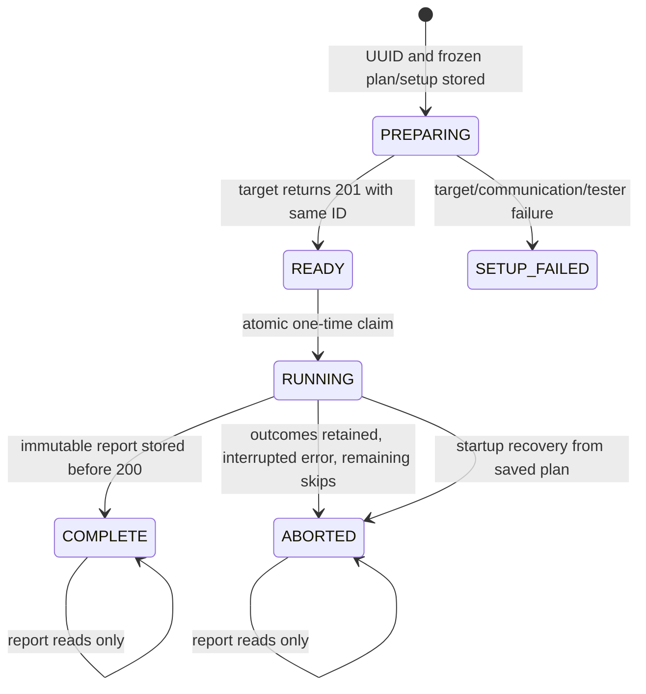
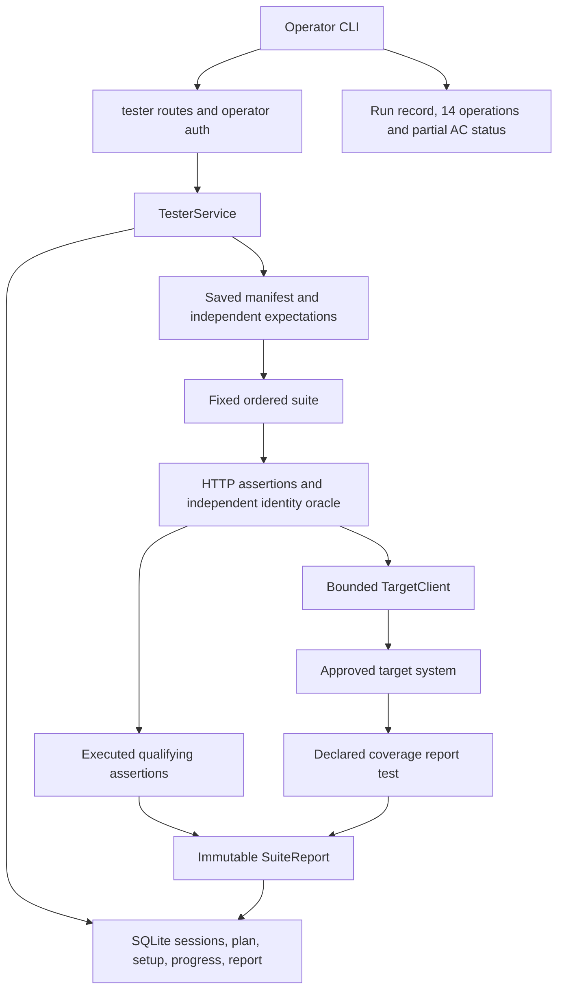

# Dixon Phase 3 implementation

Updated 2026-10-14 on `phase3/dixon`, based on foundation `ffa6947`. The current working-tree
changes correct CI and coverage gaps in Dixon's implementation at `ae40ed9`; they have not been committed,
pushed, merged or deployed by this Codex session. Historical Claude Code evidence remains in
[the evidence log](../evidence/dixon_phase3.md). The final requirement audit is
[dixon_handoff_verification.md](../evidence/dixon_handoff_verification.md).

## Delivered boundary

The independent tester implements authenticated `POST /test/setup`, `POST /test/run` and
`GET /test/report`. It calls only explicitly approved system URLs through HTTP, using private
per-target credentials. It imports shared DTOs/settings, never the target engine or storage.
A wheel includes its fixture manifest, independent expectations and thirteen synthetic files.
A wheel loaded outside the checkout was verified to expose all three routes and load all 53
planned cases without importing `tests/support/` or contacting a target.

Sessions, setup payloads, frozen suite definitions, progress markers and immutable final report
bytes are stored in a separate SQLite database. One tester API worker must own each store;
startup recovery is intended for a stopped previous process, not overlapping deployments.
The service runs suites in a server worker thread, so disconnecting the caller does not cancel
the suite. The local live acceptance check actually exercised lost-response recovery.

The deployed suite contains 53 fixed cases. Unknown/mismatched IDs and audits two through five
each have separate IDs and outcomes; an evaluable failure does not suppress later cases.
`P3-AUDIT-FAILURE-ENVELOPE` skips unless a target audit actually reports `PROCESSING_FAILED`.
A healthy fake produces 52 passes, one skip, component coverage 6/6 and partial system coverage
7/8. The fake's code coverage 40/50 is a constant test value, never a real target measurement.

The real Team 9 system API/engine/worker/UI/test interface are not integrated on this branch.
There is no AWS deployment, HTTPS evidence, live CI run or Team 12 cross-test from this session.
Shared fixtures, two-member oracle review, Excel repair-warning checks, meaningful-prose review,
and the five real-world workbook/precision experiment require human or pod inputs. These are
pending, not fabricated. Remediation, history, downloads, scheduling and deletion are future
system operations; the tester lists their status without calling them as delivered features.

## Files and interfaces

| Files | Actual role |
|---|---|
| `tester/main.py`, `auth.py`, `errors.py` | Factory/routes, operator bearer hash lookup, ownership, instructor errors and OpenAPI |
| `tester/service.py`, `store.py` | Setup/run/report lifecycle, SQLite transactions, saved plans and recovery |
| `tester/config.py`, `target.py` | Exact approved base URLs, private target tokens, address policy, bounded HTTP calls |
| `tester/suite/manifest.py` | Typed plan/catalogs, prerequisites/parameters, independent fixture hashes, snapshot/restore |
| `tester/suite/checks.py`, `identity.py` | HTTP assertions and the tester's independent finding-ID oracle |
| `tester/suite/workbooks.py` | Explicit OOXML fixtures, limits, hostile packages and encrypted ZIP generator |
| `tester/suite/runner.py`, `records.py` | Ordered results, actual assertion markers, reports and all-operation/AC evidence |
| `tests/fixtures/manifest.json`, `expectations.json` | Stable cases, six components/eight ACs, fourteen operations, independent expectations |
| `tests/unit/test_tester.py`, `test_tester_deadlines.py` | Controlled transports, fault responses, persistence/concurrency/recovery, actual streaming sockets |
| `tests/contract/`, `tests/acceptance/` | DTO/OpenAPI conformance and opt-in deployed lifecycle/lost-response checks |
| `tests/support/` | Explicit test-only fake target; not part of the deployed system |
| `scripts/run_suite.py`, `tester_selfcheck.py` | Operator workflow, lost-response polling, sanitized artifacts, local process verification |
| `.github/workflows/ci.yml` | Ubuntu/Windows checks, dependency audit, opt-in live suite |

Exposed bodies are the instructor shapes: setup `{target_url}` → 201 `{session_id}`;
run `{session_id}` → 200 complete `SuiteReport`, or 500 `{message, source: tester}` on abort;
report query `session_id` → 200 exactly the stored JSON bytes. Invalid input is 400, invalid
operator credentials 401, foreign ownership 403, unknown sessions 404, and unready/consumed
sessions 409. Graders have no required fixture/auth/catalog/setup fields beyond the handoff.

Consumed endpoints are target `/test/setup` and `/test/report` with the test-admin credential,
and the four Phase 3 project operations `/api/v1/health`, `/api/v1/workbooks`, version and audit
GETs. Project calls carry `X-Test-Session` and the appropriate user token, or no token for
negative authentication cases. URLs preserve base prefixes; TLS verification remains enabled;
redirects and environment proxies are disabled. Operator/target tokens are not stored in the
session plan or reports. Configuration uses secret fields and private environment maps.

## State and invariants



`BEGIN IMMEDIATE` protects state changes. The final update requires `RUNNING` and a null report;
concurrent, repeated and post-abort runs are rejected. Reports survive target cleanup and never
rerun the suite. Progress stores results and executed markers after each test. Recovery uses
saved test IDs rather than current-manifest positions and reads no fixture files or target URLs.

The saved plan contains the manifest, expectations and fixture-root path, not file contents or
credentials. Before a run is consumed, saved fixtures must still match their original hashes
and all saved checks must exist. A missing/tampered fixture leaves the session READY with 500.
Changing the live manifest/expectations after setup cannot alter that session's planned suite.
Interrupted PREPARING sessions become SETUP_FAILED with compensation queued, without
replaying setup. Old databases receive additive columns. Legacy RUNNING sessions without a saved plan become
ABORTED with retained recorded outcomes and honest null completeness; unknowable remaining
tests are not invented. Legacy READY sessions need a new setup because no plan was retained.

Failed target preparation always queues compensating `cleanup_session_ids` for the next **new**
setup. The setup POST that timed out is never repeated. The request uses the same target-specific
admin identity, and a failed cleanup remains pending. An operator may additionally enable
cleanup of successfully retrieved namespaces. No ordinary-user deletion route is introduced.
If no later setup occurs, failed namespaces remain pending for operator/pod cleanup; this is
explicit deferred compensation through the contract's available mechanism.



```mermaid
sequenceDiagram
  participant Operator
  participant Tester
  participant Store
  participant Target
  Operator->>Tester: setup with approved target_url
  Tester->>Store: save UUID, setup and frozen plan
  Tester->>Target: setup once with admin token
  Target-->>Tester: 201 same ID
  Tester->>Store: READY
  Operator->>Tester: run once
  Tester->>Store: atomically claim RUNNING
  loop 53 planned cases
    Tester->>Target: bounded request/assertion when prerequisites exist
    Tester->>Store: results and executed markers
  end
  Note over Tester,Target: Coverage GET occurs inside P3-CODE-REPORT, once
  Tester->>Store: save immutable report and terminal state
  Tester-->>Operator: report or tester abort error
  Operator->>Tester: report GET after a lost response
  Tester-->>Operator: stored bytes; no rerun
```

## Timing and execution evidence

System setup calls have a 30-second total request budget, tester setup 45 seconds, uploads
35 seconds, ordinary GETs 10 seconds, audit polling 75 seconds, and suites 600 seconds. GET
transport retries share a call's total budget, with at most three retries; POSTs are never
retried. A bounded daemon owns DNS/socket work while the suite caller waits against an absolute
wall deadline. Deadlines are also checked before sending, while reading/evaluating responses,
and between tests. Poll requests use the remaining polling budget. Responses are bounded to
2 MiB and decompressed exactly once. Larger target responses are reported as unavailable;
this defensive tester limit is a disclosed implementation default, not pod approval.

Python cannot forcibly terminate a blocked DNS/native socket thread. A late worker checks the
expired deadline before sending after DNS and closes its own connection when it can resume;
it cannot change the session, results or report. A timed-out POST can have an uncertain target
outcome. Normal bounded SQLite persistence/finalization follows the stop so the report is
recoverable; a failed disk or process crash cannot be promised a successful response. Network
calls have no unbounded response waits. Use egress restrictions against the documented DNS
rebind gap between address validation and HTTPX's connection lookup.

Use client/proxy read timeouts of at least 630 seconds. After a lost run response, poll report
GET at one second with a deadline; never repeat run/upload/setup POSTs. A fresh session is needed
for a new suite. The CLI writes evidence before returning nonzero for fail/error outcomes;
expected observation skips alone do not fail CI. A report/manifest mismatch refuses to fabricate
operation or AC evidence; supply the matching tester plan version.

## Suite, oracles and traceability

The complete authoritative rows, prerequisites, qualifying assertions, parameters, operation
numbers and AC/REQ mappings are in `tests/fixtures/manifest.json`. Business REQ mappings remain
the original Phase 2 operation catalog. All fourteen operation rows are emitted; future rows
are unimplemented/untested. Operation conformance is scoped to the listed evidence, with
missing/error/skip cases remaining incomplete or untested, never silently yes.

| Cases | Independent assertions | Trace |
|---|---|---|
| Health and auth | Health schema/ruleset; absent/invalid token rejection | Op 1/2; C1; AC-15 |
| Clean/seeded uploads and audits | IDs/status schemas; exact rule/category/location/classification/finding ID/order | Op 2/5; C2-C5; AC-01/04/05 |
| Version/source hash | Actual response IDs/fileName; tester's fixture byte hash before/after audit; latest audit/status | Op 4; C3; AC-01/03 |
| Missing/corrupt/CSV/xls/xlsm/protected/bounds | Expected statuses and strict error envelopes; at/over byte/sheet/cell limits | Op 2; C2; AC-01/02 |
| ZIP/XML/macros/encrypted ZIP | Traversal, duplicate paths, DTD/entity declaration, macro parts in xlsx, genuine encrypted ZIP rejected | Op 2; C2; AC-02 |
| Unicode/repeated IDs/multiple drawings | Explicit whitespace policy and zero-width exclusion; duplicate-ID XML targets/limitation; hidden drawing objects | Op 2/5; C2-C5; AC-01/04/05 |
| Unknown/mismatched/foreign/reviewer resources | Explicitly granted reviewer version/audit GETs; separate 404 cases; unauthenticated/foreign-owner 401/403 | Op 4/5; C1/C3/C5; AC-15 |
| Determinism | Completed observed baseline independent of expected-finding accuracy; five separate uploads; semantic finding fields plus same-target message/recommendation text identical | Op 2/5; C4; AC-18 |
| Observed controlled audit failure | PROCESSING_FAILED timestamp/error/no partial findings; otherwise skip | Op 5; C5; AC-14 |
| Sessions and code report | Unknown session, duplicate setup; actual coverage counts/basis or paired nulls | C6 |

Expected fixture findings are authored from explicit OOXML object/sheet definitions and the
handoff, not an engine run. `identity.py` independently implements the compact UTF-8 SHA256
algorithm and golden/Unicode vectors. Accuracy and repeatability are independent: the first valid completed audit supplies the
repeatability baseline even when its expected findings/status differ. A malformed, wrong-ID,
failed or unavailable audit does not supply a baseline. Cross-team semantic comparisons do not require identical
prose between teams; determinism within one target does require stable prose. Presence/length
is validated by the shared schema; correctness of prose meaning requires manual review.

Coverage markers are recorded at the assertions/calls they qualify. An assertion mismatch can
still exercise an AC. An earlier HTTP failure does not grant later hash/finding assertions;
a skip earns nothing. Earlier markers are preserved even if a later request prevents finishing
a case. Component/system counts are unions over the six/eight declared catalogs. A code report
failure has its own planned outcome and paired nulls; no hidden second retrieval can overwrite
an earlier measurement. `acceptance_status` in the run record discloses per-AC result evidence
and partial scope, rather than claiming completion from a percentage.

A version hash alone cannot independently prove that a dishonest target read its stored bytes;
the target contract requires that check. Actual integrated storage-preservation evidence still
belongs to the system owners. Tester pytest coverage is never substituted for target coverage.

Local fault tests exercise tester handling of health 500/503, upload/storage-style 500/503,
PROCESSING_FAILED timeout responses, source integrity 500, communication failures, schema
mismatches, tester defects, deadline aborts and coverage unavailability. These tests demonstrate
tester classification/report retention, not real system fault handling. Once integrated,
Jackson/Dylan/Ryan's dependency-injected system tests must prove their actual failure paths.

## Configuration and commands

Configuration names: `APP_ENV`, `TESTER_ROOT_PATH`, `TESTER_DB_PATH`,
`TESTER_OPERATOR_TOKEN_HASHES_JSON`, `ALLOWED_TARGET_URLS`, `TARGET_AUTH_MAP_JSON`,
`FIXTURE_MANIFEST_PATH`, `TESTER_SETUP_TIMEOUT_SECONDS`, `TESTER_RUN_TIMEOUT_SECONDS`,
`TESTER_CLEANUP_PRIOR_SESSIONS`. The target map has `userA`, `userB`, `reviewer`, `test-admin`.
Provision the reviewer with an explicit grant to userA (target `REVIEWER_GRANTS_JSON`) and
include that identity in the target test-admin's `TEST_SESSION_USERS_JSON` namespace. A reviewer
role alone is not sufficient. No default credential authorizes an operator. Store raw target tokens only in protected config;
provision matching test-admin/user identities on each target before grader setup.

```sh
uv sync --locked --group dev
uv run uvicorn tester.main:create_app --factory --host 127.0.0.1 --port 8001
uv run python -m scripts.tester_selfcheck --evidence-dir docs/evidence/dixon_local_selfcheck
uv run ruff check .
uv run ruff format --check .
uv run mypy app tester
uv run pytest tests/unit tests/contract
uv run python -m scripts.export_schemas --check
uv run python -m scripts.check_identity
uv run python -m scripts.make_synthetic_fixtures --check
```

For public deployments use HTTPS; configure prefix stripping/root_path and persistent private
SQLite separately from the system. AWS infrastructure, Docker/Compose, DNS/certificates and
system assembly remain Jackson's deployment boundary. The tester wheel includes its fixture
assets; source checkouts use the repository fixtures. A private manifest may instead point to
Team 12 shared inputs with independent reviewed expectations.

Exact remote calls use `$TESTER`/`$TOKEN` placeholders from protected configuration:

```sh
curl -sS -X POST "$TESTER/test/setup" -H "Authorization: Bearer $TOKEN" \
  -H "Content-Type: application/json" -d '{"target_url":"https://HOST/system"}'
curl -sS -X POST "$TESTER/test/run" -H "Authorization: Bearer $TOKEN" \
  -H "Content-Type: application/json" -d '{"session_id":"<uuid>"}' --max-time 630
curl -sS "$TESTER/test/report?session_id=<uuid>" -H "Authorization: Bearer $TOKEN"
```

```sh
uv run python -m scripts.run_suite --tester-url http://127.0.0.1:8001 --target-url http://127.0.0.1:8000 --target-revision unknown --output report.json --record run-record.json
```

Read the operator token from `TEAM9_TESTER_TOKEN`, never a command-line credential. Live
acceptance also needs `TEAM9_TESTER_URL` and `TEAM9_TARGET_URL`. GitHub's manual live job needs
protected `TEAM9_TESTER_URL`/`TEAM9_TESTER_TOKEN` secrets and approved target/revision inputs.
A target SHA is supplied from pod documentation; unknown stays unknown.

## Verification and integration gaps

See the dated evidence log and final handoff matrix for exact executed checks. CI defines
blocking lint/format/types/unit/contract/lock/schema/identity/fixture/smoke/self-check/audit jobs;
no new GitHub Actions run or branch-protection configuration was initiated here. Historical
evidence reports protection unconfigured; current remote settings were not checked.

| Limitation | Severity / workaround / phase |
|---|---|
| Real Team 9/AWS/Team 12 runs pending | High evidence gap; owners integrate/provision approved URLs and access; Phase 3 |
| Actual system fault paths/source integrity not implemented here | High integration gap; owner tests and real full-suite run; Phase 3 |
| Shared/manual fixture/prose/Excel review pending | Medium; Team 12 supplies files and two pod members review; Phase 3 |
| DNS pre-check/connect rebind gap | Medium; restrict production egress; Phase 3 deployment |
| Late native DNS/socket work cannot be forcibly killed | Medium; bounded caller, no retry/state mutation, controlled cleanup queue; deployment monitoring |
| Office CFB encryption and additional unsupported-object/ambiguous decorative fixtures | Medium remaining fixture scope; add independently reviewed files; Phase 3/4 |
| One process per tester SQLite store | Medium; avoid overlapping startup recovery; use separate stores for independent services |
| 2 MiB response bound and cleanup defaults need pod confirmation | Low; explicit profile/default documentation; Phase 3 |
| Existing Starlette/HTTPX deprecation warning | Low; coordinate dependency/test-client migration; maintenance |

Narrow shared-file changes include wheel fixture packaging in `pyproject.toml`, current-status
corrections in README/contract introduction and `.env.example` cleanup wording. Jackson should
review these integration hooks. DTO wire schemas and system modules were not rewritten.
The branch name differs from the handoff starter. Deferred compensation uses later setup
because no standalone cleanup endpoint exists. All fixtures remain provisional synthetic inputs.

## Next Codex prompt

```text
Read the actual branch, AGENTS.md, docs/contracts/phase3.md, the latest accepted pod
contract, docs/implementation/dixon_phase3.md, docs/evidence/dixon_handoff_verification.md
and tests/fixtures/README.md before editing. Integrate the approved real Team 9 system
and independently reviewed Team 12 fixtures, then run the unchanged Phase 3 suite over
local real HTTP and approved deployed URLs with protected per-target access. Preserve
saved-plan recovery, single-use sessions, explicit assertion markers, all per-case
outcomes, same-target prose determinism and one planned coverage retrieval. Record
actual reports/operation/AC status with unknown target revisions left unknown. Extend
Phase 4 only for pod-approved remediation/reports/history operations, keeping every
Phase 3 behavior as regression coverage and independent oracles. Add independently
reviewed Office CFB and unsupported-object fixtures without deriving expectations
from the engine. Run locked uv sync, Ruff, mypy, unit/contract tests, schemas, identities,
fixture checks, wheel verification and the real local self-check. Update models and
honest evidence; never invent deployment, manual review, precision or cross-team results.
Do not push, merge, provision paid resources or change shared scope without authorization.
```
