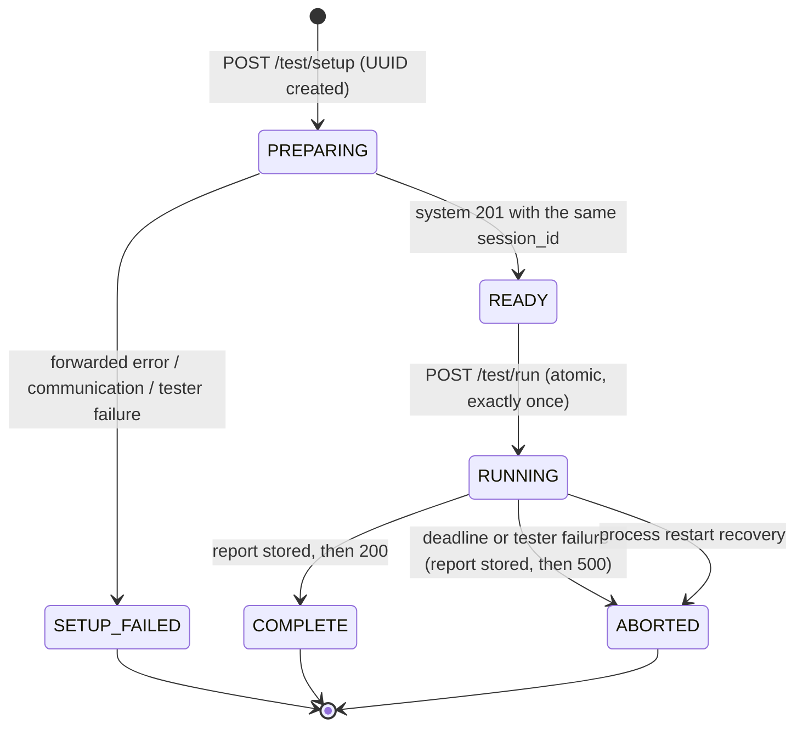
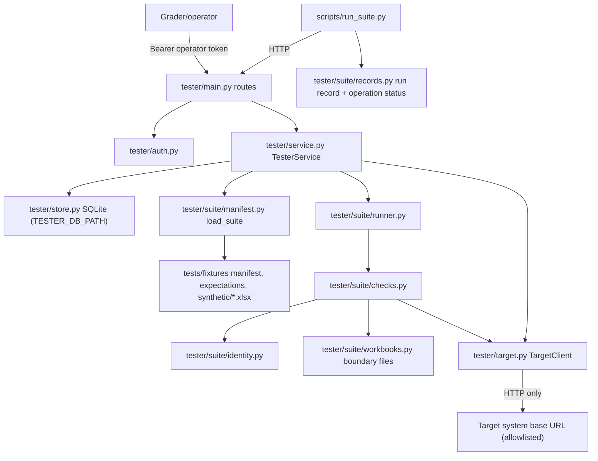
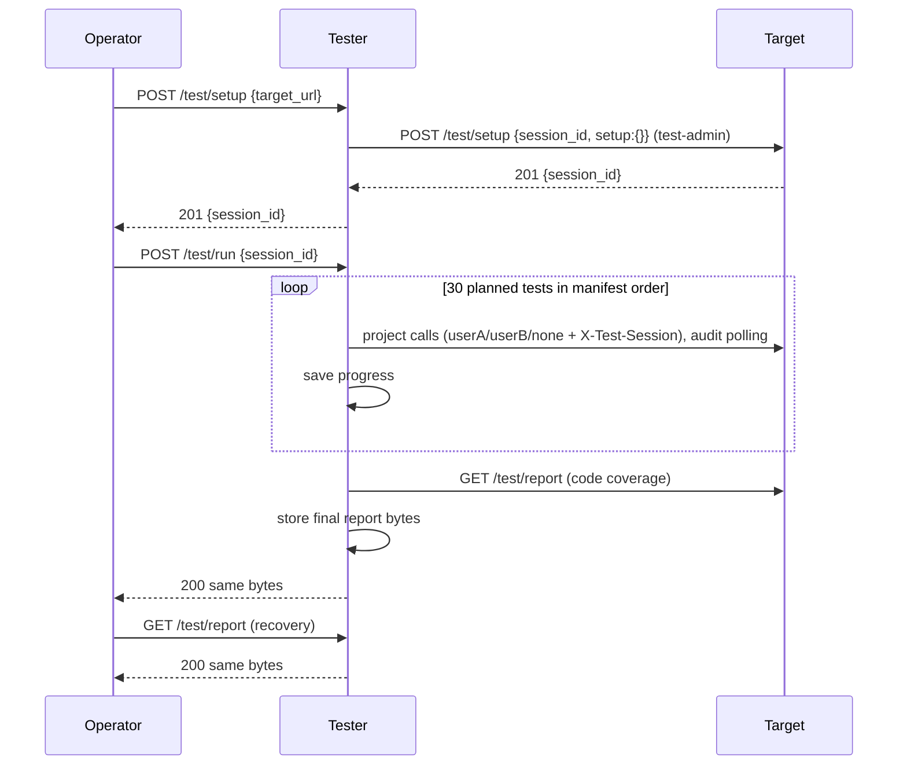

# Dixon Phase 3 implementation: independent tester, suite, fixtures, CI

Recorded 2026-10-14 (America/Indianapolis) on branch `phase3/dixon`, cut from the merged
foundation `ffa6947` (merge of PR #1), and published as draft PR #2. Built with Claude Code
against Dixon's Phase 3 handoff and the shared contract. See
[../evidence/dixon_phase3.md](../evidence/dixon_phase3.md) for the run log.

## Delivered boundary

**Implemented (local, verified):**

- Instructor tester endpoints `POST /test/setup`, `POST /test/run` and `GET /test/report`, with
  `{message, source}` errors, operator bearer authentication and per-operator session ownership.
- Single-use sessions: atomic `READY -> RUNNING` consumption. Repeat, concurrent and post-abort
  runs get 409. A setup failure leaves no runnable session.
- Immutable report storage in a separate SQLite database. The report is stored before the
  response is sent, and `GET /test/report` returns byte-identical JSON.
- Abort handling: completed outcomes are kept, the interrupted test is error/`tester`, and the
  rest skip. A run left `RUNNING` by a crashed process is closed the same way at next startup.
- A target HTTP client with an exact allowlist, a per-target access map, preserved base
  prefixes, no redirects, `trust_env=False`, TLS verification and a DNS pre-check that rejects
  metadata, link-local, unspecified, multicast and reserved addresses (plus loopback/private in
  production). It has per-call and whole-suite deadlines, retries only GETs (at most 3) and never
  retries POSTs.
- A 30-test ordered Phase 3 suite (`tests/fixtures/manifest.json`, handoff-style IDs) covering
  every delivered core operation's success and error paths, with component (C1-C6) and system
  (eight AC portions) coverage. Target code coverage is copied from the system report, or
  reported as paired nulls with a reason.
- A **14-operation status artifact** and **sanitized run records** (`tester/suite/records.py`,
  written by `scripts/run_suite.py --record`).
- Three labeled synthetic fixtures with hand-authored expectations, plus runtime-generated
  boundary inputs: 25,000,000 / 25,000,001 bytes, 50 / 51 worksheets, 250,000 / 250,001
  nonempty cells, and a password-protected structure.
- The tester's own `findingId` oracle, checked against the contract golden vector.
- Contract tests against the committed catalog, live acceptance tests, an operator CLI, a live
  self-check, and CI (push/PR checks plus an opt-in live-suite job).

**Not implemented / not claimed:**

- No run against the Team 9 system. Its business and test endpoints don't exist yet (Jackson,
  Dylan and Ryan). Every full-suite result so far is against the **test-only fake target** in
  `tests/support/`.
- No AWS deployment, HTTPS endpoint, registry URL or cross-team run with Team 12. The live CI job
  has never run because no tester is deployed.
- Branch protection is not configured.
- Team 12 shared fixtures have not been delivered. There has been no two-person manual
  expectation review and no Excel repair-warning check of the synthetic files.
- Operations 3 and 6-14 are listed in the status artifact but not described. Their names,
  paths and REQ IDs come from the Phase 2 specification (R1), which isn't in the repository, so
  they are left null instead of invented. The same applies to REQ IDs for operations 1, 2, 4
  and 5.
- Message/recommendation prose is checked for presence (1-500 characters), not meaning;
  reviewing meaning is a human task.
- Tester UI checks and the live UI integration checks are pending Ryan's UI.

## File and module map

| Path | Purpose |
|---|---|
| `tester/main.py` | App factory, routes, bearer security, OpenAPI cleanup (no unused 422), crash recovery on startup |
| `tester/service.py` | Setup, run and report lifecycle; forwards system setup errors; opt-in prior-namespace cleanup |
| `tester/store.py` | SQLite session/report store (WAL, `BEGIN IMMEDIATE`); created lazily on first use |
| `tester/target.py` | `TargetClient`, the only network path to a target; address policy, deadlines, retries |
| `tester/auth.py` | Operator token SHA256 lookup with constant-time comparison |
| `tester/errors.py` | `TesterError` and handlers: 400 for invalid requests, 500 `tester` for unexpected failures |
| `tester/config.py` | Existing settings plus `TESTER_CLEANUP_PRIOR_SESSIONS` (default false) |
| `tester/suite/checks.py` | 30 black-box checks and their outcome signals |
| `tester/suite/runner.py` | Ordered execution, outcome mapping, coverage, aborted-report building |
| `tester/suite/manifest.py` | Manifest (tests, catalogs, 14 operations, pending confirmations) and expectations models; fixture SHA256 checks |
| `tester/suite/records.py` | Operation-status artifact and sanitized run record built from a stored report |
| `tester/suite/identity.py` | Independent `findingId` implementation |
| `tester/suite/workbooks.py` | Deterministic OOXML builder: synthetic fixtures, byte/sheet/cell boundaries, protected structure |
| `tests/fixtures/manifest.json`, `expectations.json`, `synthetic/*.xlsx`, `README.md`, `.gitattributes` | Suite plan, catalogs, fixtures, inventory and review status |
| `tests/unit/test_tester.py` | 46 tester unit tests against the injected fake transport |
| `tests/contract/test_tester_contract.py` | 6 tests validating tester responses against `docs/contracts/tester.openapi.json` |
| `tests/acceptance/test_live_tester.py` | Live black-box checks of a running tester; skipped unless configured |
| `tests/support/fake_system.py`, `fake_target_app.py` | **Test-only** contract-following fake target (MockTransport and ASGI) |
| `scripts/run_suite.py` | Operator CLI: setup, one run, report polling after a lost response, `--output` report, `--record` run record |
| `scripts/tester_selfcheck.py` | Starts the real tester and the fake target as processes and runs the CLI and acceptance tests |
| `scripts/make_synthetic_fixtures.py` | Writes or `--check`s committed fixture bytes |
| `.github/workflows/ci.yml` | Ubuntu + Windows checks, dependency audit, opt-in `live-suite` job |

### Shared files changed (Jackson to review)

| File | Change | Why |
|---|---|---|
| `tests/unit/test_foundation.py` | Windows loopback socketpair allowance in the no-network guard; the tester now asserts its three routes and 401 instead of empty paths/404 | Failed on Windows before any feature work; the tester now has routes |
| `tests/contract/test_schemas.py` | UTF-8 reads; per-service implemented path sets | Profile hash failed on Windows (cp1252); the tester now has routes |
| `scripts/export_schemas.py` | Per-catalog status string; keeps route-level `components` (security schemes) | The tester catalog now documents real routes and bearer security |
| `scripts/smoke_foundation.py` | Per-service expected paths/statuses | Same |
| `.env.example` | `TESTER_CLEANUP_PRIOR_SESSIONS=false` | New tester setting |
| `docs/contracts/tester.openapi.json` | Regenerated | Real tester paths |

`docs/contracts/phase3.md` line 7 still says both catalogs have empty paths. That's Jackson's
file, so it was left unchanged. Suggested wording: "tester.openapi.json lists the implemented
instructor tester endpoints; system.openapi.json paths remain empty until system routes exist."
README tester commands are also left to Jackson; suggested commands are under
[Commands](#commands).

## Interfaces

**Exposed (HTTP, separate process, default port 8001):** `POST /test/setup {target_url}` →
201 `{session_id}`; `POST /test/run {session_id}` → 200 `SuiteReport` or 500 `{message,
source:"tester"}`; `GET /test/report?session_id=` → 200 stored report. Errors: 400 invalid, 401
credential, 403 other operator's session, 404 unknown, 409 not ready / already used / not
ended, 500 failure. The authoritative shapes are in `docs/contracts/tester.openapi.json`.

**Consumed (target system over HTTP only):** `POST {target}/test/setup` and
`GET {target}/test/report` with the test-admin token. Project calls `/api/v1/health`,
`/api/v1/workbooks`, `/versions/{id}` and `/audits/{id}` use the userA/userB tokens (or none,
for the 401 tests) plus `X-Test-Session`. The tester never imports system modules or reads
system storage; it imports only shared DTOs from `app/contracts/models.py` and settings types
from `app/config.py` (no `app.audit`, `app.storage` or `app.workbooks`).

## State and invariants



- A report is written exactly once (`report IS NULL` guard) and returned as stored bytes.
- `begin_run` checks ownership and state, then transitions, in one `BEGIN IMMEDIATE` transaction.
- Results are saved after every test, so crash recovery keeps completed outcomes.
- The suite is validated (manifest, expectations, fixture SHA256, target access) **before** the
  session is consumed, so a configuration error leaves it `READY`.
- The run executes in a server worker thread, not tied to the client connection. A dropped
  client doesn't cancel it, and the report is still stored for `GET /test/report`. (By design;
  not covered by an automated disconnect test.)
- Coverage: a component/AC counts only when a test declaring it reached pass or fail (its
  qualifying assertion executed). Error and skip results earn nothing. Target code coverage is
  paired nulls with a reason whenever it can't be retrieved and validated, and earlier outcomes
  are kept.
- Tokens exist only in `TargetAuth` (`SecretStr`) and Authorization headers. They never appear
  in reports, run records, error bodies, exception messages or logs (asserted by tests).

## Models





## Suite and traceability

Operations: 1 health, 2 upload, 4 version, 5 audit. "S" means the test checks the success
path, "E" the error path.

| Test ID | Check | Op (path) | Components | ACs |
|---|---|---|---|---|
| P3-HEALTH | 200 + `HealthResponse`, apiVersion, ruleset | 1 (S) | none | none |
| P3-AUTH-UPLOAD | No token → 401, strict envelope (no IDs) | 2 (E) | C1 | AC-15 |
| P3-AUTH-UPLOAD-INVALID | Unknown token → 401 | 2 (E) | C1 | AC-15 |
| P3-INPUT-MISSING-FILE | No `file` field → 400 | 2 (E) | C2 | AC-02 |
| P3-INPUT-CSV / -XLS | CSV and .xls → 415 | 2 (E) | C2 | AC-02 |
| P3-INPUT-XLSM | Named .xlsm → 422 `MACRO_ENABLED_WORKBOOK_UNSUPPORTED` | 2 (E) | C2 | AC-02 |
| P3-INPUT-CORRUPT | Corrupt .xlsx → 422, no IDs | 2 (E) | C2 | AC-02, AC-14 |
| P3-INPUT-PROTECTED | Password-protected structure → 422 | 2 (E) | C2 | AC-02 |
| P3-INPUT-BYTES-OVER / -AT | 25,000,001 bytes → 413; exactly 25,000,000 → 202 | 2 (E / S) | C2 | AC-02 / AC-01 |
| P3-INPUT-SHEETS-OVER / -AT | 51 worksheets → 422; exactly 50 → 202 | 2 (E / S) | C2 | AC-02 / AC-01 |
| P3-INPUT-CELLS-OVER / -AT | 250,001 nonempty cells → 422; exactly 250,000 → 202 | 2 (E / S) | C2 | AC-02 / AC-01 |
| P3-UPLOAD-CLEAN / -SEEDED | Fixtures accepted with three IDs | 2 (S) | C2, C3 | AC-01 |
| P3-VERSION-VALID | IDs, fileName, SHA256 equals the tester's own hash | 4 (S) | C3 | AC-01 |
| P3-VERSION-UNAUTHENTICATED | No token → 401 | 4 (E) | C1 | AC-15 |
| P3-AUDIT-CLEAN | Terminal `AUDIT_COMPLETE`, no findings | 5 (S) | C4, C5 | AC-04 |
| P3-AUDIT-SEEDED | Exactly six expected findings: ID, rule, category, worksheet, target, class, order | 5 (S) | C4, C5 | AC-04, AC-05 |
| P3-SOURCE-HASH | SHA256 unchanged after the audit; version reflects it | 4 (S) | C3 | AC-03 |
| P3-VERSION-FOREIGN | User B → 403 on user A's version | 4 (E) | C1 | AC-15 |
| P3-AUDIT-UNAUTHENTICATED | No token → 401 | 5 (E) | C1 | AC-15 |
| P3-AUDIT-FOREIGN | User B → 403 on user A's audit | 5 (E) | C1 | AC-15 |
| P3-NOT-FOUND | Unknown / mismatched version and audit IDs → 404 | 4, 5 (E) | C3, C5 | none |
| P3-DETERMINISM | Five separate uploads of identical bytes → identical findings | 2, 5 (S) | C4 | AC-18 |
| P3-SESSION-UNKNOWN | Unknown `X-Test-Session` → 400 | — | C6 | none |
| P3-SESSION-DUPLICATE | Duplicate system setup → 409 | — | C6 | none |
| P3-CODE-REPORT | System report: counts/basis or paired nulls | — | C6 | none |

**Oracle rationale:** the expected findings, targets, classifications and rejections in
`tests/fixtures/expectations.json` were written by hand from the object definitions in
`tester/suite/workbooks.py` and the audit policy. Expected `findingId`s come from the tester's own
hash implementation; nothing is derived from the system's engine.

**Where failure paths are covered:** every error path the contract defines for operations
1/2/4/5 that a black-box client can trigger is in the suite above. Health 503, upload 500
(storage/init failure), audit `PROCESSING_FAILED` and `SOURCE_INTEGRITY_FAILED` can't be forced
on a healthy target without an agreed protected mechanism. They belong to the owners'
dependency-injected unit tests: health/storage faults (Jackson), engine failures (Dylan) and
runner timeouts (Ryan). Tester-behavior tests (setup errors, single use, concurrency, recovery,
abort, timeouts, URL/access controls, coverage available/unavailable) are in
`tests/unit/test_tester.py`, `tests/contract/test_tester_contract.py` and `tests/acceptance/`.

**Operation status and run records:** `scripts/run_suite.py --record FILE` writes a JSON record
with these fields:
- `recorded_at`, the tester and target URLs, `target_revision` (operator-supplied; `unknown` by
  default and never inferred), `session_id` and `report_sha256`;
- counts for run/pass/fail/error/skip and `not_passed`, each entry with
  `classification: "unclassified"` for the operator to set to system/test/specification;
- coverage and `pending_confirmation`;
- `operation_status`, with one row for each of the 14 operations:
  - `implemented`: "observed responding", "not observed" or "not delivered in Phase 3";
  - `success_conformance` and `error_conformance`: yes, no, incomplete or untested;
  - the evidence test IDs.

## Configuration (names only)

`TESTER_ROOT_PATH`, `TESTER_DB_PATH`, `TESTER_OPERATOR_TOKEN_HASHES_JSON`, `ALLOWED_TARGET_URLS`,
`TARGET_AUTH_MAP_JSON` (keys `userA`, `userB`, `reviewer`, `test-admin`), `FIXTURE_MANIFEST_PATH`,
`TESTER_SETUP_TIMEOUT_SECONDS` (45), `TESTER_RUN_TIMEOUT_SECONDS` (600),
`TESTER_CLEANUP_PRIOR_SESSIONS` (false), `APP_ENV`. The operator configures access before any
grader call. Graders supply only `target_url`.

## Commands

```sh
uv sync --locked --group dev
uv run uvicorn tester.main:create_app --factory --host 127.0.0.1 --port 8001
```

### Raw remote calls

`$TESTER` is the tester base URL and `$TOKEN` the operator token. Both are placeholders; never
put real tokens in documents or shell history.

```sh
curl -sS -X POST "$TESTER/test/setup" -H "Authorization: Bearer $TOKEN" \
  -H "Content-Type: application/json" -d '{"target_url":"https://HOST/system"}'
# -> 201 {"session_id":"<uuid>"}

curl -sS -X POST "$TESTER/test/run" -H "Authorization: Bearer $TOKEN" \
  -H "Content-Type: application/json" -d '{"session_id":"<uuid>"}' --max-time 630
# -> 200 full SuiteReport, or 500 {"message":...,"source":"tester"} after an abort

curl -sS "$TESTER/test/report?session_id=<uuid>" -H "Authorization: Bearer $TOKEN"
# -> 200 the stored report (byte-identical), or 409 while the suite has not ended
```

### Timeouts and recovery

- Setup takes at most 45 s (the system setup call is 30 s of that). Don't retry a setup whose
  response was lost; start a new setup instead.
- The suite takes at most 600 s, including coverage retrieval. Use a client and proxy read
  timeout of at least **630 s** for `/test/run`.
- If the run response is lost, **never POST run again**. Poll `GET /test/report` at 1 s until 200
  (409 means still running). `scripts/run_suite.py` does this automatically.
- Inside the suite: each GET has 10 s with up to 3 transport retries; each upload has 35 s and
  no retry; each accepted workbook's audit is polled for up to 75 s.
- To run again, create a new session; every session runs once.

### Operator CLI and checks

```sh
TEAM9_TESTER_TOKEN=... uv run python -m scripts.run_suite --tester-url http://127.0.0.1:8001 --target-url http://127.0.0.1:8000 --target-revision unknown --output report.json --record run-record.json
```

Live acceptance against any deployed tester: set `TEAM9_TESTER_URL`, `TEAM9_TARGET_URL` and
`TEAM9_TESTER_TOKEN`, then run `uv run pytest tests/acceptance`. Local self-check (real processes,
test-only fake target): `uv run python -m scripts.tester_selfcheck`.

**Opt-in CI live run:** set repository secrets `TEAM9_TESTER_URL` and `TEAM9_TESTER_TOKEN`, then
start the `ci` workflow manually (Actions → ci → Run workflow) with `target_url` and
`target_revision`. It runs the acceptance tests and the full suite and uploads `report.json` and
`run-record.json`, which contain no credentials. The tester must be reachable from GitHub's
runners.

## Verification results (2026-10-14, Windows 11, CPython 3.12.15, uv 0.13.1)

| Command | Result |
|---|---|
| `uv sync --locked --group dev` | OK, 84 packages |
| `uv run ruff check .` / `ruff format --check .` | Passed / 48 files formatted |
| `uv run mypy app tester` | Passed, 32 source files, strict |
| `uv run pytest tests/unit tests/contract` | 193 passed (141 foundation + 46 tester unit + 6 tester contract); 1 existing Starlette/HTTPX deprecation warning |
| `uv run pytest` | 193 passed, 3 skipped (live acceptance unconfigured) |
| `export_schemas --check`, `check_identity`, `make_synthetic_fixtures --check` | Passed |
| `scripts.smoke_foundation` | Both processes: docs 200, routes and unauthenticated statuses OK |
| `scripts.tester_selfcheck` (30-test suite) | Run 200 in 11.7 s; 30 run, 30 pass; acceptance 3 passed. **Target was the test-only fake.** |
| pip-audit, locked runtime + measurement extra | No known vulnerabilities found |
| GitHub Actions on PR #2 | Ubuntu, Windows and dependency-audit pass after the fixture fix; see the evidence log |

## Limitations and defects

| Item | Severity | Workaround | Target |
|---|---|---|---|
| No run against the real Team 9 system or Team 12 | High (evidence gap) | Run `scripts/run_suite.py --record` once system endpoints exist and URLs/tokens are provisioned | Phase 3 integration |
| Operations 3/6-14 and all REQ IDs not described in the status artifact | Medium | Copy names/paths/REQ IDs from the Phase 2 spec (R1) into `manifest.json` | Phase 3 |
| DNS pre-check can be bypassed by rebinding between check and connect | Medium | Restrict tester egress at the network/security-group layer in AWS | Phase 3 deployment |
| Synthetic fixtures not reviewed by two members or opened in Excel | Medium | Pod review; add Team 12 files under `tests/fixtures/shared/` | Phase 3 |
| Server-side faults (health 503, upload 500, PROCESSING_FAILED, integrity 500) not black-box testable | Medium | Owner fault-injection tests; agree a protected mechanism if needed | Phase 3/5 |
| Limit/protection rejection statuses (422) and error codes are Team 9 defaults | Low | Listed in `pending_confirmation`; confirm with Team 12 | Phase 3 |
| `TESTER_CLEANUP_PRIOR_SESSIONS` semantics need pod confirmation | Low | Leave off until confirmed | Phase 3 |
| A tester crash between storing the report and responding can lose the response | Low | Disclosed; `GET /test/report` recovers it | Inherent |
| Client-disconnect survival is by design but has no automated test | Low | Verify during the first deployed run | Phase 3 |
| Starlette TestClient/HTTPX deprecation warning | Low | Coordinate a test-client migration with Jackson | Maintenance |
| Each run uploads about 60 MB in total: two ~25 MB files, two ~7 MB cell-limit files, plus small ones | Low | Expected; accepted data is session-tagged for the target's cleanup | — |

## Deviations from the handoff

- Branch `phase3/dixon` (chosen by Dixon) instead of `feature/phase3-tester-ci`.
- Added `TESTER_CLEANUP_PRIOR_SESSIONS` (off by default) to meet the "failed setup must
  compensate" obligation through the only agreed mechanism, `cleanup_session_ids`, without
  making an unconfirmed convention the default.
- Tester sessions store the operator, target and per-test results. The setup body is always
  `{}` (or the cleanup list) and the plan is the versioned manifest, so neither is stored per
  session.
- Fixtures are stored ZIPs (no DEFLATE) with a fixed creator OS, so committed bytes are
  identical on every platform.
- Two Windows defects in the bootstrap tests were fixed (UTF-8 reads and the socketpair guard).

## Phase 4/5 extension points

- New checks: add a function to `CHECKS` and a manifest entry with components, ACs, operations
  and path. Planned-but-undelivered entries use `"phase": "future"` to report a skip without
  earning coverage.
- Operation catalog: when an operation is delivered, set `phase3`/name/method/path/REQ IDs in
  `manifest.json`; the status artifact picks it up automatically.
- Team 12 fixtures: add `"origin": "team12"` entries; `load_suite` verifies hashes automatically.
- Remediation/history tests can reuse `TargetClient`, `poll_audit` and the workbook builder.

## Next Codex prompt

```text
Read README.md, docs/contracts/phase3.md (and any newer accepted contract),
docs/implementation/dixon_phase3.md, docs/evidence/dixon_phase3.md and
tests/fixtures/README.md completely. Inspect the current branch, history and the
actual tester/ code before editing. Extend the independent HTTP-only tester for the
Phase 4 operations that the pod has actually approved (for example remediation,
audit report download or version history): add one manifest entry per behavior with
operations/path/components/ACs, a check in tester/suite/checks.py, hand-authored
expectations, and fill the matching operation rows (name/method/path/REQ IDs from the
specification, never invented). Keep every Phase 3 test unchanged as a regression;
change Phase 3 expectations only with a documented contract change. Never import
system modules beyond app/contracts and app/config, and never derive expectations
from the engine. Run uv sync --locked --group dev, ruff check, ruff format --check,
mypy app tester, pytest tests/unit tests/contract, scripts.export_schemas --check,
scripts.make_synthetic_fixtures --check and scripts.tester_selfcheck. Record real
runs with scripts/run_suite.py --record (target revision from pod documentation)
in docs/evidence/dixon_phase3.md. Do not push, merge, deploy or claim cross-team
results unless separately authorized and actually executed.
```
