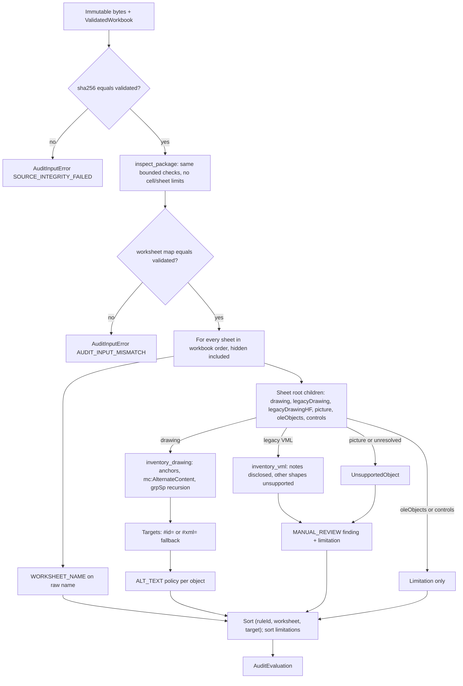
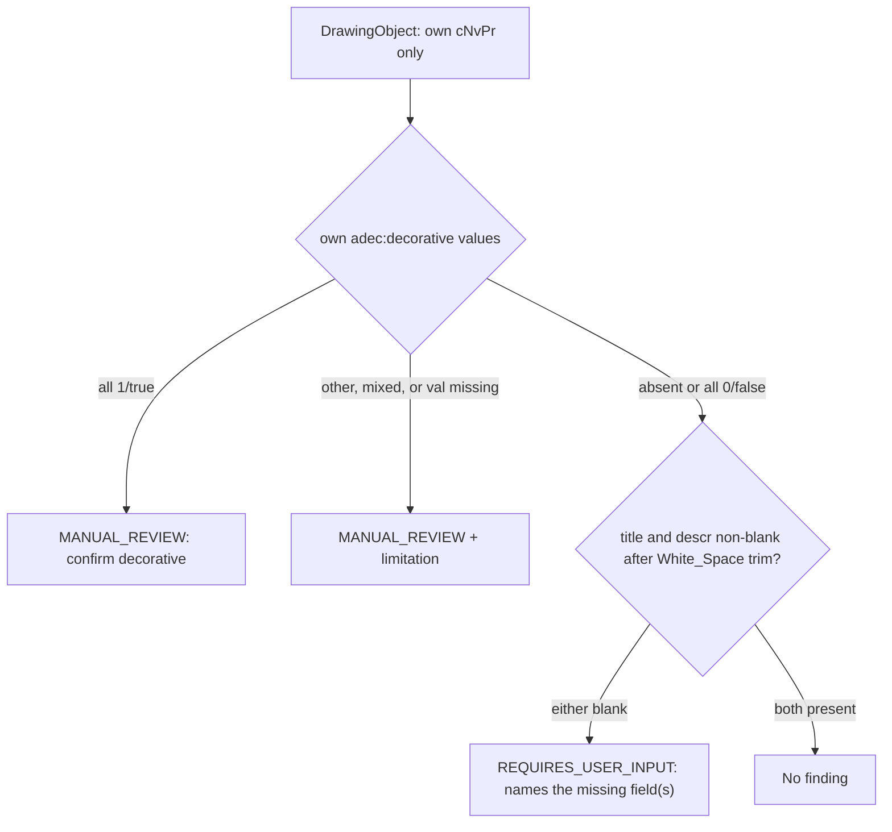

# Dylan Phase 3 implementation: workbook validation and audit engine

Branch `feature/phase3-audit` from `main` at `ffa6947` (bootstrap merged). Recorded 2026-10-14.
Owner: Dylan Patel. Scope: `app/workbooks`, `app/audit`, their unit tests, synthetic fixtures,
and the non-deployed preservation experiment. No other owner's module, no shared file
(`app/contracts`, `app/config.py`, `app/main.py`, `pyproject.toml`, `uv.lock`, README) and no
contract document was changed.

## Status in one paragraph

The `WorkbookEngine` adapter is implemented and unit-tested locally:
`app.audit.engine.OoxmlWorkbookEngine`. It validates untrusted `.xlsx` bytes with bounded
ZIP/XML reads, inventories DrawingML objects on all sheets (hidden sheets included), applies
ALT_TEXT and WORKSHEET_NAME, and returns sorted, deterministic, hashed findings as frozen
shared DTOs. **Module tests passed. HTTP/worker integration is pending**: Jackson's API,
storage and worker are not on this branch, and no end-to-end, deployed or cross-team run has
taken place. Team 12's shared fixtures were not available, so synthetic fixtures were used.

## Implemented capabilities

- `validate(data, filename, limits) -> ValidatedWorkbook`: extension, byte, package,
  content-type, relationship, structure, protection, macro, XML-safety, worksheet-count and
  nonempty-cell checks. Rejections raise `WorkbookValidationError` with status/code/details.
- `audit(data, validated, ruleset_version) -> AuditEvaluation`: re-reads the same bytes,
  verifies the SHA256 and worksheet map against `validated`, inventories objects and
  evaluates both rules. Findings are sorted by `(ruleId, worksheet, target)`; limitations are
  deduplicated and sorted.
- Exact `findingId` algorithm (matches the handoff golden digest `502d66…7714`).
- Disclosed partial support: legacy VML, ink/content parts, background images, unresolved
  drawing references and unknown drawing elements produce MANUAL_REVIEW findings plus
  limitations instead of being skipped.

## Non-capabilities (not delivered, not claimed)

- No HTTP routes, persistence, jobs, sessions, coverage measurement or UI. These belong to
  the other owners.
- No remediation, workbook writing or `save()`. The engine never modifies its input.
- No content-quality judgement of alt text, no decorative-intent inference, no AI calls.
- No internal timeout. Jackson's runner enforces the 30 s validation and 60 s audit limits.
- Not yet verified against Team 12 files or real Excel-authored workbooks containing images,
  charts or shapes. One openpyxl-written workbook (cells only) was validated.

## File and module map

| Path | Role |
|---|---|
| [app/workbooks/xmlsafe.py](../../app/workbooks/xmlsafe.py) | defusedxml parse/stream wrappers (`forbid_dtd=True`, entities and externals forbidden); streaming detaches finished elements |
| [app/workbooks/package.py](../../app/workbooks/package.py) | `OoxmlPackage`: in-memory ZIP checks, bounded reader, content types, relationship parsing and resolution |
| [app/workbooks/structure.py](../../app/workbooks/structure.py) | Workbook part, sheets, macro and protection policy, streaming sheet scan (cells, drawing references) |
| [app/workbooks/validation.py](../../app/workbooks/validation.py) | Check order, `inspect_package`, `validate_workbook` |
| [app/workbooks/drawings.py](../../app/workbooks/drawings.py) | DrawingML and VML object inventory (`DrawingObject`, `UnsupportedObject`) |
| [app/workbooks/errors.py](../../app/workbooks/errors.py) | Rejection codes and helpers |
| [app/audit/identity.py](../../app/audit/identity.py) | `finding_id`, target formats, `format_xml_path`, sort key |
| [app/audit/rules.py](../../app/audit/rules.py) | Whitespace set, ALT_TEXT and WORKSHEET_NAME rules, messages |
| [app/audit/engine.py](../../app/audit/engine.py) | `OoxmlWorkbookEngine` adapter and `AuditInputError` |
| [tests/unit/ooxml_builder.py](../../tests/unit/ooxml_builder.py) | Test-only builder for small, deliberately seeded OOXML packages |
| `tests/unit/test_workbook_*.py`, `test_audit_*.py`, `test_engine_contract.py`, `test_synthetic_fixtures.py` | 204 owner unit tests |
| [tests/fixtures/synthetic/dylan/](../../tests/fixtures/synthetic/dylan/README.md) | 4 synthetic `.xlsx` files, the build script and hand-authored `expectations.json` |
| [experiments/preservation/](../../experiments/preservation/README.md) | Non-deployed openpyxl vs targeted-edit comparison and its results |

## Interfaces

**Exposed** (for Jackson to register once at assembly):

```python
from app.audit.engine import OoxmlWorkbookEngine
engine = OoxmlWorkbookEngine()                # optional: OoxmlWorkbookEngine(audit_limits=ProcessingLimits(...))
validated = engine.validate(data, filename, settings_limits)        # ValidatedWorkbook
evaluation = engine.audit(data, validated, settings.ruleset_version)  # AuditEvaluation
```

It satisfies `app.contracts.ports.WorkbookEngine` (checked by mypy and by
`test_engine_matches_shared_protocol_signatures`). The engine is stateless and safe to reuse.
It has no constructor side effects and no session or storage knowledge, and it accepts only
bytes plus JSON-serializable DTOs, so it fits the runner's child-process boundary.

**Consumed:** `ProcessingLimits`, `ValidatedWorkbook`, `Finding`, `AuditEvaluation`, the
enums and `SemVer` from `app/contracts/models.py`; `WorkbookValidationError` and
`ProjectException` from `app/contracts/errors.py`. No new shared field was added.

**Exceptions raised:**

| Exception | When | Mapping for Jackson |
|---|---|---|
| `WorkbookValidationError` (status 413/415/422) | `validate()` rejects input | HTTP status/code as carried; no resources are created |
| `WorkbookValidationError` | `audit()` re-read fails (e.g. `audit_limits` stricter than the validation limits) | Worker: PROCESSING_FAILED |
| `AuditInputError` 500 `SOURCE_INTEGRITY_FAILED` | `sha256(data) != validated.source_sha256` | Worker: PROCESSING_FAILED |
| `AuditInputError` 500 `AUDIT_INPUT_MISMATCH` | Re-derived worksheet map differs from `validated` | Worker: PROCESSING_FAILED |
| `pydantic.ValidationError` (a `ValueError`) | `ruleset_version` is not SemVer | Programming/config error |

## Validation model

Check order (the first failure wins): extension → byte size → OLE/ZIP signature → central
directory (entry count, names, duplicates, encryption flag, compression, declared sizes) →
`[Content_Types].xml` → macro parts and content types → every `.rels` part (macro links,
traversal, duplicate IDs) → officeDocument relationship and workbook content type →
`workbook.xml` (protection, sheets, worksheet limit) → streaming scan of each sheet
(protection, nonempty cells, cell limit) → every remaining `.xml` part (readability, DTDs).

| Status | Code | Trigger | `details` |
|---|---|---|---|
| 415 | `UNSUPPORTED_FILE_TYPE` | Extension other than `.xlsx`/`.xlsm` (case-insensitive), or none | `{extension}` (≤16 chars) |
| 422 | `MACRO_ENABLED_WORKBOOK_UNSUPPORTED` | `.xlsm` name; `vbaProject.bin`; `xl/macrosheets/`; macro content type; vbaProject/xlMacrosheet relationship | `{reason}` |
| 413 | `FILE_TOO_LARGE` | `len(data) > max_file_bytes` | `{limit, maximum}` |
| 422 | `WORKBOOK_LIMIT_EXCEEDED` | `max_worksheets`, `max_nonempty_cells`, `max_zip_entries`, `max_expanded_bytes`, `max_xml_part_bytes` | `{limit, maximum}` |
| 422 | `INVALID_WORKBOOK` | Empty, not a ZIP, corrupt or truncated entry, legacy OLE binary, missing parts, malformed XML, wrong roots or content types, bad or duplicate sheets, external or missing sheet target | `{reason}` |
| 422 | `ENCRYPTED_WORKBOOK_UNSUPPORTED` | OLE container with `EncryptionInfo`; ZIP entry encryption flag | `{reason}` |
| 422 | `PROTECTED_WORKBOOK_UNSUPPORTED` | See protection policy | `{scope: workbook\|worksheet}` |
| 422 | `UNSAFE_WORKBOOK_PACKAGE` | Traversing, absolute, backslash, drive, control-character, empty-segment or duplicate (case-insensitive) entry names; relationship targets escaping the root; DTD, entity or external reference in any XML | `{reason}` |

`details` never contain entry names, sheet names or workbook content.

**Protection policy (Team 9 default, needs pod confirmation).** Rejected:
`workbookProtection` with `lockStructure`, `lockWindows` or `lockRevision` = `1`/`true`, or any
password/hash attribute; `fileSharing` with any password/hash attribute; worksheet
`sheetProtection` with `sheet` = `1`/`true` or any password/hash attribute; chartsheet
`sheetProtection` with `content`/`objects` true or a password/hash. Accepted:
`lockStructure="0"`, `readOnlyRecommended` alone, and `sheetProtection sheet="0"`.

**Nonempty-cell convention.** A `<c>` counts if it has an `<f>` child (even with no cached
value), a `<v>` with non-empty text (`"0"` and boolean false count; whitespace-only text
counts because it is not empty), or `<is>` with any non-empty `<t>`. Formatting-only cells,
empty `<v>` and empty inline strings do not count. Shared-string references count whatever
string they point to. Cells on hidden and very hidden sheets count. Counting stops at limit+1.

**Bounds.** The declared sizes (sum and per XML part) are checked first. Every actual read is
then counted in 64 KiB chunks against `max_xml_part_bytes` (per part) and
`max_expanded_bytes` (whole call). Binary parts such as images are never decompressed. Sheet
XML is streamed and finished elements are detached, so memory tracks the open subtree rather
than the whole sheet.

**Relationships.** Each target resolves relative to its owning part's folder. A leading `/`
means package root. The target is percent-decoded, its fragment removed, and `.`/`..`
normalized; escaping the root is rejected. The result matches the stored ZIP entry
case-insensitively (OPC rule) and **returns the stored spelling**. External targets are never
resolved or fetched. Sheets are located through `workbook.xml` `r:id` → workbook rels, never
by file name. Transitional and Strict OOXML namespaces are both accepted.

## Audit model





Inventory details:

- Anchors: `twoCellAnchor`, `oneCellAnchor` and `absoluteAnchor` in the transitional and
  Strict `xdr` namespaces. Objects: `pic` (Picture), `sp` (Shape; Text box when
  `txBox=1`), `cxnSp` (Connector), `graphicFrame` (Chart for chart/chartex URIs, SmartArt
  graphic for diagrams, otherwise Graphic object), and `grpSp` (Group, which is itself an
  object; its children are inspected recursively).
- `mc:AlternateContent`: the first `mc:Choice` is inspected, otherwise `mc:Fallback`.
  Never both, because they describe the same object.
- `contentPart`, unknown objects and objects without `cNvPr` become UnsupportedObject
  (MANUAL_REVIEW). `extLst` is ignored.
- Legacy VML: `v:shapetype` and non-`v:` elements are skipped. Shapes with
  `x:ClientData ObjectType="Note"` are counted into one limitation per part (they are cell
  comments). Every other top-level `v:` element becomes a MANUAL_REVIEW finding. An
  unreadable VML part produces one part-level MANUAL_REVIEW whose target is the bare part path.
- See "Pod contract 1.1 alignment" below: those rules supersede the object, VML, control,
  cell-image and protection details in this section where they differ.
- The visible chart title, shape text, object name and file names are never read as alt text.

Messages and recommendations are fixed templates. Object names are shown collapsed, trimmed
and truncated to 80 characters (ending in `…`), which keeps them within the 500-character limit.

## Identity algorithm (for Team 12)

```text
findingId = lower(hex(SHA256(UTF8(json.dumps(
    [sourceSha256, rulesetVersion, ruleId, worksheetName, target],
    ensure_ascii=False, separators=(",", ":"))))))
```

- `sourceSha256` is the SHA256 of the uploaded bytes. `worksheetName` is the raw `name`
  attribute: untrimmed, case and spelling preserved, no Unicode normalization.
- Object target: `<stored drawing part path>#id=<raw cNvPr id>`, for example
  `xl/drawings/drawing1.xml#id=7`.
- Worksheet target: `<stored sheet part path>#sheetId=<workbook sheetId>`.
- XML fallback `#xml=`: used when the cNvPr `id` is absent, empty, not ASCII digits, or
  duplicated among inspected objects in the same drawing part. **Every** occurrence of a
  duplicated ID uses the fallback. The path lists local element names with one-based
  indices among same-named siblings, from the root through `cNvPr`, for example
  `/wsDr[1]/twoCellAnchor[2]/pic[1]/nvPicPr[1]/cNvPr[1]`. `mc:AlternateContent` and
  `mc:Choice` appear as steps. One limitation is added per part and reason.
- Unsupported targets: `<part>#xml=<path to the element>` (for VML, a sheet `picture`, an
  unresolved `drawing`, or a `contentPart`), or the bare `<part>` for an unreadable VML part.
- Identical bytes give identical findings regardless of upload filename, IDs or time. New
  bytes or a new ruleset version give new IDs.

Golden vectors are in [tests/unit/test_audit_identity.py](../../tests/unit/test_audit_identity.py).
Their literal digests were computed with a standalone `python3 -I` stdlib one-liner, not with
the production function.

## Pod contract 1.1 alignment (2026-10-18)

The pod shared API contract 1.1 (Team 12, October 18) was compared with Team 12's code
(`Gus-ps/ECE30861`, branch `Gustavo`, commit `490b28d`) by running both implementations on the
same 52 generated workbooks. Team 9 changed the following so the observable results match.
The finding-ID recipe was already identical, so IDs now match byte for byte.

Validation (contract §4):
- The 50 limit counts worksheets only; chartsheets and dialogsheets do not count.
- Only active protection rejects: `workbookProtection` lockStructure/lockWindows/lockRevision,
  or worksheet `sheetProtection sheet="1"`. A stored password or hash without a lock,
  `fileSharing` reservation passwords and chartsheet protection are accepted.

ALT_TEXT (contract §7):
- Missing or duplicate cNvPr ids (any nonempty unique id is usable, digits not required) are
  MANUAL_REVIEW at the object element's path, e.g. `#xml=/wsDr[1]/twoCellAnchor[1]/pic[1]`,
  even when the object is described. Duplicates are counted over every cNvPr in the part.
- Group containers get no finding of their own; children are checked individually. A
  decorative (or ambiguous decorative) group is one MANUAL_REVIEW.
- `mc:AlternateContent` is one MANUAL_REVIEW at its element path; neither branch is inspected.
- A `graphicFrame` that is not a single `c:chart` with a chart relationship (SmartArt, chartex,
  other graphics) is MANUAL_REVIEW at `#id=`.
- An object with an `r:link`/`r:embed` to an External relationship is MANUAL_REVIEW at `#id=`.
- Sheet elements `legacyDrawing`, `legacyDrawingHF`, `picture`, `control` and `oleObject`, at
  any depth (controls and OLE objects inside `mc:AlternateContent` included), point at a VML
  part or are MANUAL_REVIEW at their sheet `#xml=` path.
- Legacy VML: every `shape` element, comment notes included, is MANUAL_REVIEW at `#id=<id>`
  when the id is unique, else its `#xml=` path. A VML part with no shapes reviews the
  referencing sheet element. An unreadable VML part is one part-level review (Team 12 fails).
- Cell images: a `<c>` with `vm` or an `IMAGE()` formula is MANUAL_REVIEW at
  `#xml=/worksheet[1]/sheetData[1]/row[n]/c[m]` (up to 1,000 per sheet, the rest counted in a
  limitation). Every `xl/richData/*` part and `xl/cellimages.xml` is also MANUAL_REVIEW with
  worksheet `__WORKBOOK__` and target `<part>#xml=/` (contract §8 workbook-level location).
- Dialogsheets are not audited by either rule.

Deliberately kept: rejecting DTDs, duplicate ZIP entries, path traversal and decompression
bombs (contract §4 allows additional unsafe-package 422s; Team 12 accepts these). The pinned
shared packet in `docs/contracts/phase3.md` still describes the old cNvPr fallback path; the
pod contract 1.1 supersedes it. Remaining Team 12 differences found: a sheet `picture` without
a sheet relationships part makes Team 12's audit fail (KeyError); Team 12 ignores VML elements
other than `shape` when a part also has shapes.

## Data and state invariants

- Input bytes are never written. Tests hash before and after every validation and audit.
- No filesystem, network, database, subprocess or logging use in engine modules. This is
  enforced by `test_engine_modules_have_no_io_side_effect_imports`.
- Every inspected object yields at most one ALT_TEXT finding. Decorative objects never also
  get a missing-fields finding.
- Targets are unique per worksheet. Findings are fully determined by
  `(bytes, ruleset_version)`. This is verified by five fresh-engine audits producing identical
  JSON payloads.
- A finding is emitted for every unsupported representation; none is silently skipped.

## Configuration

No environment variables. The engine uses the caller's `ProcessingLimits` for validation and
`ProcessingLimits()` defaults (or the `audit_limits` constructor argument) for the audit
re-read. `ruleset_version` should come from `SystemSettings.ruleset_version` (`1.0.0`).

## Commands

```sh
uv sync --locked --group dev
uv run pytest tests/unit                       # all owner + foundation unit tests
uv run pytest tests/unit/test_workbook_validation.py tests/unit/test_workbook_limits.py \
  tests/unit/test_audit_alt_text.py tests/unit/test_audit_worksheet_name.py \
  tests/unit/test_audit_identity.py tests/unit/test_engine_contract.py \
  tests/unit/test_synthetic_fixtures.py        # Dylan's 204 tests only
uv run ruff check . && uv run ruff format --check .
uv run mypy app tester
uv run python tests/fixtures/synthetic/dylan/build_fixtures.py   # rebuild synthetic fixtures
uv run python -m experiments.preservation.run_experiment          # preservation experiment
```

## Test results (actually run 2026-10-14, macOS arm64, Python 3.12.3, uv 0.13.1)

| Check | Result |
|---|---|
| `pytest tests/unit tests/contract` | **345 passed** (141 pre-existing foundation + 204 new), ~5 s |
| Dylan's 7 test files | 204 passed: validation 72, limits 23, alt text 56, worksheet name 25, identity 10, engine contract 14, synthetic fixtures 4 |
| `ruff check .`, `ruff format --check .` | Pass |
| `mypy app tester` (strict) | Pass, 29 source files |
| `scripts.export_schemas --check`, `scripts.check_identity`, `scripts.smoke_foundation` | Pass (unchanged foundation) |
| Slowest tests | 250,000-cell boundaries, ~0.8 s each |
| Manual mutation check | Removing U+3000 from the whitespace set, allowing `Sheet0`, or ignoring formula cells each made exactly 2 tests fail; the code was restored |

Boundary coverage: file bytes 24,999,999 / 25,000,000 / 25,000,001 (valid stored ZIPs padded
with an innocuous `.bin` part); worksheets 49/50/51; nonempty cells 249,999 / 250,000 /
250,001 split across two sheets; ZIP entries 39/40/41 (explicit limit 40) and 10,000 / 10,001
(default);
expanded bytes and XML part bytes below/equal/above with small explicit limits. Each rejection
asserts `details.limit`, so an XML defense or a different limit cannot mask the one under test.

Not run: HTTP integration, worker subprocess, coverage measurement, deployed/AWS tests,
cross-team tests, Excel manual checks, `pip-audit` (no dependency changes were made).

## Known limitations

| # | Limitation | Severity | Workaround | Target |
|---|---|---|---|---|
| L1 | Legacy VML shapes (form controls, OLE/ActiveX visuals, header/footer images) are MANUAL_REVIEW, not inspected; affects REQ-04 completeness | Medium | Disclosed finding + limitation | Phase 4: parse VML `alt`/`o:title` |
| L2 | Ink `contentPart` not inspected | Low | MANUAL_REVIEW | Phase 4 |
| L3 | SmartArt and charts are checked only through their `graphicFrame` cNvPr; inner diagram/chart parts are not read (by policy) | Low | none needed | Pod confirmation |
| L4 | Resolved 2026-10-18: group containers no longer get their own finding (pod contract 1.1) | — | — | — |
| L5 | `mc:AlternateContent` always takes the first Choice, regardless of `Requires` | Low | Deterministic | Phase 4 if a fixture disagrees |
| L6 | Cell comment notes are now MANUAL_REVIEW findings like every VML shape (pod contract 1.1, matches Team 12); possible review noise | Low | Pod may narrow later | Pod confirmation |
| L7 | No real Excel-authored drawing fixtures yet; synthetic and openpyxl inputs only | **High** for acceptance confidence | Run Team 12 files as soon as delivered | Phase 3 cross-testing |
| L8 | Worksheet-level protection rejection may refuse workbooks users consider ordinary | Medium (policy) | Documented policy | Pod confirmation |
| L9 | U+000B/U+000C in alt text cannot be represented in XML 1.0; such parts are rejected as malformed | Info | none | none |
| L10 | No in-engine timeout; relies on the runner hard-kill | Medium if the runner is missing | Jackson's runner | Integration |
| L11 | Cell images are not resolved through `xl/metadata.xml`/`xl/richData`, so linked data types (Stocks, Geography) are also MANUAL_REVIEW, plus one workbook-level finding per rich-data part (matches Team 12); no Excel-authored in-cell picture fixture yet; the independent tester suite has no cell-image case | Low | Disclosed findings + limitation | Phase 4: resolve `_localImage`; Dixon adds a tester case |

## Deviations from the handoff

- The handoff names Codex. This work was done with **Claude Code** (Claude Opus 5.5) in the
  Claude desktop app, at Dylan's request.
- No `docs/contracts/phase3.md` edit. The rejection codes, protection policy, unsupported-target
  formats and group policy above are listed for Jackson to merge into the contract profile
  and confirm with Team 12.
- openpyxl is not used in production validation, because the ZIP/XML path is safer and
  exposes the metadata directly. It is used in tests and the experiment.
- Added `WORKBOOK_LIMIT_EXCEEDED` (422) for non-byte limits, keeping 413 only for bytes as
  Phase 2 specifies. An empty upload is 422 `INVALID_WORKBOOK`. The extension check runs
  before the size check.

## REQ/AC traceability (Phase 3 portions only)

| AC | Evidence in this branch | Status |
|---|---|---|
| AC-01 | Accepted valid workbooks, exact-limit acceptance (`test_workbook_limits.py`) | Module level only |
| AC-02 | 415/422/413 rejections, attacks, over-limit (`test_workbook_validation.py`, `test_workbook_limits.py`) | Module level only |
| AC-03 | SHA256 before/after on every audit; `audit()` refuses hash mismatch | Module level; storage-level proof is Jackson's |
| AC-04 | Seeded and clean synthetic fixtures (`test_synthetic_fixtures.py`) | Synthetic only; Team 12 files pending |
| AC-05 | Finding fields, enums, targets, messages (`test_audit_*`) | Module level |
| AC-14 | Typed engine failures for Jackson to map | Integration pending |
| AC-18 | Five identical audits (`test_five_audits_produce_identical_complete_payloads...`) | Determinism portion |
| REQ-04 | ALT_TEXT for pictures, charts, shapes, connectors, groups; VML partial (L1) | Partial, disclosed |

## Items for Jackson to confirm with Team 12

Rejection code table and `details` shape; protection policy; empty file = 422; extension
checked before size; group containers as objects; first-Choice policy; VML notes as a
limitation; `#xml=` paths for unsupported elements and a bare part path for unreadable VML;
treating missing decorative `val` as ambiguous; Strict OOXML acceptance; counting chartsheets
as worksheets in `worksheet_parts` and the 50-sheet limit.

## Phase 4/5 extension points

- New rules: add a function to `app/audit/rules.py` returning `Finding`s through
  `RuleContext.finding()`, then call it in `OoxmlWorkbookEngine.audit`. Bump `rulesetVersion`
  whenever the output changes.
- Table, merged-cell and link-text rules can reuse the `_SheetScanner` pattern in
  `structure.py`. Add sheet-root children to `SHEET_REFERENCE_ELEMENTS`.
- VML parsing support: extend `inventory_vml` to return `DrawingObject`s once `alt` and
  `o:title` semantics are agreed.
- Remediation: build on the targeted-part strategy in `experiments/preservation/`, never on
  an openpyxl round trip, and only after the Excel manual checks pass.

## Next Codex prompt

```text
You are continuing Dylan Patel's Phase 3 workbook engine in 30861_Team9. First read
AGENTS.md (if present), README.md, docs/contracts/phase3.md, this file
(docs/implementation/dylan_phase3.md), docs/evidence/dylan_phase3.md and every
docs/implementation/*_phase3.md from teammates. Inspect app/workbooks, app/audit,
tests/unit/test_workbook_*.py, test_audit_*.py, test_engine_contract.py,
tests/fixtures/synthetic/dylan and experiments/preservation before changing anything;
confirm the documented behavior still matches the code and update this file if not.
Then: (1) if Team 12's clean.xlsx/seeded_issues.xlsx/corrupt.xlsx and an independently
reviewed expectations manifest now exist under tests/fixtures, add tests that run
OoxmlWorkbookEngine against them without overwriting them, and record any disagreement
as a specification or implementation defect rather than editing expectations to match;
(2) apply any pod decisions recorded in docs/contracts/phase3.md for the "Items for
Jackson to confirm" list, updating tests and bumping rulesetVersion if outputs change;
(3) for the next phase's rules, add them to app/audit/rules.py with independently
authored fixtures. Keep the engine free of HTTP, storage, sessions, AWS and file writes;
never save the uploaded workbook; keep findings deterministic. Run uv run pytest
tests/unit, uv run ruff check ., uv run ruff format --check . and uv run mypy app tester,
and report real results. Do not push, merge, or claim integration, deployment or
manual Excel checks that did not happen.
```
