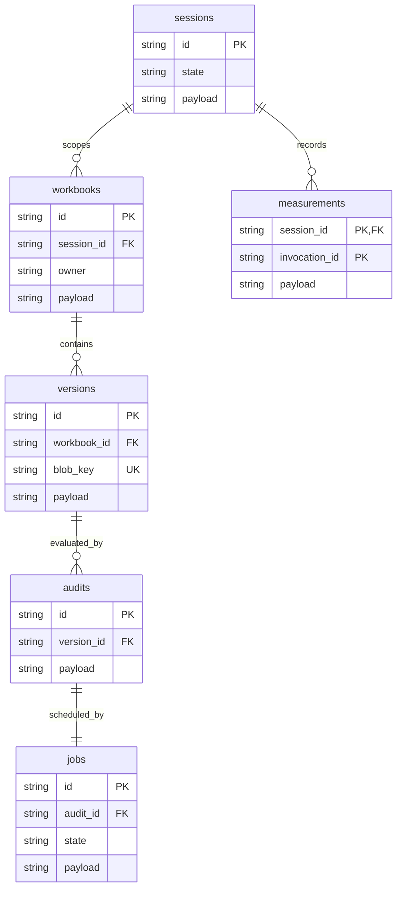
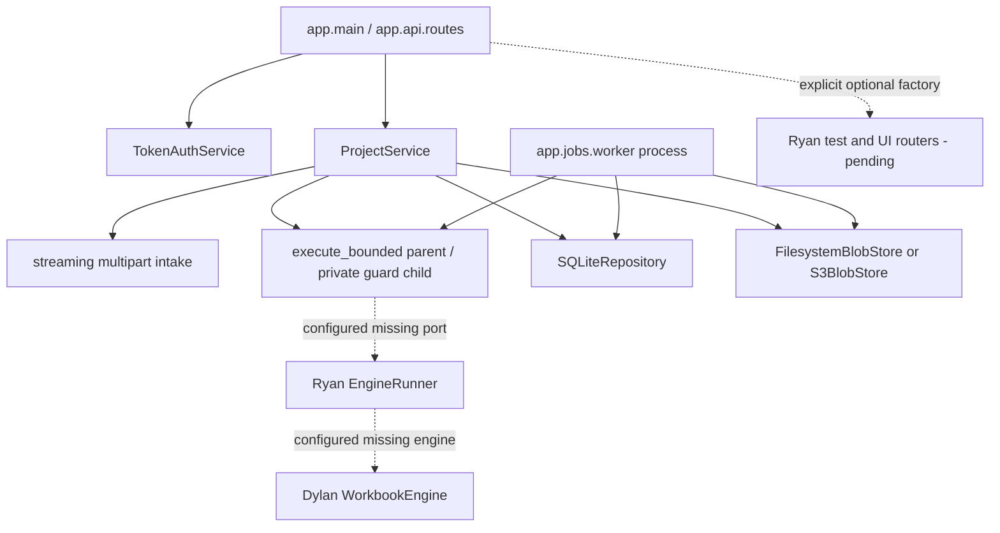
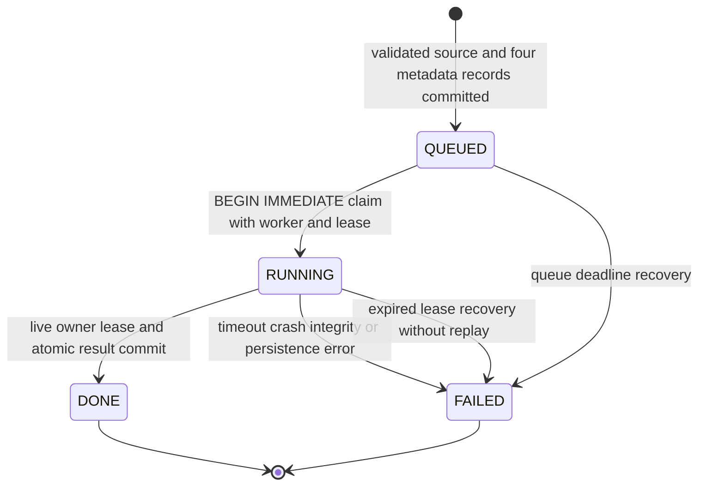
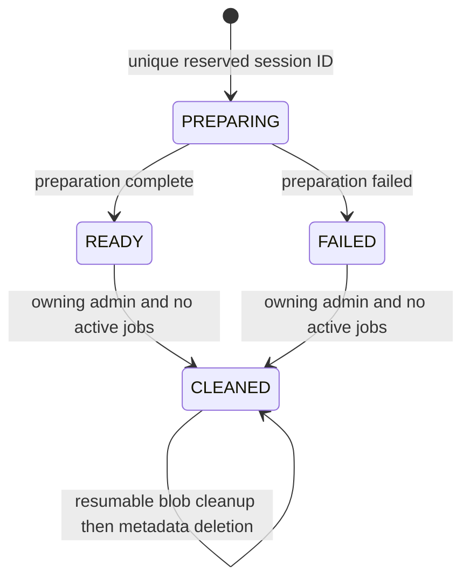
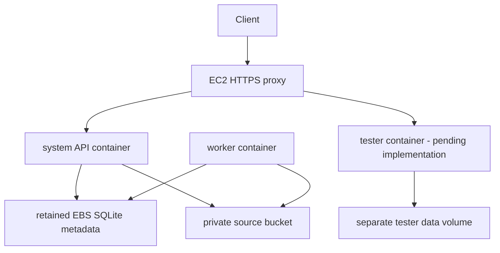

# Jackson Phase 3 implementation and continuation

Record date: 2026-10-16, America/Indianapolis. Branch: `feature/phase3-service`, based on merged
bootstrap `ffa6947`. This record describes locally verified code prepared for PR review, not a released/deployed SHA.
The complete Jackson handoff was read; no applicable AGENTS.md was found in the checkout or
parent directories. Teammate feature modules were preserved. No merge or billed resources were created.
The subsequent user request to open a PR authorizes committing/pushing this branch for review.

## Delivered boundary

Implemented: the four shared project routes; configuration-driven bearer auth and explicit
reviewer authorization; transactional SQLite persistence with durable jobs, session namespaces
and measured line sets; immutable filesystem/S3 source adapters; bounded streaming multipart
intake; upload acceptance/compensation; source integrity verification; separate durable worker;
parent-enforced process deadlines; sanitized JSON logs/errors/request IDs; assembly hooks;
startup scripts; Docker/Compose/HTTPS/IAM/CloudFormation preparation.

Owner tests use explicitly injected serializable doubles. They prove service/storage/worker
behavior, including real child kills and a live HTTP process restart. They do **not** prove
Dylan's workbook checks or Ryan's instrumentation/session/UI behavior. `app/workbooks`,
`app/audit`, `app/measurement`, `app/test_interface`, `app/ui` remain preserved bootstrap packages.
`tester` remains Dixon's foundation. No synthetic runner is used by default production assembly.
Health is 503 until actual engine/runner dependencies are supplied. A missing configured module
fails explicitly; there is no import fallback that supplies findings or silently drops a router.

Not delivered: actual workbook engine, measurement implementation, instructor endpoints, UI,
full tester suite/coverage, real seeded-workbook integration, AWS deployment/TLS evidence,
cross-team runs, full version history, downloadable reports, remediation, schedules/reminders,
test clock, ordinary deletion or legal compliance determination.

## File map and shared interfaces

| Path | Responsibility |
|---|---|
| `app/auth/service.py` | Hash bearer input, compare every configured hash with `hmac.compare_digest`, require user/admin, explicit reviewer grants |
| `app/api/intake.py` | Incremental python-multipart callbacks, one file, bounded raw/file/header bytes, incomplete-body detection |
| `app/api/routes.py` | Health/upload/version/audit handlers, auth and thread-pool dispatch, actual error/OpenAPI models |
| `app/services/projects.py` | Namespace/owner authorization, runner validation, metadata verification, acceptance and compensation, real source hashing |
| `app/storage/sqlite.py` | Schema v1 migration/init, transactions, durable claims/results/recovery, sessions/cleanup, line-set aggregation |
| `app/storage/blobs.py` | Complete-file no-replace publication, constrained source keys, checksums; lazy S3 SDK adapter |
| `app/jobs/execution.py`, `_guard.py` | Trusted runner isolation, bounded IPC, minimal environment, parent deadline/group kill, Linux RLIMIT_AS |
| `app/jobs/worker.py` | Separate worker CLI, queue claims, pre/post hashes, deterministic result commit or controlled failure |
| `app/services/assembly.py` | Real adapter defaults and explicit server-side teammate factory hooks |
| `app/services/logging.py`, `app/main.py` | Allowlisted JSON logging, lifespan init/recovery, uniform errors/request IDs/router assembly |
| `app/config.py`, `app/contracts/models.py` | Compatible settings additions; optional internal persisted validated inventory |
| `scripts/run_*.sh`, `prepare_deploy.py`, `export_schemas.py`, `smoke_foundation.py` | Independent process commands, local deployment rendering, actual schemas, real process smoke |
| `tests/unit/test_jackson_*.py`, `jackson_support.py` | Owner HTTP/storage/subprocess/live-restart/render tests and test-only doubles |
| `deploy/` | Planned local/EC2/EBS/S3/HTTPS configuration and operator runbook |

Exposed ports are unchanged from `app/contracts/ports.py`: Repository, BlobStore, AuthService.
Consumed ports are EngineRunner, WorkbookEngine and SessionService. `SystemServices` is still
supported directly, as are individual `create_app` dependencies. API request handlers dispatch
blocking repository/blob work to Starlette's thread pool. The API does not run an in-process
job queue or background audit task.

Teammate factories are configurable hooks, not existing entry points. README lists exact
signatures. Engine construction occurs once per process. Runner construction receives only
engine + measurement flag, avoiding credential-bearing settings. The runner must be serializable
configuration with importable classes, no live handles or secrets. The guard launches it in a
fresh interpreter, with the same configured engine adapter inside the runner for validate/audit.
It serializes only a **trusted server-created** object with pickle; uploaded bytes are never
unpickled, imported, executed or treated as configuration. IPC output is validated JSON.
Ryan must reconcile this narrow construction/serialization hook with his real runner on merge.

Only configured real test/UI router factories are attached; the test factory is gated by
`ENABLE_TEST_INTERFACE`. Their shared `create_router(services)` shape is preserved. No Ryan
router was implemented. The session-service hook is available, and the project service also
checks READY/allowed-subject/session namespace through the repository; acceptance repeats this
check transactionally so cleanup cannot race an upload into a reserved namespace.

## Data model and invariants

SQLite schema version 1 uses `PRAGMA user_version`, explicit ordered DDL, foreign keys, WAL,
5,000ms busy timeout and FULL synchronous writes. Every mutation uses `BEGIN IMMEDIATE` and
commit/rollback. Each operation opens/closes its own connection, supporting the API thread pool
and independent worker. SQLite errors are typed StorageError/IntegrityError; duplicate session,
missing mutation target, busy session and lease conflicts have separate shared exceptions.
Future schema versions are refused instead of silently downgraded.

Relational keys/FKs enforce workbook→version→audit→job and session→workbook/measurement links.
Owner subjects are persisted with workbooks and immutable DTO snapshots; identities and role
credentials remain protected configuration, rather than a new user-account-management API.
Snapshots use the shared frozen Pydantic records. `VersionRecord.validated` is an optional
backward-compatible internal addition containing accepted worksheet inventory. It avoids a
second parsing pass before normal audit. Old records without it are revalidated inside the
same audit budget; no new wire field was added to VersionResponse.



Upload checks matching record IDs, ownership, namespaces, initial statuses and queue timestamps
before a single transaction inserts four records. Source key must exactly match its
`ordinary/{workbookId}/{versionId}/source` or
`tests/{sessionId}/{workbookId}/{versionId}/source` scope. The filename is display metadata.
A test session must still be READY and allow the uploading subject in that same transaction.
No accepted resources are created for intake/validation rejection; test instrumentation records
may exist for rejected invocations because they represent real attempted executions.

Validation metadata must match the actual SHA256 and byte length, worksheet count/inventory,
unique safe part paths and shared count bounds. Content validation belongs to Dylan, through
Ryan's bounded runner. No alternate parser or openpyxl save was introduced here. Input source
bytes are never changed by the service. The parent persists a source only after validation,
checks the adapter hash, creates all metadata+job state, then returns 202 PROCESSING. If a known
successful put is followed by metadata failure it compensates only that allocated source key.
A collision does not authorize deletion. Blob/SQLite cannot share one ACID transaction;
process death or failed cleanup can leave an unreferenced blob, disclosed in the runbook.

Filesystem put fsyncs private temporary bytes, atomically links without replacement and fsyncs
the directory. S3 put uses IfNoneMatch `*`, SHA256 checksum and AES256 encryption, no public ACL;
read bounds bytes and validates stored checksum metadata plus any returned checksum. The default SDK client accepts only iam-role/container-role credential providers (explicit test clients bypass this for stubs). S3 client
construction/credentials are lazy and no import/local default startup calls AWS. Private bucket
configuration is a deployment precondition. Application role needs conditional Put/Get plus
compensating/test Delete; the IAM boundary alone cannot recognize committed sources.

Read authorization happens before blob access. Test resources require the same session header;
ordinary reads cannot select test data and sessions cannot select ordinary/other-session data.
Known foreign-owner resources return 403; unknown/mismatched IDs return 404. Reviewers read only
explicitly approved owner subjects, cannot upload, and still need namespace permission. A
`test_admin` bearer has only testing powers and is forbidden on project routes.

Version retrieval rereads and hashes bytes; mismatch returns 500 SOURCE_INTEGRITY_FAILED and
does not rewrite completed audit history. Audit reads return the persisted exact nested audit;
processing returns no findings/error/completion, failure returns completion+error and no partial
findings. Parent-generated request IDs appear in the error envelope and `X-Request-ID`; supplied
IDs are not trusted/logged. Unexpected exception messages/locals/source content are excluded
from logs; safe exception class and stack function/line positions are retained.

## Actual component and state models





DONE means AUDIT_COMPLETE for zero findings, REVIEW_REQUIRED for any findings. FAILED means
PROCESSING_FAILED with sanitized ProjectError and empty findings. Worker code-point sorts by
(ruleId, worksheet, target), refuses duplicate finding IDs, verifies bytes before/after execution,
and retains failed sources. Actual execution duration is a monotonic job log value;
AuditRecord.started_at remains the required acceptance timestamp. Full-contract future enums
stay recognized but are never produced as delivered remediation states.

Claims and completion serialize with cleanup/recovery. Completion requires the claiming worker's
unexpired lease; retries/foreign/expired workers cannot overwrite any terminal result. Failure
also respects leases. API lifespan, authorized polling and each worker claim recover expired
queue/leases transactionally. Live leases are left alone after restart until expiration. If
storage itself fails, immediate failure persistence may be impossible; later lease recovery
records a controlled failure. No automatic audit replay is attempted.

The audit budget is at most 60 seconds (config may shorten), checked around pre/post processing;
normal persisted inventory avoids revalidation. Child runtime gets the remaining budget. Parent
kills the entire child process group on timeout and cleans up descendants after return. A
separate 30-second maximum bounds initial validation. Linux children enforce RLIMIT_AS (512MiB
default), RLIMIT_FSIZE (4MiB), and disable core dumps. macOS has tested process timeouts, but
Linux memory enforcement is pending execution on Linux. Blocking/unresponsive host filesystem
I/O is not a security sandbox or a real-time kernel guarantee; timeout is checked before
successful commit. S3 calls have bounded connection/read timeouts and SDK retries disabled.



CLEANED is a retained tombstone; duplicate setup stays a conflict. Cleanup selection is strictly
session-scoped. Blob deletion occurs outside SQLite after reservation and finalization deletes
only that namespace's metadata/measurements. Partial cleanup error stays inspectable/resumable.
These are repository primitives for Ryan; the instructor setup/report/cleanup transport is pending.

Measurement invocations are immutable by (session_id, invocation_id), scoped to READY sessions
and the exact deployment revision. Covered/executable line numbers merge as sets across
invocations. Missing/failed measurement returns both covered and total null with a scope/reason;
never 0/0 or invented whole-app coverage. No runtime percentage has been claimed in this checkout.

Planned deployment only (not actually deployed):



The models were checked against the actual schema/code. A real divergence from bootstrap was
its empty OpenAPI/factory-no-lifespan-storage assumptions: implemented service routes/lifespan
initialization now exist, so the corresponding existing assertions/smoke and schema exporter
were updated narrowly. Shared wire DTOs and the verbatim embedded specification were preserved.

## Configuration and commands

No secret values appear here. `.env.example` lists settings; README gives setup and exact
factory signatures. Important names:
`APP_ENV`, `API_ROOT_PATH`, `RULESET_VERSION`, `DEPLOYMENT_SHA`, `METADATA_DB_PATH`,
`BLOB_BACKEND`, `BLOB_ROOT`, `S3_BUCKET`, `S3_PREFIX`, `AWS_REGION`,
`SYSTEM_TOKEN_HASHES_JSON`, `REVIEWER_GRANTS_JSON`, `ENGINE_MEMORY_LIMIT_MIB`,
`ENABLE_TEST_INTERFACE`, `TEST_SESSION_USERS_JSON`, `ENABLE_CODE_MEASUREMENT`,
`VALIDATION_TIMEOUT_SECONDS`, `AUDIT_TIMEOUT_SECONDS`, `QUEUE_TIMEOUT_SECONDS`,
`ENGINE_FACTORY`, `RUNNER_FACTORY`, `SESSION_SERVICE_FACTORY`, `TEST_ROUTER_FACTORY`,
`UI_ROUTER_FACTORY`. Tester names and target access maps remain Dixon's existing configuration.
Production additionally requires a real deployment SHA and configured token hashes. Neither
validation nor audit ceiling can be increased above 30/60 seconds through validated settings.

Local commands from repository root:

```sh
uv sync --locked --group dev
./scripts/run_system.sh
# Other terminals:
./scripts/run_worker.sh
./scripts/run_tester.sh
# A single worker iteration:
uv run --locked python -m app.jobs.worker --once
```

Verification: 195 tests passed, one Linux-only test skipped on macOS; Ruff, strict mypy, schemas, builds, dependency scan and live restart checks passed. Commands/outcomes are in `docs/evidence/jackson_phase3.md`. Deployment input names,
exact operator steps, TLS/root paths, release mapping, rollback, EBS mount/backup requirements,
scoped resets, security groups, cost review and outstanding authorization are in `deploy/README.md`.
Nothing in these scripts provisions AWS or pushes Git.

## Limitations, deviations and traceability

| Severity / owner | Limitation | Workaround / target |
|---|---|---|
| Blocking integration — Dylan/Ryan | Real engine/runner/session/UI factories absent | Merge owner modules, reconcile constructor hooks, run seeded full checkpoint in Phase 3 |
| Blocking integration — Dixon | Tester endpoints/fixtures/CI and both cross-team reports absent | Use service owner tests now; complete HTTP acceptance after integration |
| Blocking deployment — Jackson | Linux memory test, Docker build/Compose, AWS policy validation/TLS and deployment unexecuted | Run on reviewed Linux image/account only after inputs and authorization |
| Medium — Jackson | Blob/metadata are separate stores; uncertain put/cleanup/process death can orphan a source | Retain metadata/backups; operator reconciliation, Phase 4 tooling |
| Medium — Jackson/Ryan | Guard requires serializable trusted runner configuration and POSIX process groups | Narrow integration adapter on merge; Linux/WSL runtime; no Windows claim |
| Medium — Jackson | No automatic schema downgrade, multi-host SQLite or public worker liveness endpoint | One host/API/worker, explicit backup/restore and logs; revisit scaling in later phase |
| Medium — pod | New safety defaults include 65,536 multipart overhead and 4MiB result IPC | Confirm with Team 12; very large result sets fail controlled instead of truncating |
| Evidence pending — Ryan/pod | Real workbooks, two-person oracle reviews, Excel checker/preservation experiments, precision/performance | Obtain human inputs; do not invent evidence or reduce remediation scope |
| Low — dependency owners | Existing Starlette/HTTPX TestClient deprecation warning | Keep pinned compatible environment; coordinate future dependency update |

No libraries/versions/lock entries were duplicated or changed. Frozen internal validated inventory
and explicit construction hooks are compatible implementation additions. Bootstrap tests/catalogs
were adapted to actual delivery; teammate feature internals were untouched. Queue expiration is
also evaluated during authorized GET polling so missing workers do not leave indefinite PROCESSING.
No AC or business scope was silently reduced.

| Requirement / acceptance trace | This module's evidence | Remaining boundary |
|---|---|---|
| AC-01 / AC-02 intake | 202 acceptance, bytes-at/exceed limit, malformed/missing/file types, delegated rejection with no accepted records | Actual engine worksheet/cell/ZIP/XML/protection boundaries owned by Dylan |
| AC-03 audit-only preservation | Version reread/hash, worker pre/post verification, tamper failures, retained source | Real Excel semantics/remediation preservation pending human experiments |
| AC-04 / AC-05 two-rule portion | Result DTOs/status and deterministic persistence sorting | Exact rule oracle/finding identities require Dylan/fixtures |
| AC-14 delivered failures | Storage rollback, atomic terminal rollback, timeout/crash/recovery, uniform HTTP faults | Future operations excluded |
| AC-15 delivered access | A/B ownership, scoped reviewer/test-admin/session access | Future ordinary deletion/remediation permissions excluded |
| AC-18 determinism/performance portion | Stable sort and no terminal overwrite, bounded execution | Five actual audits/workbook and REQ-15 performance/precision pending |
| AC-16 hosting/HTTPS | Templates/runbook only | Actual certificate/credential/deployed evidence pending Jackson |
| AC-17 UI accessibility | No claim | Ryan's delivered UI evidence pending |

REQ/AC IDs and Phase 2 baseline are preserved in the shared profile; the underlying Phase 2 PDF
was referenced by the handoff but was not supplied in this checkout. No additional unseen REQ
wording is invented. Test/admin namespace cleanup is not completion of REQ-14 ordinary deletion.
The 25MB ceiling is distinct from REQ-15's 10MB/100,000-cell performance workload.

Team 12 confirmation still needed: contract version/serialization/enums/error status conventions,
session header/admin transport and cleanup, `.xlsm` 422 policy, whitespace/name/cell counting,
ZIP/XML/memory/IPC/overhead/queue limits, deterministic identity and sort, measured catalogs and
scope denominators, instructor formats and actual pod URLs/access, EC2/EBS/S3 topology. These
are Team 9 defaults, not claimed instructor approval.

## Next Codex prompt

```text
Inspect the actual repository, AGENTS.md, docs/contracts/phase3.md, Jackson's implementation
and evidence, all teammate continuation documents, and current branch/status before editing.
Preserve the merged bootstrap and owner boundaries. First integrate Dylan's real WorkbookEngine
and Ryan's runner/session/UI factories with the explicit server-owned construction hooks.
Verify the runner serializes without secrets/live handles, respects Linux memory/deadline limits,
and returns real child measurements. Attach real routers; never use test doubles in production.
Run a clean/seeded workbook via live API + separate worker + real tester, retain sanitized
hash/status/coverage evidence, and record remaining Team 12 agreement. Do not claim AWS delivery
until real authorized deployment/TLS checks pass. Do not provision, push, merge or send messages.
Then implement separately approved Phase 4 version uploads/history and downloadable reports
using immutable source references, new audit records/jobs, nested ownership/session checks,
transactional idempotent state changes and independently specified tests. Completed earlier
audits must remain immutable. Design remediation as a separate explicitly authorized operation;
never modify original/external/live workbooks or claim preservation without required Excel and
semantic evidence. Keep future scheduling/deletion scopes distinct. Review schema migrations,
backup/rollback, compatible contracts, operation status and all actual models together. Update
Jackson's continuation/evidence, README, generated OpenAPI and future prompt with real outcomes.
```
