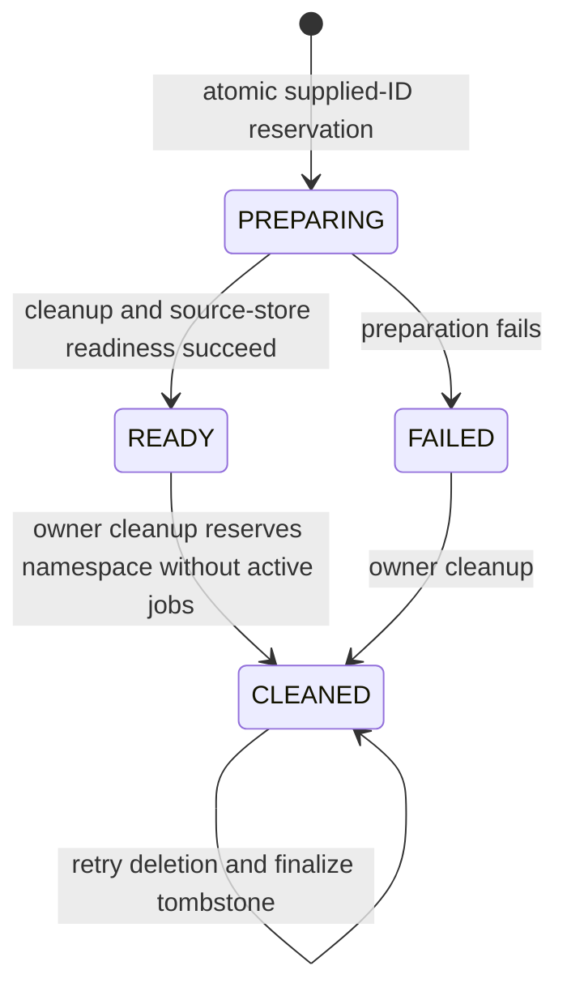
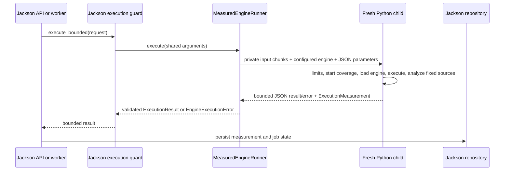

# Ryan Phase 3 implementation

Implemented 2026-10-16 on `feature/phase3-system-testing-ui`, based on foundation
`ffa6947b6850a5df624e5f48837e029fab8c7272`. This branch provides injectable modules;
its foundation `app.main` intentionally remains unchanged. Jackson owns production
assembly and registers the factories below. No deployment, push, merge, ordinary-user
deletion, remediation, scheduling, download or tester-service implementation is included.

## Modules and integration

| Factory/module | Responsibility |
|---|---|
| `app.test_interface.routes:create_router` | Flag-gated POST `/test/setup`, GET `/test/report` |
| `app.test_interface.service:PersistentSessionService` | Repository-backed session policy and cleanup |
| `app.measurement.runner:MeasuredEngineRunner` | Serializable configured engine; bounded child invocation |
| `app.measurement.child` | Linux limits, engine execution, fixed-scope coverage, structured result |
| `app.ui.routes:create_router` | Jinja root page and explicit static asset routes |
| `app/ui/templates`, `app/ui/static` | Upload, polling, results and accessible controls |
| `tests/ryan` | Owner tests and optional standalone Chromium verification |

Jackson's recorded assembly accepts these environment values:

```dotenv
ENGINE_FACTORY=app.audit.engine:OoxmlWorkbookEngine
RUNNER_FACTORY=app.measurement.runner:MeasuredEngineRunner
SESSION_SERVICE_FACTORY=app.test_interface.service:PersistentSessionService
TEST_ROUTER_FACTORY=app.test_interface.routes:create_router
UI_ROUTER_FACTORY=app.ui.routes:create_router
ENABLE_TEST_INTERFACE=true
ENABLE_CODE_MEASUREMENT=true
```

Use `uv sync --locked --no-dev --extra measurement` for a measured deployment.
Configure `SYSTEM_TOKEN_HASHES_JSON`, `TEST_SESSION_USERS_JSON` (admin subject to
approved user subjects), `REVIEWER_GRANTS_JSON`, `DEPLOYMENT_SHA`, metadata/blob
settings and `API_ROOT_PATH` privately. No credentials appear in this document.
The default memory ceiling is `ENGINE_MEMORY_LIMIT_MIB=512`; validation/audit deadlines
are passed through the shared runner signature by Jackson. API and worker must use
identical source revisions and configuration. The combined app starts via
`uv run uvicorn app.main:create_app --factory`; the worker via
`uv run python -m app.jobs.worker`. These commands require the assembled teammate
modules; the foundation alone still exposes only its framework documentation.

## Session model and policy



The actual shared `TestSession` contains session_id, owner_subject, allowed_subjects,
state, created_at, revision and cleanup_error. `prepare` validates `SystemSetupRequest`,
checks cleanup ownership, reserves the new ID with `create_test_session`, performs
explicit cleanup and source-store health checks, then marks READY. Empty setup requires
no fixture uploads. Duplicate IDs, including tombstones, cannot be reused. Preparation
errors retain FAILED state. Multiple cleanup targets are a resumable sequence, not a
cross-namespace transaction; completed earlier cleanups are not rolled back.

Only a test administrator may prepare/report/clean its namespaces. `require_ready`
checks the configured user allowlist; Jackson also enforces READY and allowed subjects
atomically when creating an upload. Normal resources and other sessions are outside
cleanup. Repository `begin_session_cleanup` rejects queued/running work and reserves
CLEANED before blob deletion; `finish_session_cleanup` removes matching records and
measurements, preserving the ID. Failures retain cleanup_error and can be retried in a
later setup. A new setup that fails during cleanup remains FAILED and needs a fresh ID.

Disabled router factories return no testing routes. Authorization occurs before body
validation; instructor errors use `{message,source:"system"}`. Malformed input is 400,
duplicates/busy/not-ready sessions 409, missing sessions 404, foreign sessions 403,
unexpected failures 500; missing injected services is 503. Reports for PREPARING/FAILED
states return 409; CLEANED reports return 404 as required by the checked-in contract,
while the tombstone still prevents ID reuse. Reporting only
calls repository aggregation and performs no execution, reset or measurement writes.
A cleanup between readiness lookup and aggregation also maps the resulting absent
namespace to 404; other storage errors remain 500.
Synchronous auth/session/storage calls run in Starlette's thread pool. Router deadlines
are 30 seconds for setup and 10 for reports. A timeout returns a sanitized system error;
it cannot terminate an in-flight repository thread. Its namespace stays inspectable and
may finish preparation later; callers must inspect/report or explicitly clean it rather
than reuse the ID. Storage adapters still need their own bounded I/O timeouts.

## Execution and coverage model



`MeasuredEngineRunner(engine, enable_code_measurement)` captures the trusted engine as
serialized configuration, preserving constructor state, and is itself pickleable by
Jackson. Engine configuration is never accepted through HTTP. Each call launches a new
interpreter; coverage starts before unpickling/importing the configured engine.
Only deployment code is trusted for pickle. Children inherit Jackson's process group;
there is no nested `setsid`, so his guard can kill descendants. The runner's own timeout
kills/reaps its direct child. Production must retain Jackson's outer guard to clean up
arbitrary descendants; standalone use assumes the trusted engine does not spawn children.

Private mode-0700 temporary directories contain mode-0400 input chunks. Chunking keeps
each input file <=4 MiB because Jackson's outer guard imposes an inherited RLIMIT_FSIZE.
This permits the contract's 25,000,000-byte workbooks without weakening the guard.
Output is JSON bounded to 4 MiB; oversized optional line maps are replaced with an
attributed unavailable measurement before enforcing that same limit again. Oversized
engine results still fail. Stdout/stderr are discarded. Linux enforces RLIMIT_AS,
RLIMIT_FSIZE and zero core size. Environment is limited to PATH, LANG, PYTHONNOUSERSITE,
PYTHONPATH and TMPDIR; auth/AWS credentials are excluded. No shell receives filenames.
Temporary files are removed on success/failure/timeout. This is resource isolation,
not an OS security sandbox; engine purity and workbook parsing safety remain Dylan's.
Only Linux resource enforcement was verified.

The fixed denominator is executable statements in every deployed `.py` file recursively
under `app/workbooks` and `app/audit`, analyzed with coverage.py's public `analysis2` API.
Unimported files remain in the denominator. Tests, dependencies and unrelated app code
are outside scope. Every measured session invocation carries a unique invocation_id,
exact caller-supplied deployment revision, relative-file executable_lines/covered_lines
and optional unavailable_reason. Non-session calls return no measurement. Disabled,
missing or failed instrumentation produces unavailable coverage without changing a
successful engine result into a failure. Validation rejections preserve safe typed
status/code/message/details; crashes and invalid results never masquerade as empty audits.

Jackson persists invocation results and unions line sets. No second database or in-memory
session ledger was introduced. The repository rejects revision mismatch; operators must
change DEPLOYMENT_SHA when changing sources. No measurements yet means unavailable,
not invented 0/0. Coverage excludes all HTTP/auth/storage/UI code and does not measure
whole-system compliance. Temporary integration code coverage was 698/835 lines.

## UI behavior

The root page names the two implemented checks: image alternative text and default
worksheet names. It does not claim compliance. User tokens are password-field values
used only in Authorization headers, with autocomplete disabled and no storage/logging
calls. Ordinary UI requests have no test-session header. The UI uses same-origin URLs
prefixed from the ASGI root_path, explicit multipart submission, 35-second intake timeout,
10-second GET timeouts and a 75-second total polling window. Terminal states stop polling.
Transport/deadline errors retain accepted IDs for explicit GET-only recovery; a lost
upload response is never automatically retried. A new explicit upload begins a new flow.

All filename/finding/error/limitation output uses textContent. Jinja escapes template
values, and the page adds a restrictive CSP. Labels, semantic buttons/headings, visible
focus, live status/alerts and result focus support keyboard/screen-reader use. Findings
show worksheet, target, classification, explanation and recommendation; metadata includes
source hash, version and ruleset. Human screen-reader, zoom and complete accessibility
review remain pending; automated checks are recorded separately.

## Verification, traceability and limits

See [evidence](../evidence/ryan_phase3.md) for commands, counts and snapshot SHAs, and
[design decisions](ryan_design_decisions.md) for alternatives and consequences.
Shared DTOs were inspected and left unchanged. Real corrections were the initial UI
scope wording and the inherited 4 MiB input-file limit discovered by Dixon's suite.
REQ-11 session/testing support and REQ-13 attributable measurement are delivered through
these modules; REQ-14 has only test-namespace cleanup, not ordinary deletion. AC-17 has
partial automated UI evidence. Delivered paths support Phase 3 portions of AC-01/02/03/
04/05/14/15/18; the full Phase 2 definitions and later-phase obligations are not inferred.

Pending external inputs: accepted full Phase 2 definitions and Team 12 agreement on the
Team 9 profile; five de-identified real workbooks; two human expected-result reviewers;
Excel Accessibility Checker comparison; repeated real-workbook precision evaluation;
manual accessibility review; AWS/HTTPS/deployment logs; CI execution and cross-testing
in both directions. Ryan coordinates review evidence, Jackson production assembly and
deployment, Dylan engine expectations, and Dixon independent deployed testing.
These are material readiness limitations, targeted to Phase 3 review/Phase 4–5 evidence.

## Next Codex prompt

Read `docs/implementation/ryan_phase3.md`, `ryan_design_decisions.md`, the evidence record,
shared contracts and actual assembled code first. Confirm teammate PR heads and rerun
owner plus integrated checks. Preserve Jackson's persistence/guard/auth and Dylan's pure
engine boundaries. Coordinate reviewed Phase 4 human-review and remediation contracts
before adding controls. Implement accessible human decisions and safe post-remediation
results only for supported operations; preserve source/version attribution and require
real workbook preservation evidence. Do not infer compliance or fill pending human,
Team 12, CI or deployment evidence with synthetic claims.
